# Project 1 — Static Website Hosting with Azure Blob Storage

Hosted a public static website directly from Azure Blob Storage — no web server to manage.

## What was built

- Resource group **rg-gp-static-website**
- Storage account **stgpstaticcpm26** with static website hosting enabled (index document and 404 error document configured)
- Public endpoint: https://stgpstaticcpm26.z13.web.core.windows.net/
- Version 1 site content (index page + custom 404 page) uploaded to the `$web` container

## How it was validated

- The endpoint served the Version 1 landing page in the browser.
- A request for a nonexistent page returned the custom 404 page.
- Site content was then updated to Version 2 and re-uploaded with overwrite; the live endpoint served the new version, and the blob properties for both files were checked in the portal.
- All resources were deleted after the lab (cleanup confirmed).

## What this demonstrates

- Provisioning and configuring an Azure storage account
- Enabling and configuring Blob Storage static website hosting
- Deploying and updating web content in the `$web` container
- Verifying hosting behaviour end-to-end, including custom error pages

## Screenshots

### Exercise 1 — Create the storage account and enable hosting

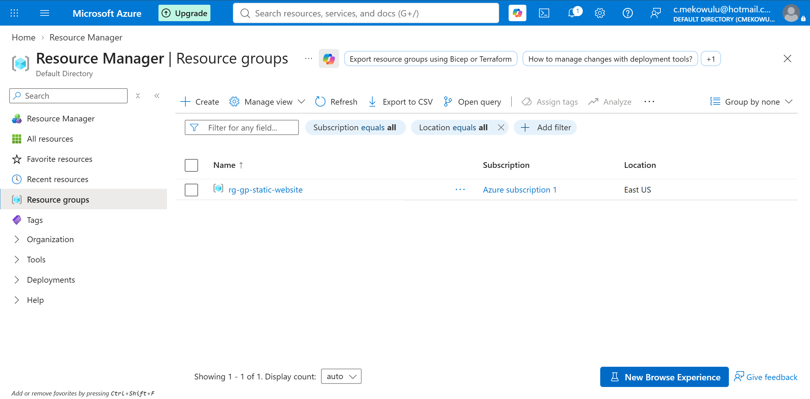
*Resource group rg-gp-static-website created.*

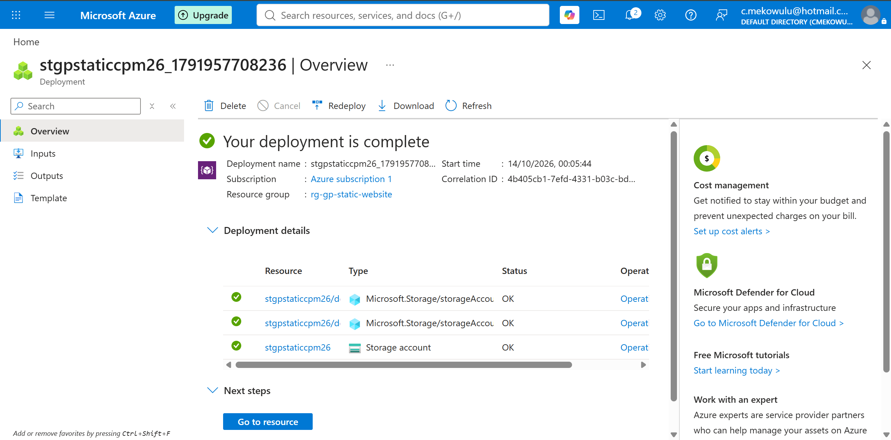
*Storage account stgpstaticcpm26 — configuration, part 1.*

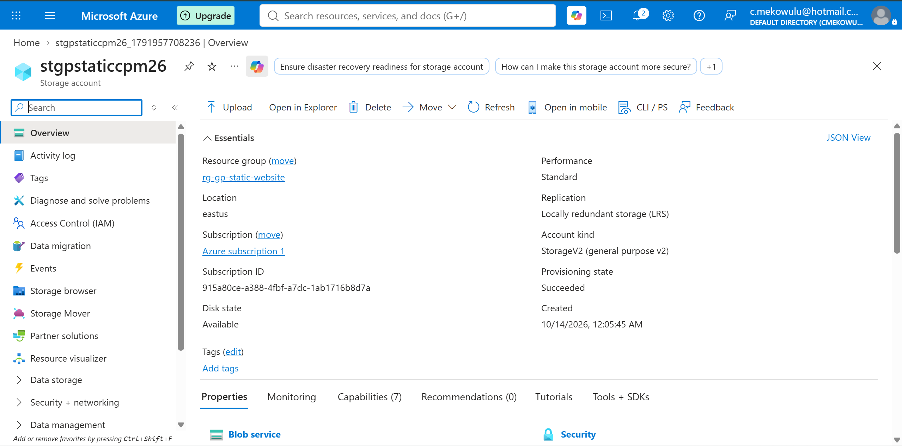
*Storage account stgpstaticcpm26 — configuration, part 2.*

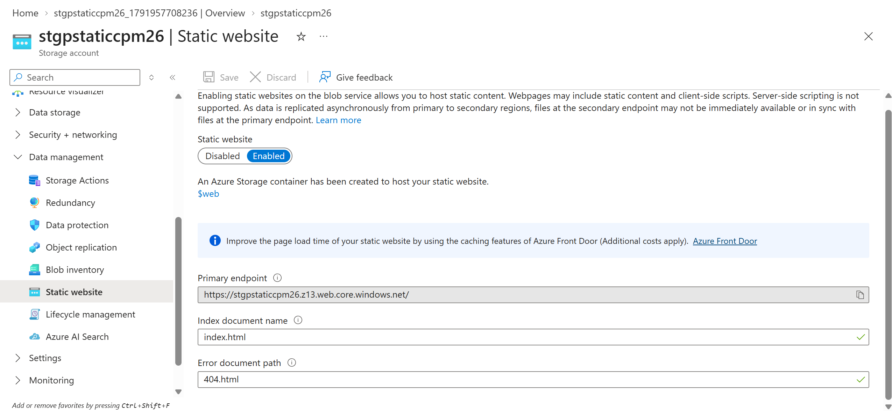
*Static website hosting enabled, with index and error documents set.*

### Exercise 2 — Upload and verify site content

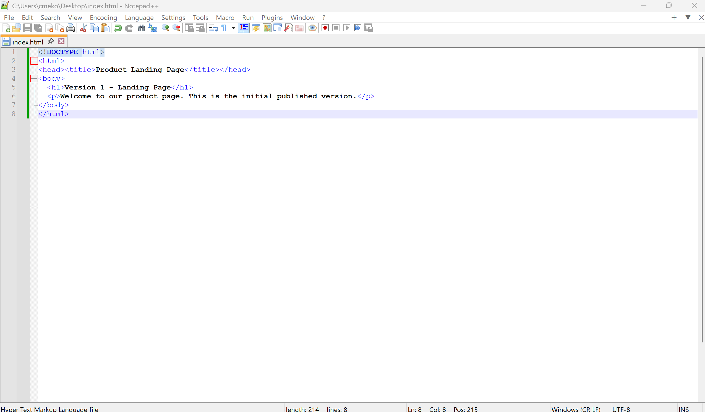
*Version 1 index.html created.*

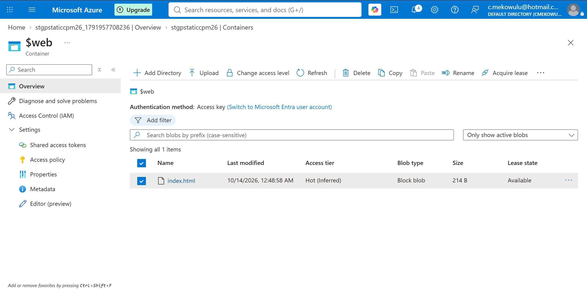
*Site files uploaded to the $web container.*

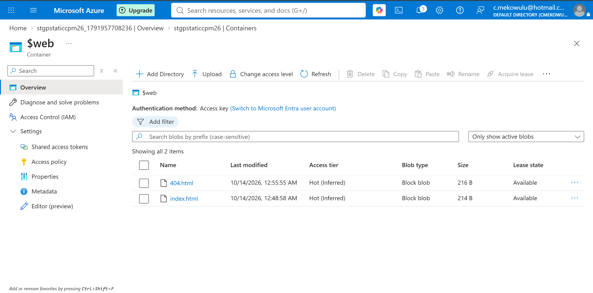
*Custom 404 page served for an unknown path.*

*Version 1 landing page live at the web endpoint.*

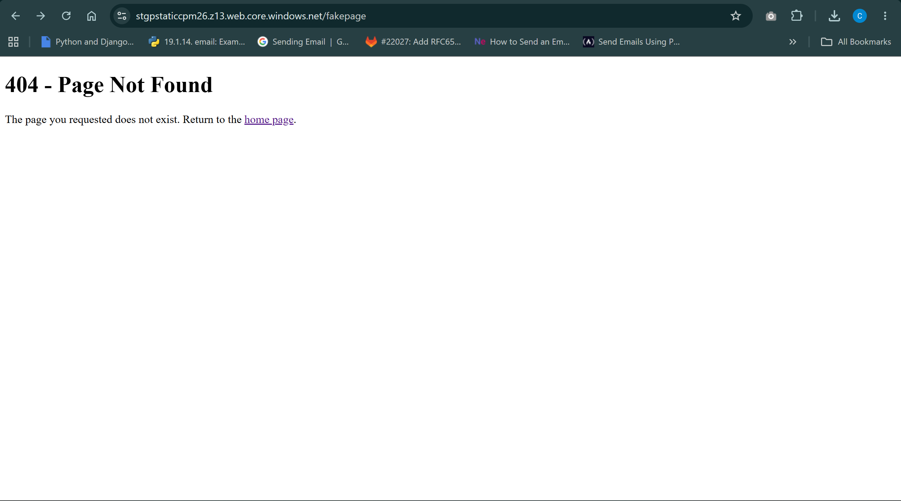
*Requesting a nonexistent page returns the custom error page.*

### Exercise 3 — Update the site content

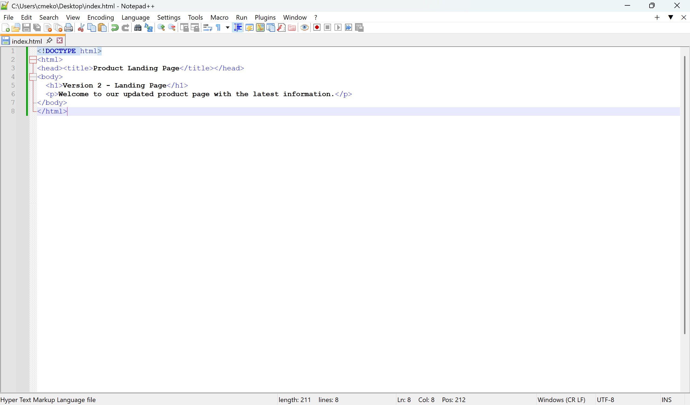
*Version 2 index file created.*

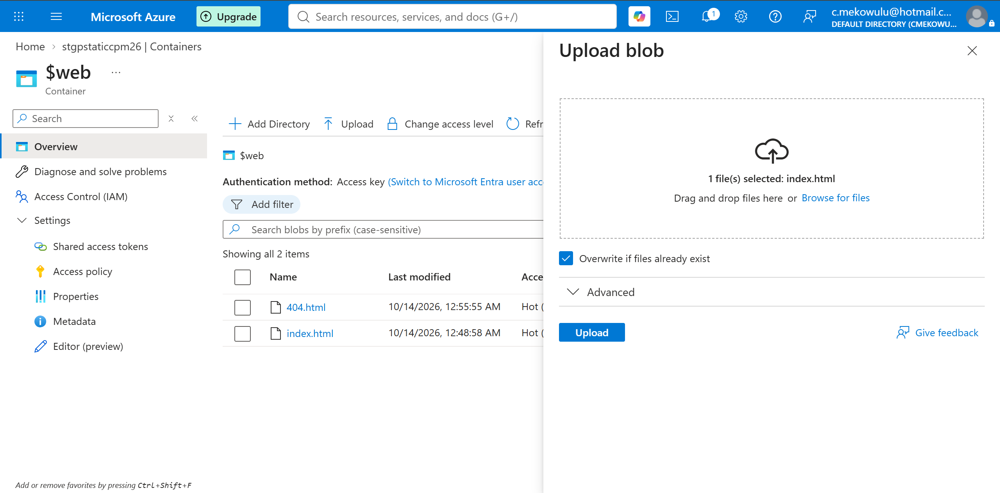
*Version 2 uploaded with overwrite.*

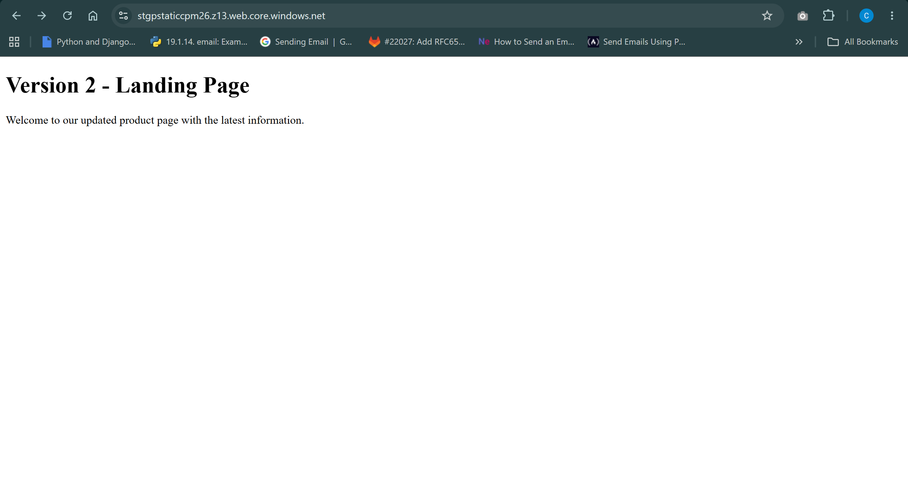
*Updated site verified live at the endpoint.*

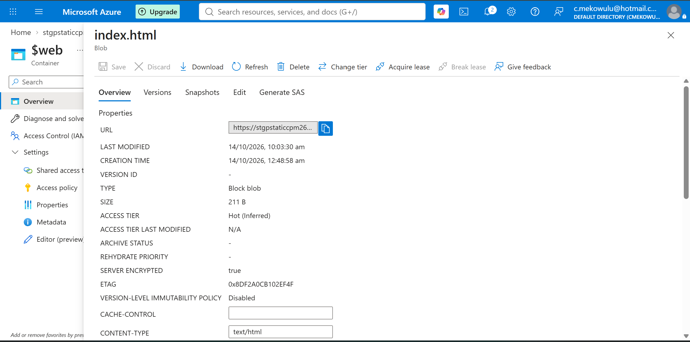
*index.html blob properties after the update.*

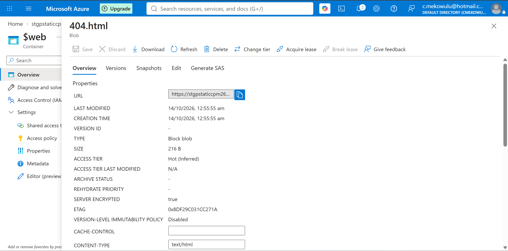
*404 page blob properties.*
