# Project 2 — Organize and Protect Resources with Tags and Resource Locks

Used tags to organize resources for filtering and reporting, then protected them with management locks and proved the locks actually block changes.

## What was built

- Resource group **rg-gp-tags-locks**
- Storage accounts **stgptagslockcpm20** and **stgptagsopscpm25**
- Tags applied at both the resource group level and the individual resource level, then used to filter the resource list
- A **Delete lock** on a storage account and a **Read-only lock** on the resource group

## How it was validated

- Tag-based filtering returned the expected development and operations accounts.
- With the Read-only lock in place, a change attempt was blocked; with the Delete lock in place, deletion was blocked (ScopeLocked).
- Locks were then removed, normal operations were restored (tag update succeeded), and the lab's `lock-test: passed` check completed.
- All resources were deleted after the lab (cleanup confirmed).

## What this demonstrates

- Applying and using tags for organization, filtering, and cost tracking
- Choosing the right lock level (Delete vs. Read-only) and the right scope
- Testing governance controls instead of assuming they work
- Lock inheritance and the operational impact of Read-only locks

## Screenshots

### Exercise 1 — Create resources and apply tags

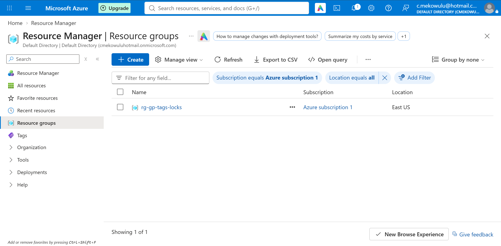
*Resource group rg-gp-tags-locks.*

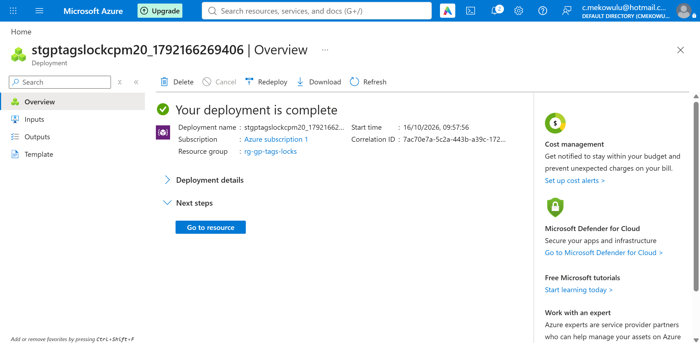
*Deployment complete for the lab resources.*

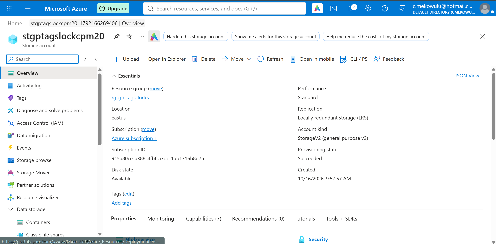
*Resource overview page.*

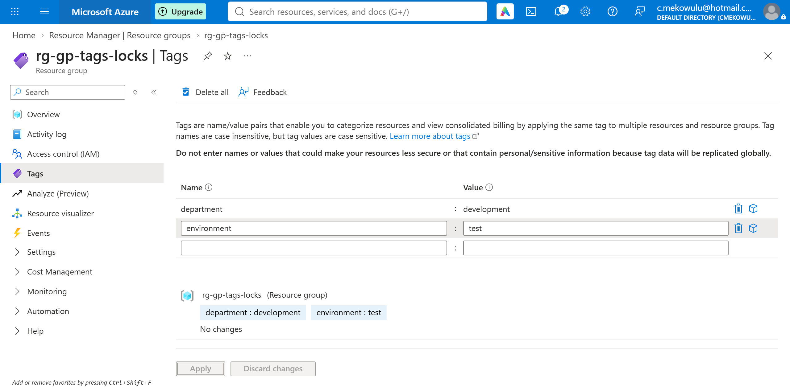
*Tags applied at the resource group level.*

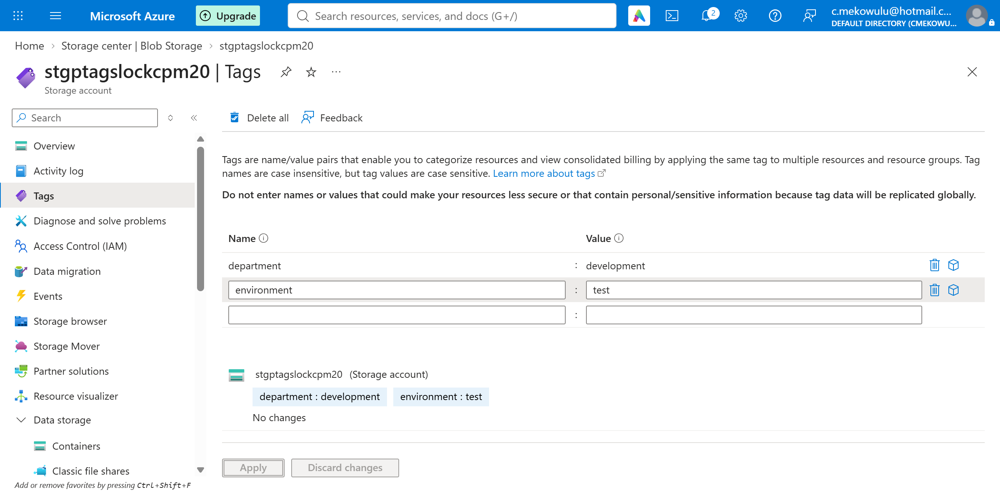
*Tags on the first storage account.*

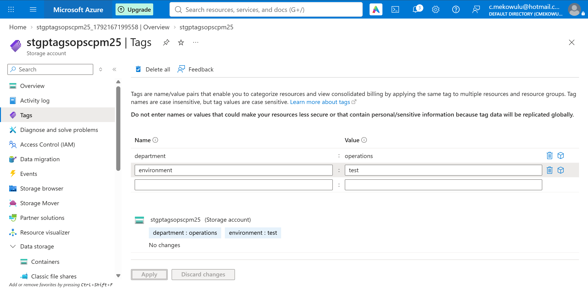
*Tags on the second storage account.*

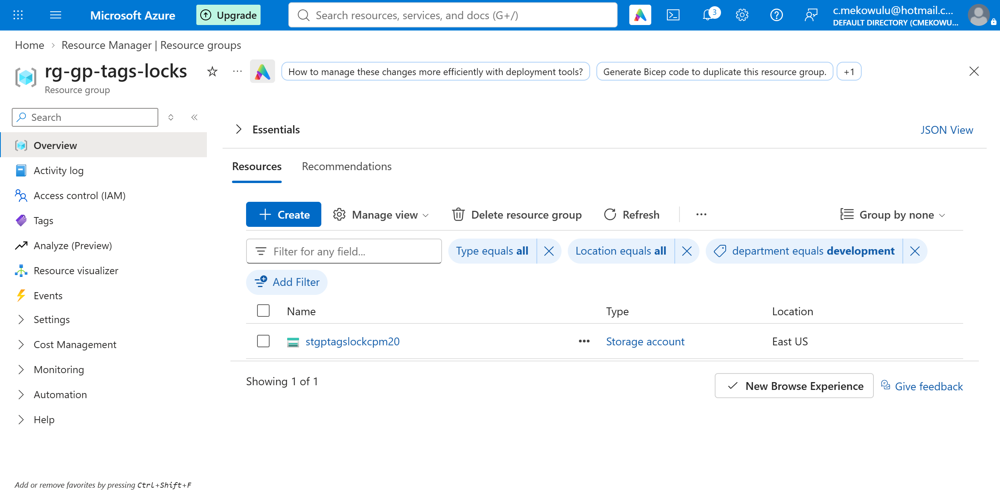
*Resources filtered by tag — development account.*

*Resources filtered by tag — operations account.*

### Exercise 2 — Apply resource locks

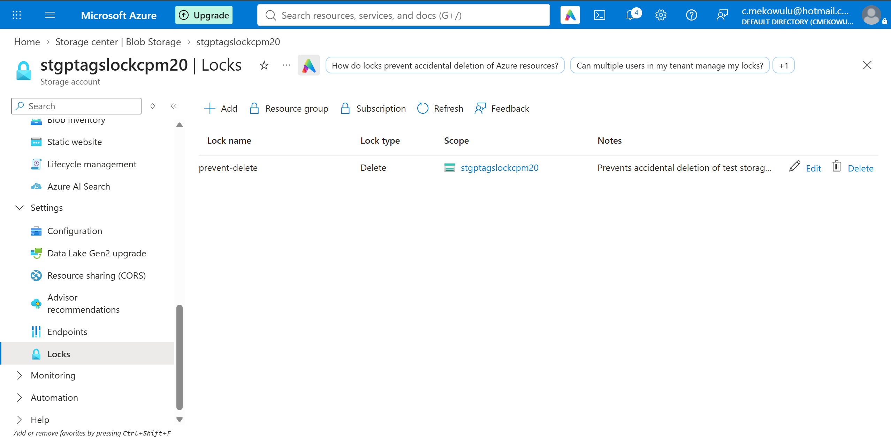
*Delete lock applied to the storage account.*

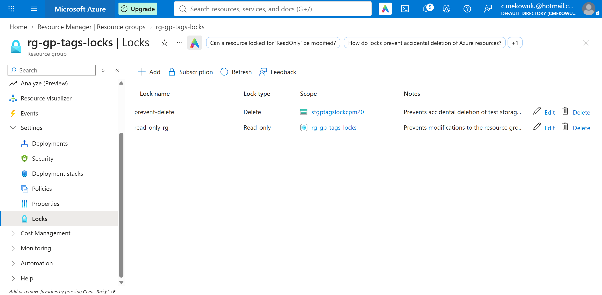
*Read-only lock applied to the resource group.*

### Exercise 3 — Test lock enforcement

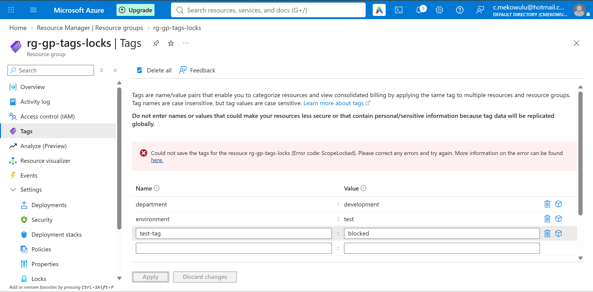
*Read-only lock test — the change is blocked.*

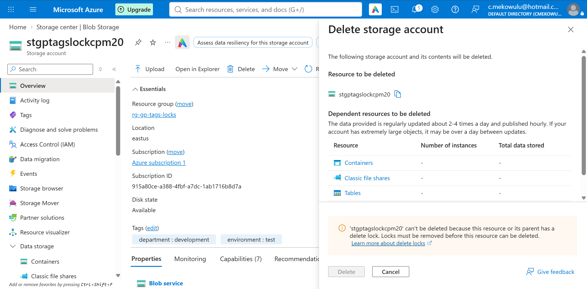
*Delete lock test — deletion blocked (ScopeLocked).*

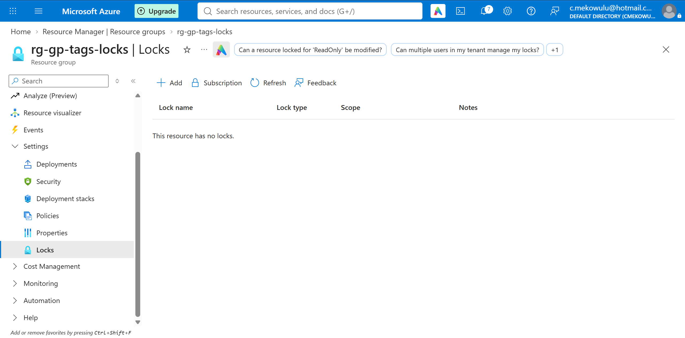
*Locks removed after testing.*

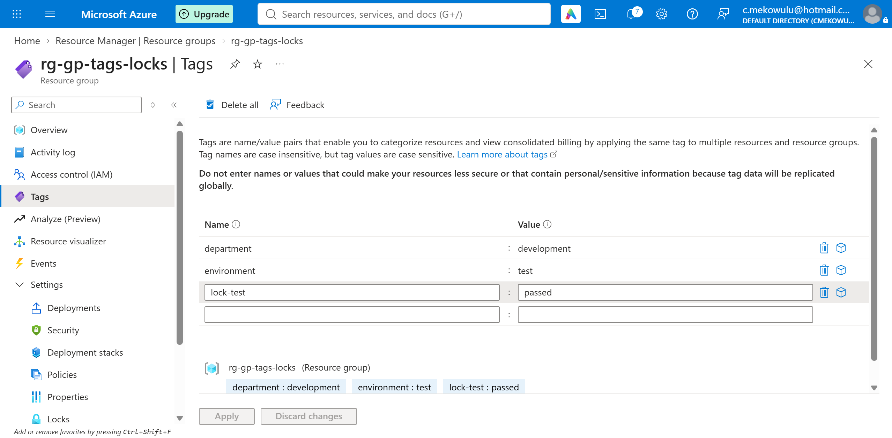
*Operations restored — a tag update succeeds once the locks are off.*
