# Project 3 — HTTP Endpoint with an Azure Function App

Built a serverless HTTP endpoint with Azure Functions, then tightened it from anonymous access to key-based authorization and proved both states.

## What was built

- Resource group **rg-gp-functions-endpoint**
- Function App **func-gp-endpoint-cpm20** — Flex Consumption plan, Node.js 24 LTS, East US, with Application Insights connected
- **GetStatus** HTTP-trigger function, created and deployed from Azure Cloud Shell (`func azure functionapp publish`)
- Authorization level changed from **anonymous** to **function** (key required)

One practical note: Flex Consumption is not available on a free-trial subscription, so the subscription was upgraded to Pay-As-You-Go (free Basic support plan kept) before the Function App could be created.

## How it was validated

- The endpoint first responded in a regular and an Incognito browser window under anonymous access.
- After the authorization change and redeploy, the same URL without the function key returned **401 Unauthorized**; with the key it returned **200**.
- HTTP 200 invocations were confirmed in the Application Insights logs.
- All resources were deleted after the lab (cleanup confirmed). The Function App no longer exists, and the function key shown during the lab is redacted in the screenshot in this folder.

## What this demonstrates

- Creating a Function App on the Flex Consumption plan
- Developing and deploying an HTTP-trigger function from Cloud Shell
- Function-level authorization and how the `code` key changes endpoint behaviour
- Verifying executions in Application Insights

## Screenshots

### Exercise 1 — Create the Function App

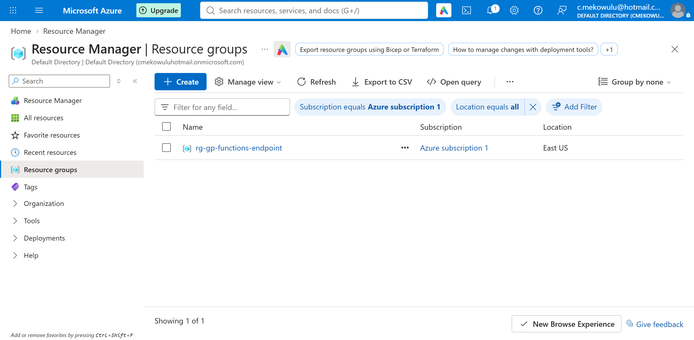
*Resource group rg-gp-functions-endpoint created.*

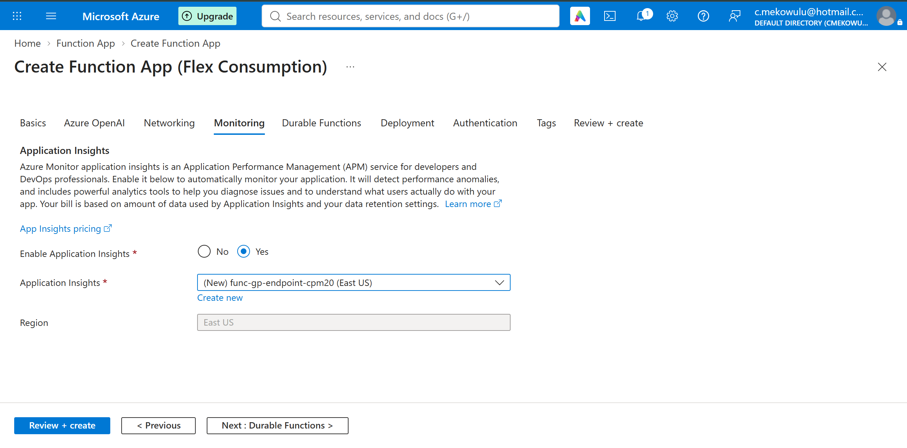
*Function App creation — monitoring tab, Application Insights connected.*

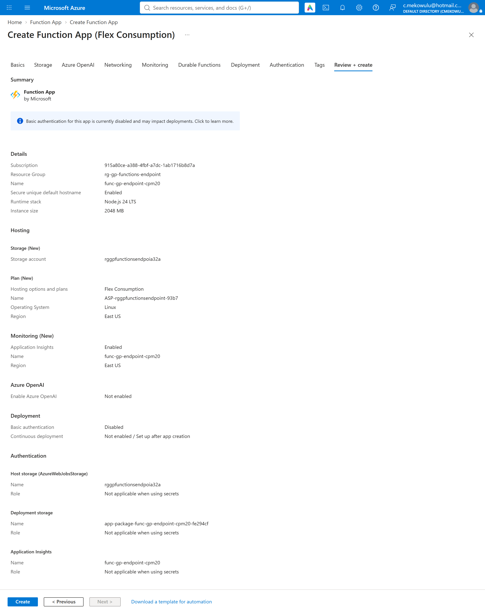
*Review page before deployment.*

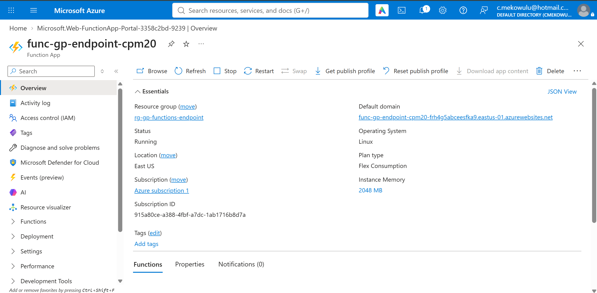
*Function App func-gp-endpoint-cpm20 — overview.*

### Exercise 2 — Create an HTTP-trigger function

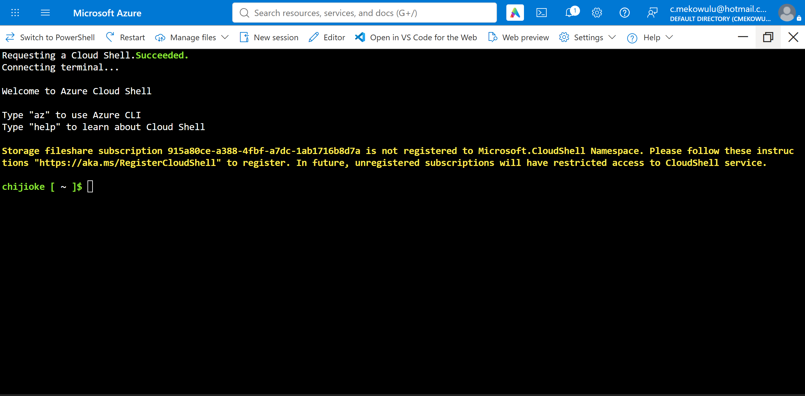
*Azure Cloud Shell session.*

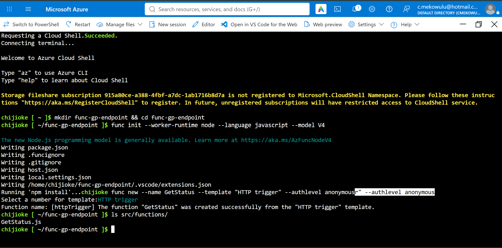
*Function project scaffolded in Cloud Shell.*

*GetStatus function deployed with func publish.*

### Exercise 3 — Test the endpoint and review logs

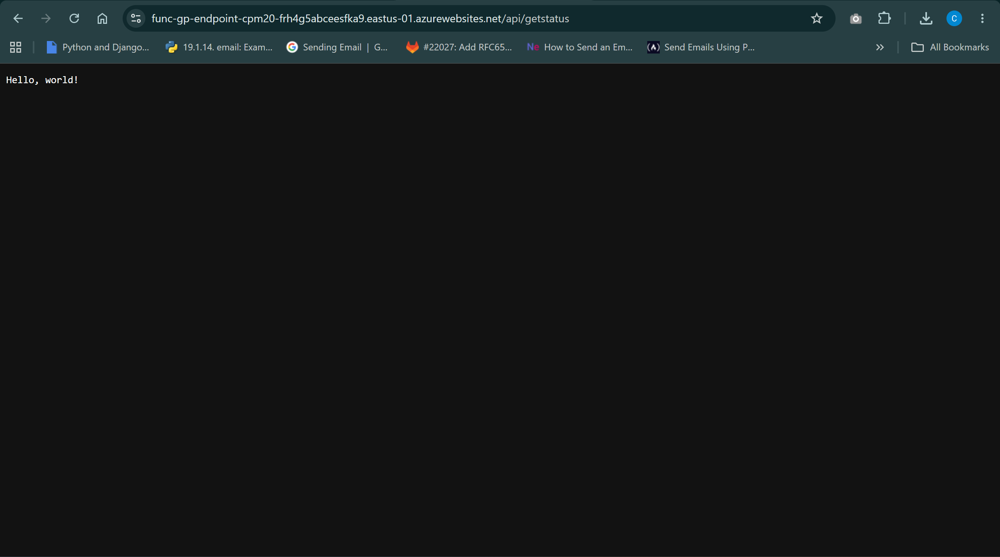
*Endpoint test in the browser (anonymous access).*

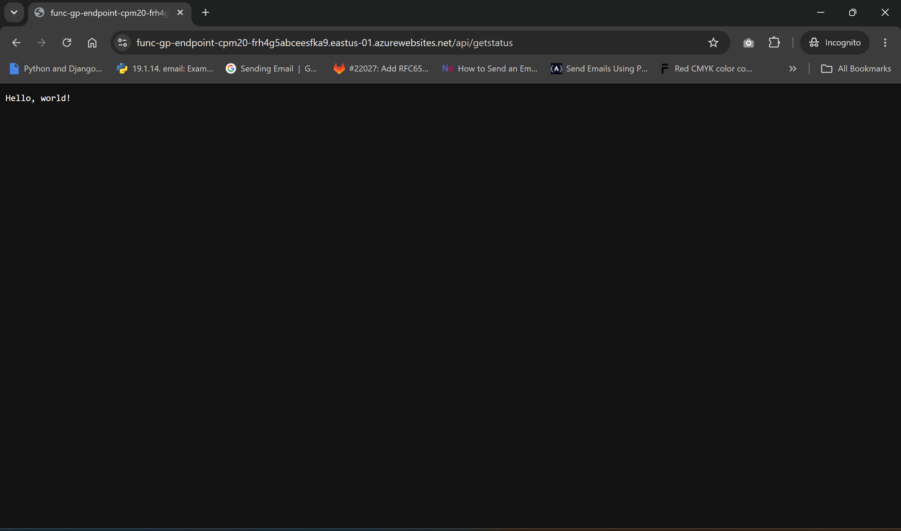
*Endpoint test in an Incognito window.*

*Function verified in the portal.*

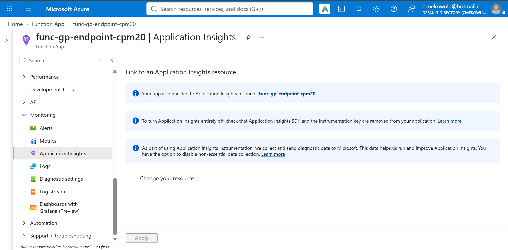
*Monitoring view for the Function App.*

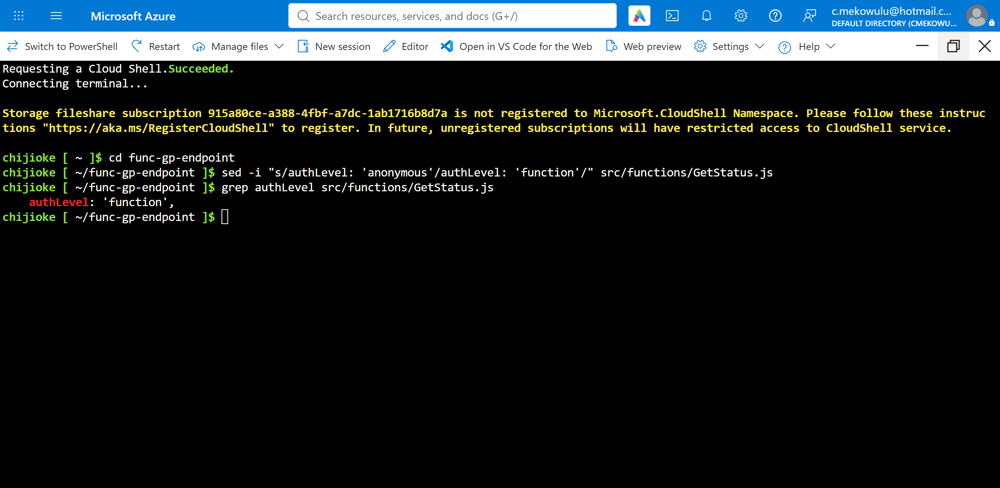
*The authLevel setting located in the function code (grep output).*

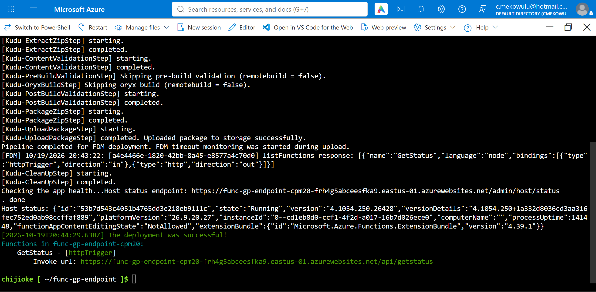
*Redeploy after switching authorization to function level.*

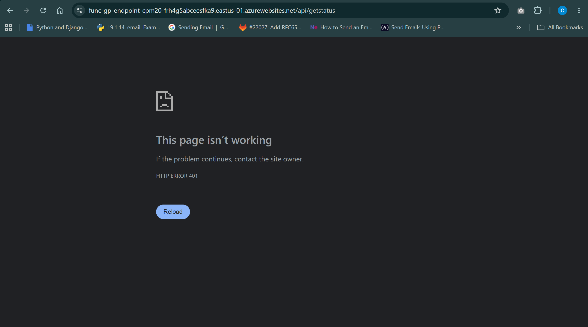
*Request without the function key — 401 Unauthorized.*

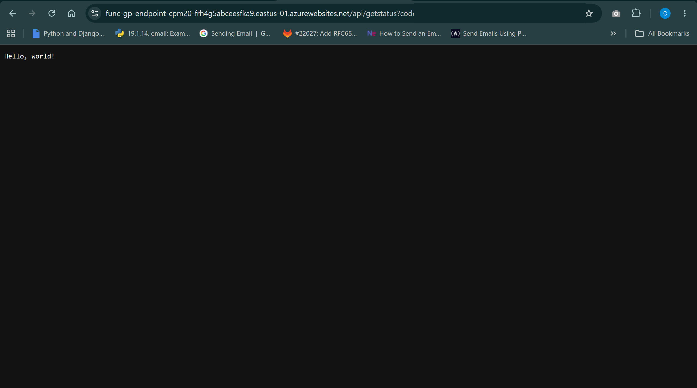
*Request with the function key — 200 response. The key value is redacted in this copy.*

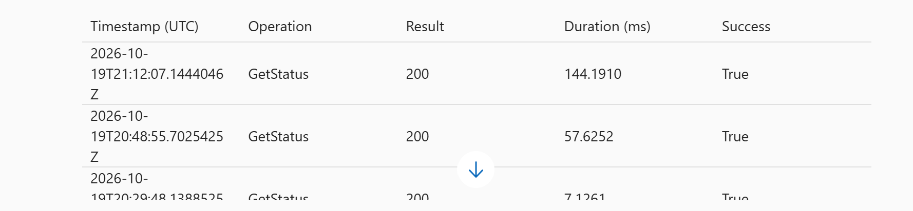
*Invocation logs in Application Insights.*
