# Project 4 — New Employee Access with Microsoft Entra ID and RBAC

Set up least-privilege access for a new employee the way an IT team actually does it: a user account, a security group, and one role assignment — then signed in as the employee to prove exactly what they could and could not do.

## What was built

- Resource group **rg-gp-access-model** with storage account **stgpaccessmodelcpm10**
- Security group **gp-rg-readers** (Security type, Assigned membership — members are added manually by an admin)
- User **Alex Guided Project** (alexgp@cmekowuluhotmail.onmicrosoft.com), added to the group
- **Reader** role assigned to the *group* at resource-group scope, so access is inherited by members
- **Temporary Access Pass** enabled and issued for Alex's first sign-in

## How it was validated

- **Check access** showed Alex's effective Reader access, inherited through the group — no direct assignment.
- The Activity Log held the "Create role assignment" audit entry for the change.
- Signed in as Alex: the resource group was viewable (read access works), and creating a storage account was denied with **AuthorizationFailed** (least privilege holds).
- All resources were deleted after the lab (cleanup confirmed).

## What this demonstrates

- Provisioning users and security groups in Microsoft Entra ID
- Group-based RBAC: assign roles to groups, not individuals, at the correct scope
- Verifying effective permissions with Check access before sign-in testing
- Passwordless onboarding with Temporary Access Pass, and audit awareness via the Activity Log

## Screenshots

### Exercise 1 — Create the user and group

*Resource group rg-gp-access-model.*

*Test storage account stgpaccessmodelcpm10 — part 1.*

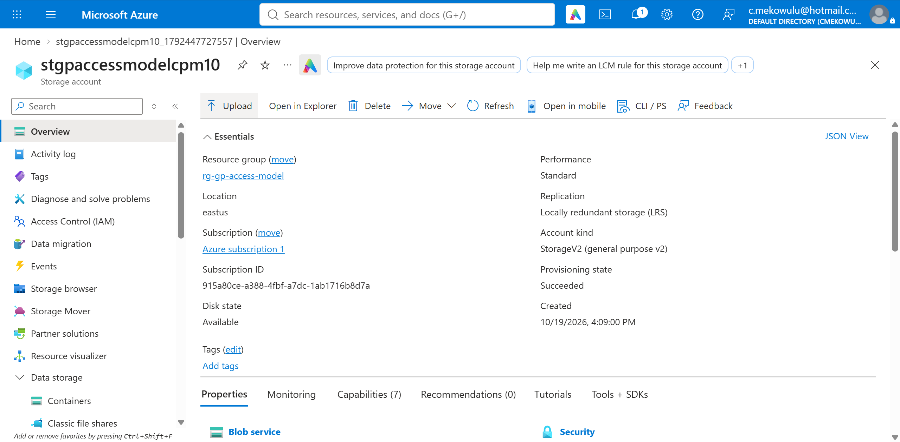
*Storage account overview — part 2.*

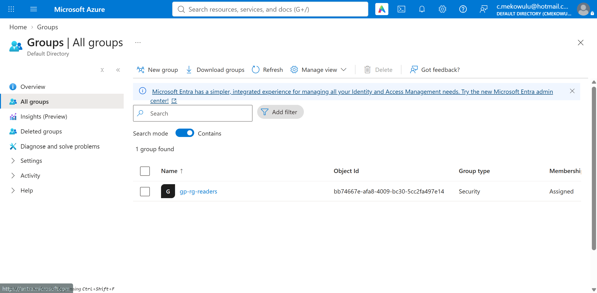
*Security group gp-rg-readers created.*

*User Alex Guided Project created.*

*Alex added to gp-rg-readers.*

### Exercise 2 — Assign the RBAC role at scope

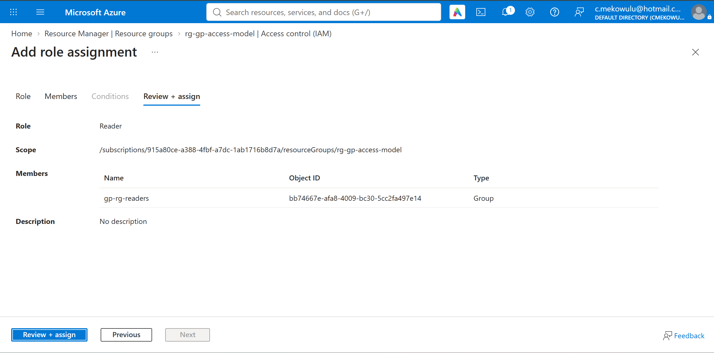
*Reader role assignment to the group — review page.*

*Role assignments tab showing the group assignment at resource-group scope.*

### Exercise 3 — Verify the least-privilege model

*Check access — Alex's effective permissions, inherited through the group.*

*Activity Log — "Create role assignment" audit entry.*

*Temporary Access Pass enabled in the authentication methods policy.*

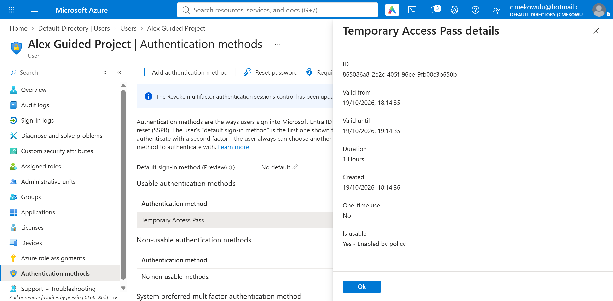
*Temporary Access Pass issued for Alex (details pane shows the validity window only — no passcode is screenshotted).*

*Signed in as Alex — the resource group is visible; read access works.*

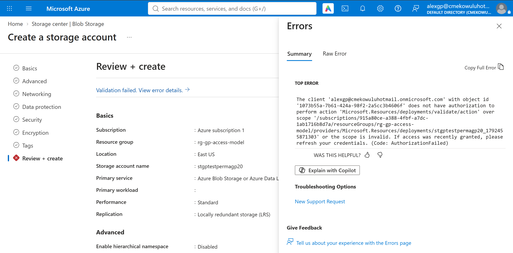
*Signed in as Alex — storage account creation denied (AuthorizationFailed).*

### Exercise 4 — Assign licenses to users (AZ-104 extension, Nov 17, 2026)

Group-based licensing in the same tenant: a new user, a security group, and an Entra ID P2 license assigned to the group through the Microsoft 365 admin center.

- User **Chris Green** (ChrisG@cmekowuluhotmail.onmicrosoft.com) created in the Microsoft Entra admin center
- Security group **Marketing** (Security type, Assigned membership, owner the administrator account, member Chris Green; Object Id fa909d91-d55b-4258-ab55-93d8a62c8a77)
- License **Microsoft Entra ID P2** — 100 available in the tenant, 0 assigned before the exercise, 1/100 assigned after
- The restore/recently-deleted-user part of the exercise page is reading only (30-day restore window; restore needs Global administrator, Partner Tier-1/2 Support or User administrator) — no deletion or restore performed

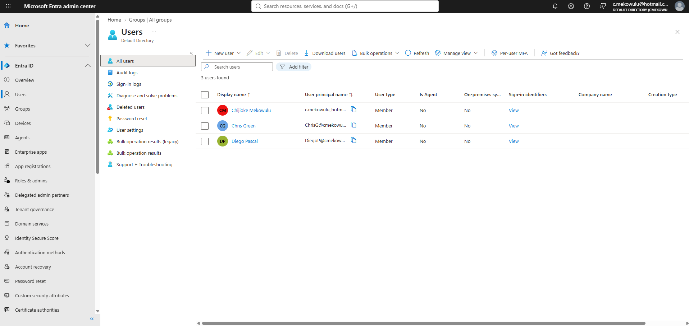
*All users list — Chris Green created (3 users in the tenant).*

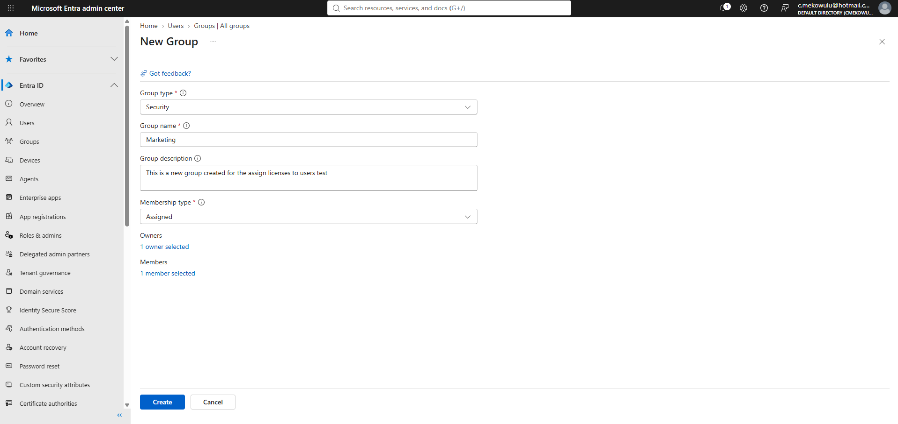
*New Group form: Security, Marketing, Assigned, 1 owner and 1 member selected.*

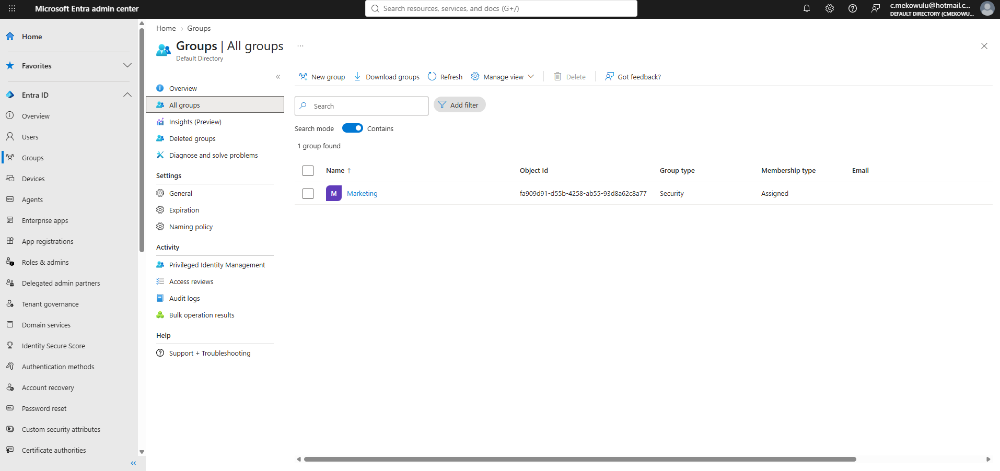
*All groups list — Marketing, Security, Assigned.*

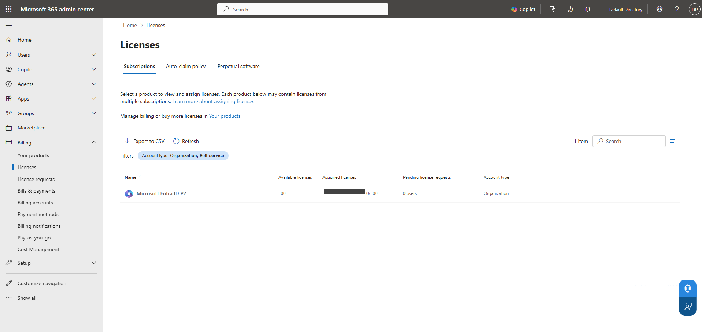
*Microsoft 365 admin center Licenses — Microsoft Entra ID P2, 100 available, 0/100 assigned.*

*Assign licenses dialog — Marketing selected, 100 of 100 available.*

*"Your licenses are being assigned" — success message.*

*License details — 1/100 assigned, Marketing group listed as the assignee.*

### Exercise 5 — Restore or remove deleted users (AZ-104 extension, Nov 17, 2026)

Deleted user Chris Green and restored him through the 30-day soft-delete window — then verified him back in the tenant with his original user principal name.

- Deleted **Chris Green** from the All users list ("Delete the selected users?" confirmed)
- Found him in the **Deleted users** list: deleted 17 Nov 2026, 14:26; permanent deletion scheduled 17 Dec 2026, 14:26
- Restored him ("Restore user(s)?" confirmed) and verified him back in **All users** with his original UPN — tenant back to 3 users
- Finding: **Alex Guided Project** from the original Project 4 work is still in the Deleted users list too — deleted 19 Oct 2026, permanent deletion due 18 Nov 2026. The page banner confirms users are permanently deleted automatically 30 days after deletion.

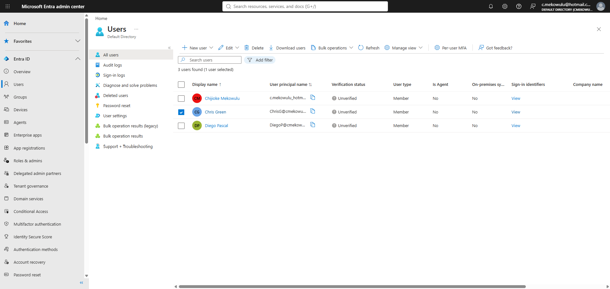
*All users list — Chris Green's checkbox selected (1 user selected).*

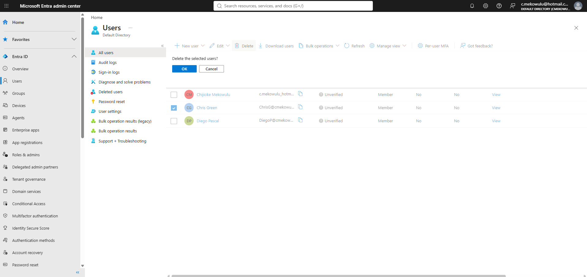
*"Delete the selected users?" confirmation dialog.*

*Deleted users list — Chris Green deleted 17 Nov 2026, 14:26, permanent deletion 17 Dec 2026; Alex Guided Project deleted 19 Oct 2026, permanent deletion 18 Nov 2026.*

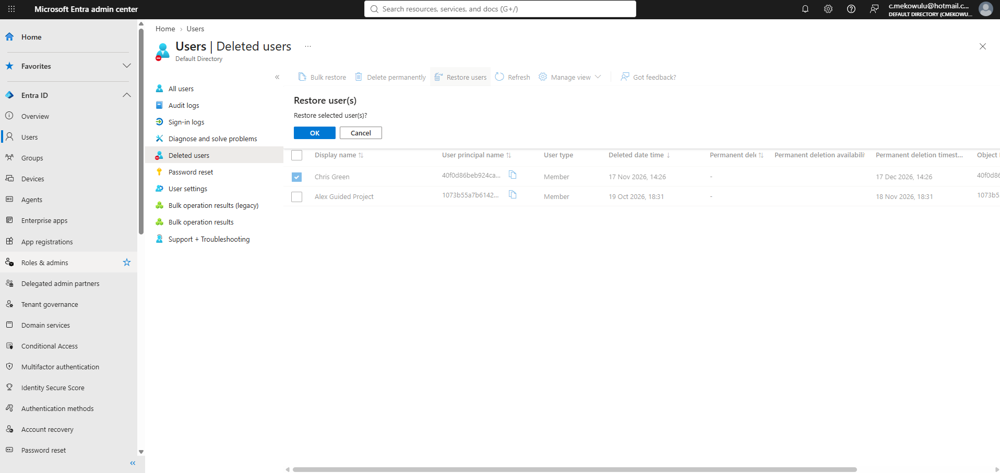
*"Restore user(s)?" dialog, Chris Green selected.*

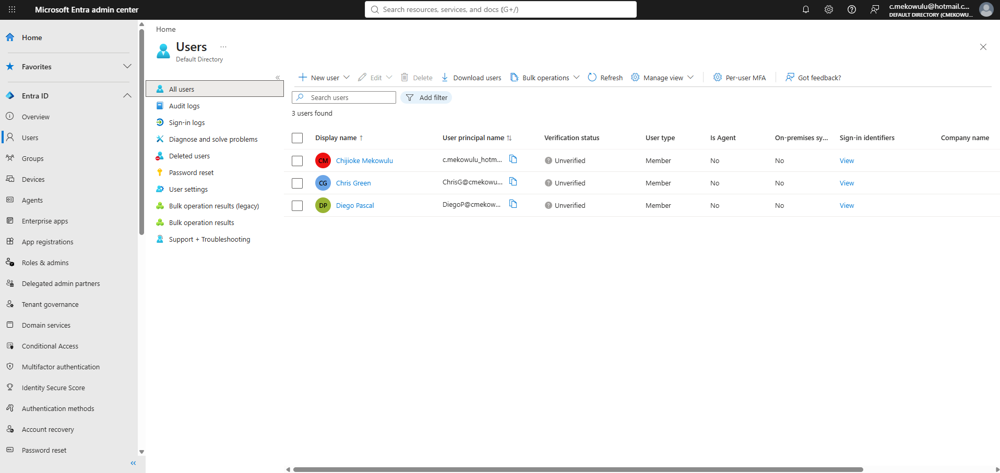
*All users list after restore — Chris Green back with his original UPN.*

### Exercise 6 — Add groups in Microsoft Entra ID (AZ-104 extension, Nov 17, 2026)

Created a **Microsoft 365 group** named **Northwest Sales** — the other group type, alongside the Marketing security group from Exercise 4.

- Group type **Microsoft 365**, name **Northwest Sales**, group email address NorthwestSales@cmekowuluhotmail.onmicrosoft.com, description "Group containing members of the sales team in Northwest region"
- Membership type **Assigned**, 1 owner (the administrator account) and 1 member selected
- Verified in the **All groups** list: 2 groups — Marketing (Security, Assigned, Object Id fa909d91-d55b-4258-ab55-93d8a62c8a77) and Northwest Sales (Microsoft 365, Assigned, Object Id 8e5327d9-4bf4-40e9-aa6e-527080a4f0d2)
- Contrast with the security group: a Microsoft 365 group also gets a mailbox address and the collaboration backing behind it.

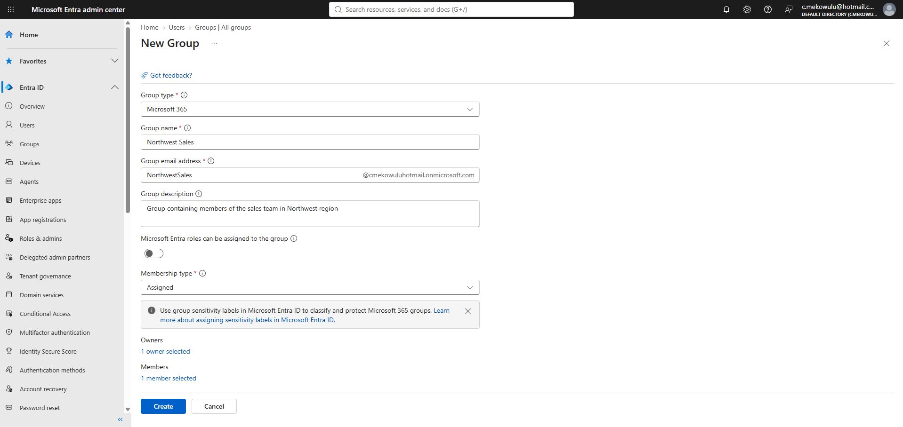
*New Group page — Microsoft 365, Northwest Sales, Assigned, 1 owner and 1 member selected.*

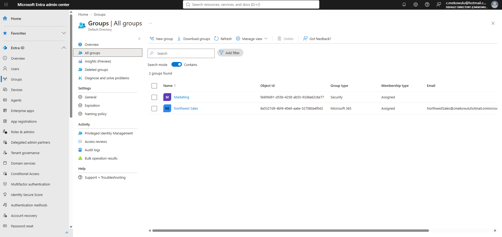
*All groups list — Marketing (Security) and Northwest Sales (Microsoft 365) side by side.*

### Exercise 7 — Change group license assignments (AZ-104 extension, Nov 18, 2026)

Changed the license assignment of the **Microsoft 365 group Northwest Sales**.

- Before: its **Licenses** page in the Entra admin center showed "No license assignments found" — with the banner noting that adding, removing, and reprocessing licensing assignments is only available within the M365 Admin Center
- Assigned **Microsoft Entra ID P2** in the Microsoft 365 admin center — the Assign licenses pane with Northwest Sales picked, subscription "Nov 17, 2026 (99 of 100 available licenses)" selected, at 1/100 assigned (Marketing holding the one)
- After: Northwest Sales' Licenses page in Entra shows Microsoft Entra ID P2, State **Queued**, 4/4 enabled services — group-based licensing processes assignments in the background
- Confirmed complete: the Microsoft 365 admin center license details now read **2/100 assigned**, listing the subscription (2 assigned) plus both groups, Marketing and Northwest Sales

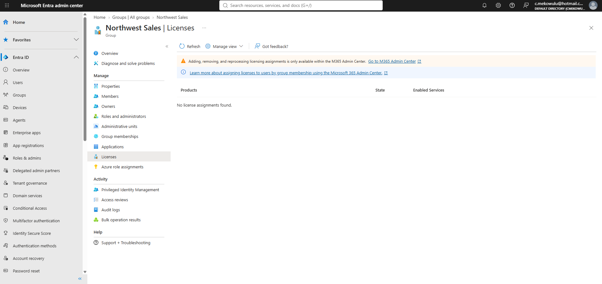
*Northwest Sales Licenses page before — no license assignments found.*

*Microsoft 365 admin center — Assign licenses pane, Northwest Sales picked, P2 at 1/100 assigned.*

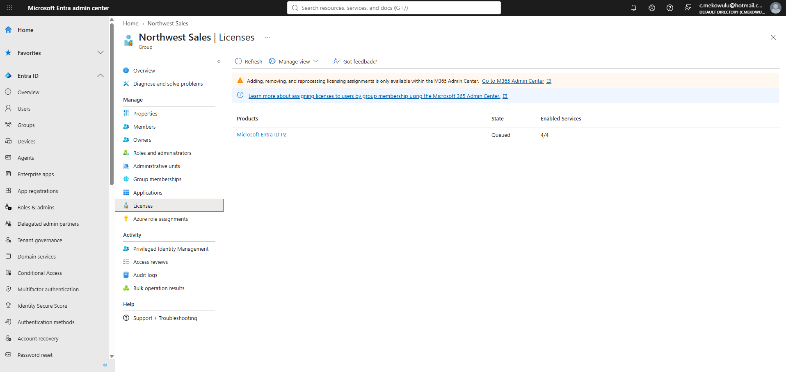
*Northwest Sales Licenses page after — Entra ID P2, Queued, 4/4 services.*

*Microsoft 365 admin center license details — 2/100 assigned, Marketing and Northwest Sales listed.*

### Exercise 8 — Change user license assignments (AZ-104 extension, Nov 18, 2026)

Created a new user **Dominique Koch** (DominiqueK@cmekowuluhotmail.onmicrosoft.com) and assigned Microsoft Entra ID P2 to her **directly** — the counterpart to the group-based licensing in Exercises 4 and 7.

- Tenant now has 4 users: Chijioke Mekowulu, Chris Green, Diego Pascal, Dominique Koch
- Assigned **Microsoft Entra ID P2** in the Microsoft 365 admin center — the Assign licenses pane with Dominique Koch picked, subscription "Nov 17, 2026 (98 of 100 available licenses)" selected, at 2/100 assigned
- Verified on Dominique Koch's **Licenses** page in Entra: Microsoft Entra ID P2, State **Active**, 4/4 enabled services, Assignment Paths **Direct**
- Confirmed: the Microsoft 365 admin center license details now read **3/100 assigned**, listing the subscription (3 assigned) plus Marketing (Group), Northwest Sales (Group), and Dominique Koch (User)

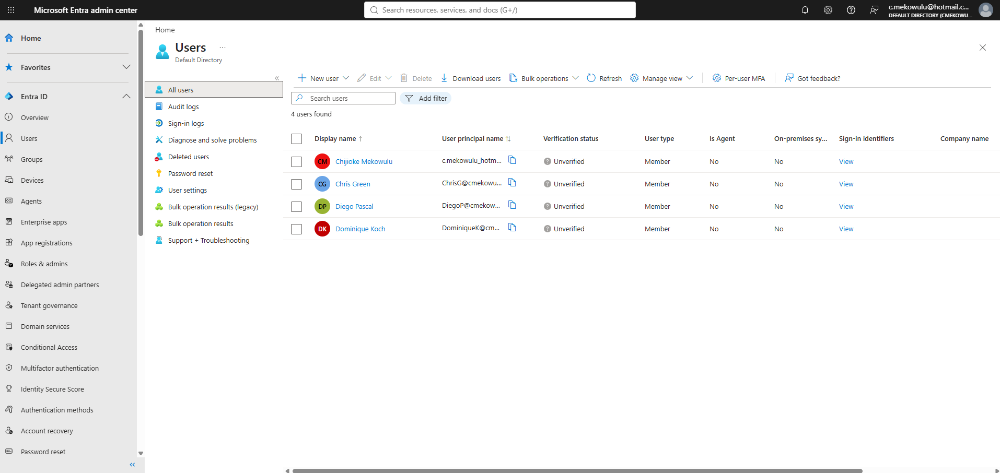
*All users list — 4 users including Dominique Koch.*

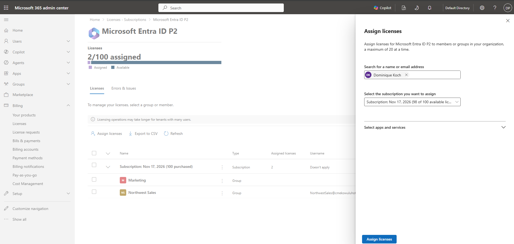
*Microsoft 365 admin center — Assign licenses pane, Dominique Koch picked, 2/100 assigned.*

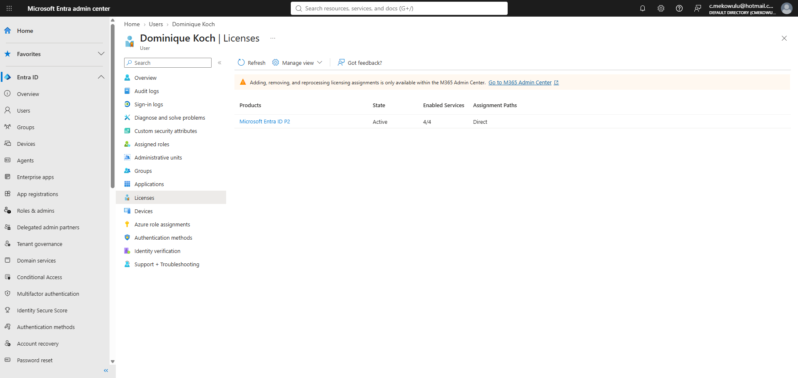
*Dominique Koch's Licenses page in Entra — Entra ID P2, Active, 4/4 services, Assignment Paths Direct.*

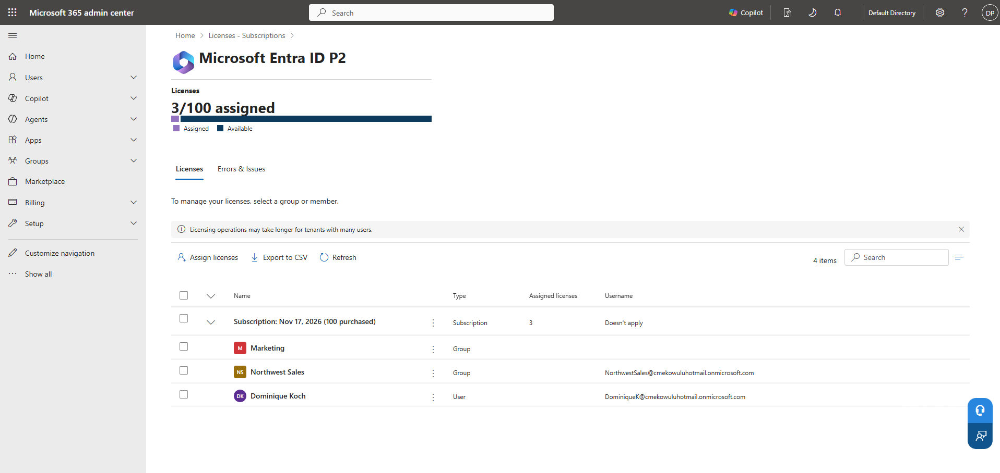
*Microsoft 365 admin center license details — 3/100 assigned, Marketing, Northwest Sales, Dominique Koch.*

### Exercise 9 — List access using Azure RBAC and the Azure portal (AZ-104 extension, Nov 24, 2026)

Listed RBAC access in the portal — the read side of the access model built in the earlier exercises. Own access first, then the resource group's assignments, then the roles themselves.

- Opened the Profile menu and selected **My permissions**: the account c.mekowulu@hotmail.com has been assigned the role **Owner** (type BuiltInRole) with access to **Azure subscription 1**
- Inspected a fresh non-production resource group, **rg-role-lab-10** (East US), created for this exercise
- Its **Access control (IAM) → Role assignments** tab shows exactly **1 assignment** for the subscription (1 of 5000 used), **1 privileged**: Chijioke Mekowulu (User) — **Owner**, Scope **Subscription (Inherited)**, State Active Permanent, End time Permanent, Condition None — the inherited-from-parent-scope case, with no assignments scoped directly to the resource group itself
- The **Roles** tab lists the built-in roles (**1,011 results**): Owner grants full access to manage all resources, including the ability to assign roles; Contributor grants full access to manage all resources but does not allow assigning roles; Reader allows viewing all resources but not making changes

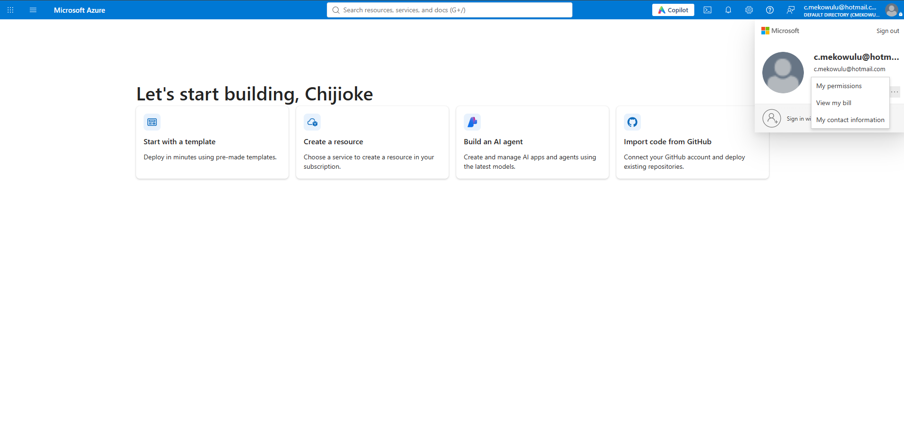
*Profile menu with My permissions highlighted.*

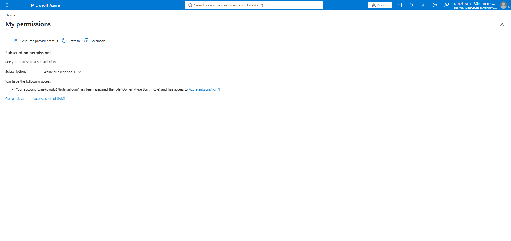
*My permissions pane — Owner (BuiltInRole) at Azure subscription 1.*

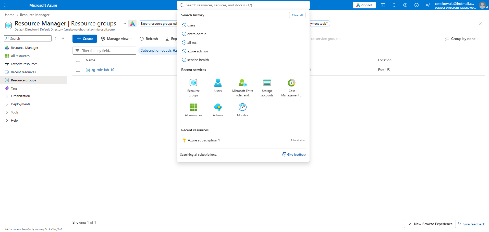
*Search menu with Resource groups; the list shows rg-role-lab-10 (East US).*

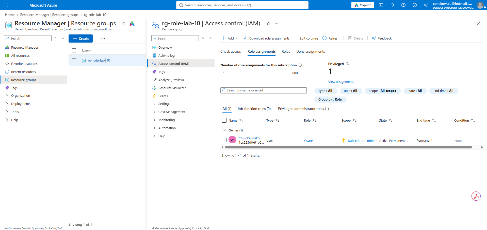
*rg-role-lab-10 Access control (IAM) — Role assignments tab: 1 assignment, Owner inherited from the subscription.*

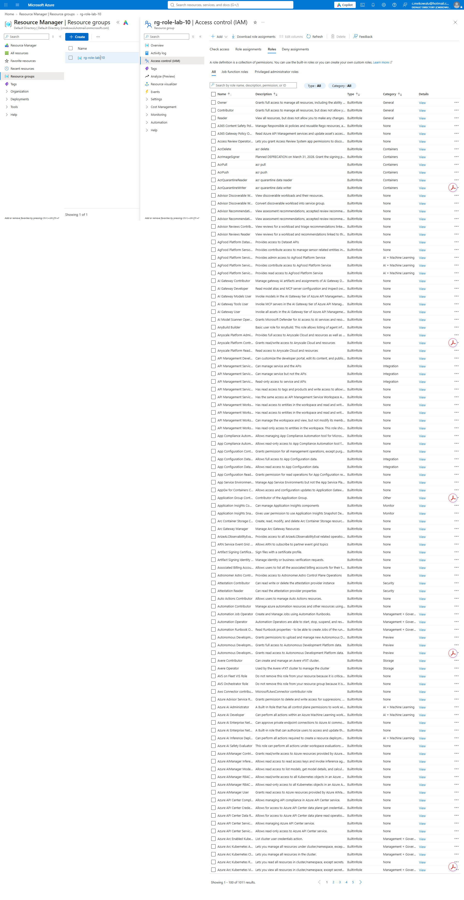
*Roles tab — built-in roles list, 1–100 of 1,011 results, Owner, Contributor, and Reader at the top.*

### Exercise 10 — Grant access using Azure RBAC and the Azure portal (AZ-104 extension, Nov 24, 2026)

Granted least-privilege access in the portal — the write side of the access model listed in Exercise 9. Assigned the **Virtual Machine Contributor** role to the test user **Dominique Koch** (DominiqueK@cmekowuluhotmail.onmicrosoft.com, standing in for the exercise's example identity Alain) at the resource-group scope of **rg-role-lab-10** (East US).

- Before: the resource group's **Access control (IAM) → Role assignments** tab showed exactly **1 assignment** — the inherited Owner at subscription scope
- **Add role assignment → Role tab** (Job function roles): searched "virtual machine" and selected **Virtual Machine Contributor** — "Lets you manage virtual machines, but not access to them, and not the virtual network or storage account they're connected to."
- **Members tab**: Dominique Koch selected from the tenant's users
- **Review + assign** verified Role Virtual Machine Contributor, Scope /subscriptions/915a80ce-a388-4fbf-a7dc-1ab1716b8d7a/resourceGroups/rg-role-lab-10, Member Dominique Koch, Assignment type **Active**, Assignment duration **Permanent**
- After: the Role assignments tab showed **2 assignments** — the inherited Owner plus Dominique Koch, Virtual Machine Contributor, Scope **This resource**, State Active Permanent
- **Check access** confirmed Dominique Koch's assignment at this scope: Virtual Machine Contributor, This resource, no group assignment, no condition, **0 deny assignments**
- Cleanup, as the exercise requires: the assignment was removed afterward and the final Role assignments tab is back to **1 assignment** — only the inherited Owner, untouched, and the resource group was not deleted

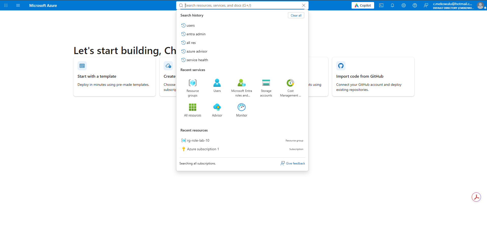
*Search menu with Resource groups; rg-role-lab-10 in recent resources.*

*rg-role-lab-10 Access control (IAM) — Role assignments tab before: 1 inherited Owner.*

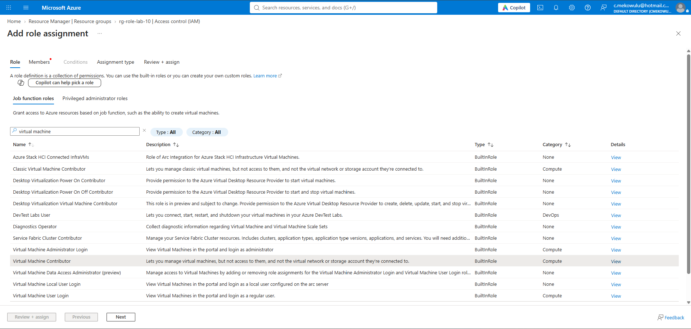
*Add role assignment — Role tab, Virtual Machine Contributor selected.*

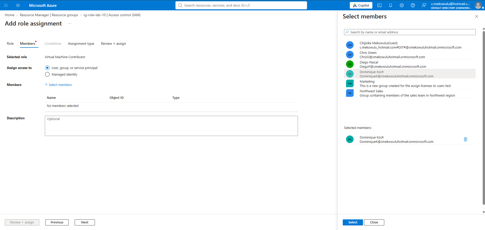
*Members tab — Select members pane, Dominique Koch selected.*

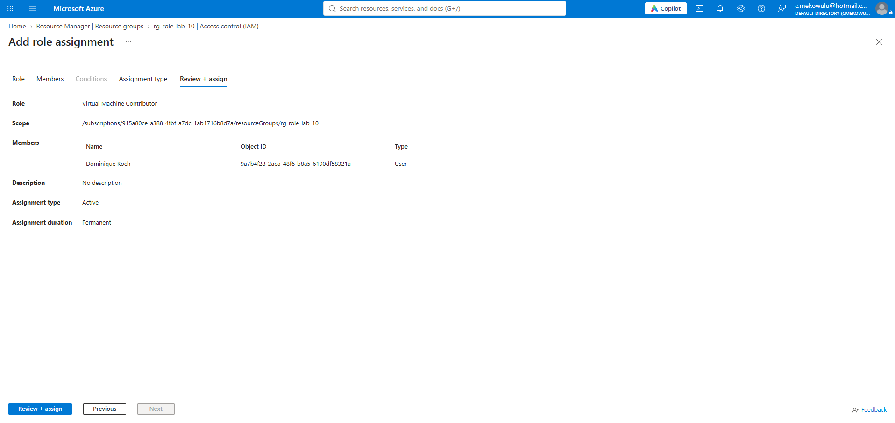
*Review + assign — Virtual Machine Contributor, rg-role-lab-10 scope, Dominique Koch, Active, Permanent.*

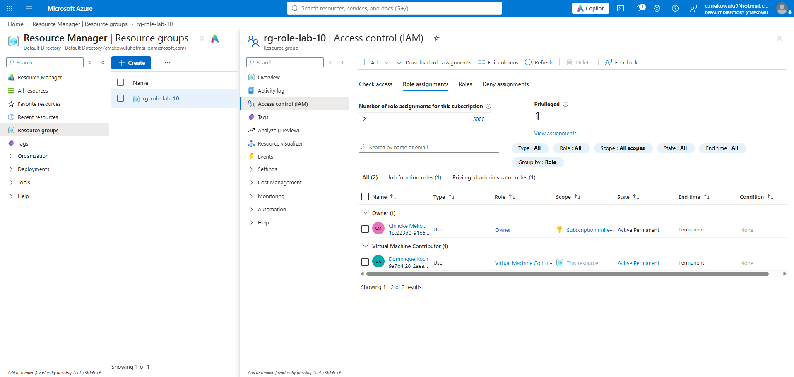
*Role assignments tab after — 2 assignments, Dominique Koch Virtual Machine Contributor at This resource.*

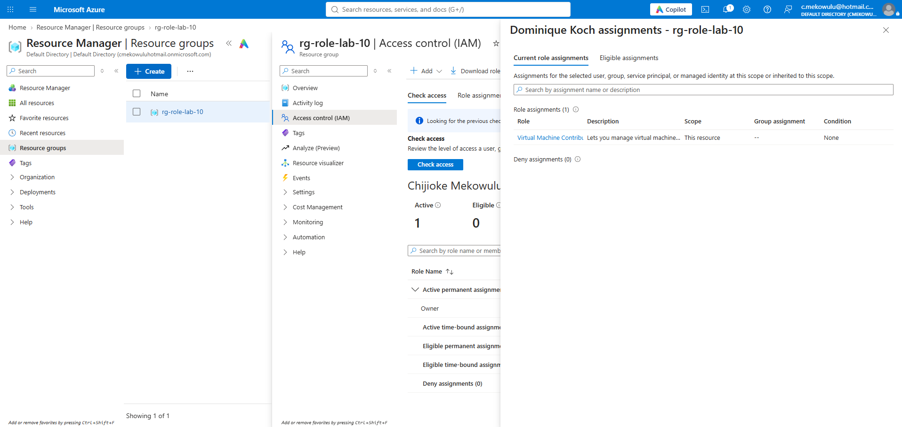
*Check access — Dominique Koch assignments: Virtual Machine Contributor, This resource.*

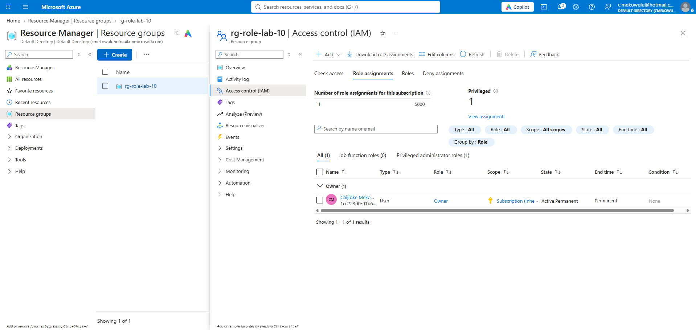
*Role assignments tab after removal — back to 1 inherited Owner.*

### Exercise 11 — View activity logs for Azure RBAC changes (AZ-104 extension, Nov 24, 2026)

Audited Azure RBAC role-assignment operations in the subscription Activity Log for **Azure subscription 1**, filtered to the four operations: Create role assignment, Delete role assignment, Create or update custom role definition, and Delete custom role definition.

- Timespan used: custom range starting **Thu Oct 01 2026 08:19:48 GMT-0600 (Mountain Daylight Time)** through Nov 24, 2026. Note honestly: the exercise asked for the previous calendar month (October 2026), but the range actually ran Oct 1 – Nov 24, so the export covers both October and the Nov 24 Exercise 10 work. The export file is named accordingly: `Azure-subscription-1_ActivityLog_Oct01-Nov24-2026_RBAC-4-ops_not-PIM-audit.csv`.
- The filtered list (**Operation: 4 selected**) shows **4 items, all Succeeded**: Delete role assignment (Tue Nov 24), Create role assignment (Tue Nov 24), Delete role assignment (Mon Oct 19), Create role assignment (Mon Oct 19). (The operation-filter pane itself could not be captured as a screenshot; the "Operation: 4 selected" chip in the results is the evidence the filter was applied.)
- The CSV export has **7 rows** — the 4 Succeeded completion records plus 3 Started records — reconciled by correlation ID into exactly **4 distinct operations**:
  - Oct 19 22:55 UTC — Create role assignment, Succeeded, rg-gp-access-model (the Project 4 Reader assignment to gp-rg-readers)
  - Oct 20 00:28 UTC — Delete role assignment, Succeeded, rg-gp-access-model (the Reader assignment removed in the Oct 19–20 cleanup)
  - Nov 24 13:53 UTC — Create role assignment, Succeeded, rg-role-lab-10 (the Exercise 10 Virtual Machine Contributor grant to Dominique Koch)
  - Nov 24 14:01 UTC — Delete role assignment, Succeeded, rg-role-lab-10 (the Exercise 10 assignment removal)
- No custom role definition operations appeared — none were ever created.
- The opened event is the Nov 24 delete: Tue Nov 24 2026 08:01:19 GMT-0600, initiated by c.mekowulu@hotmail.com, message "Shared with 'Dominique Koch'.", Role Virtual Machine Contributor, Scope Resource group: 'rg-role-lab-10'.
- Coverage note: Activity Log records for those four RBAC operations only, **not a complete PIM audit** — PIM eligibility and activation activity is not covered by these four operations.

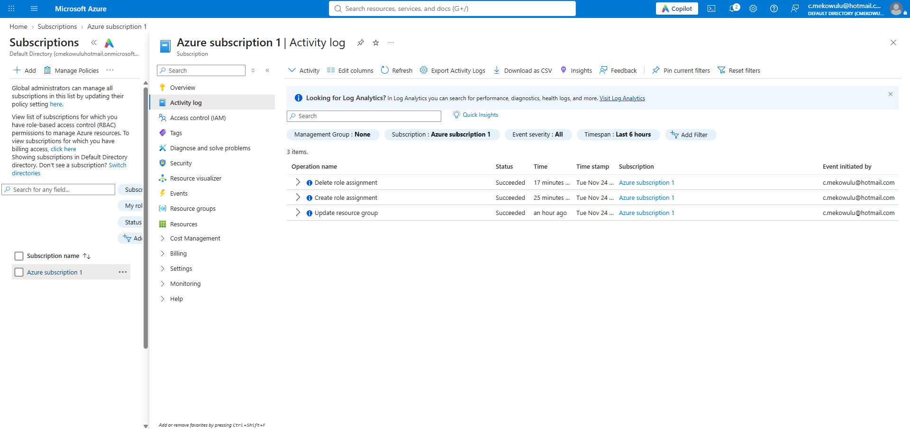
*Azure subscription 1 Activity log — Last 6 hours, 3 items.*

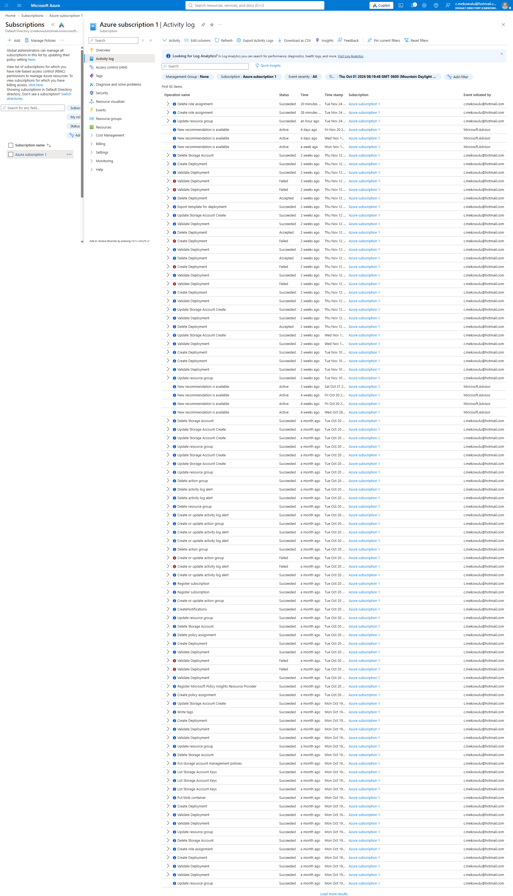
*Timespan starting Thu Oct 01 2026 — First 92 items, unfiltered.*

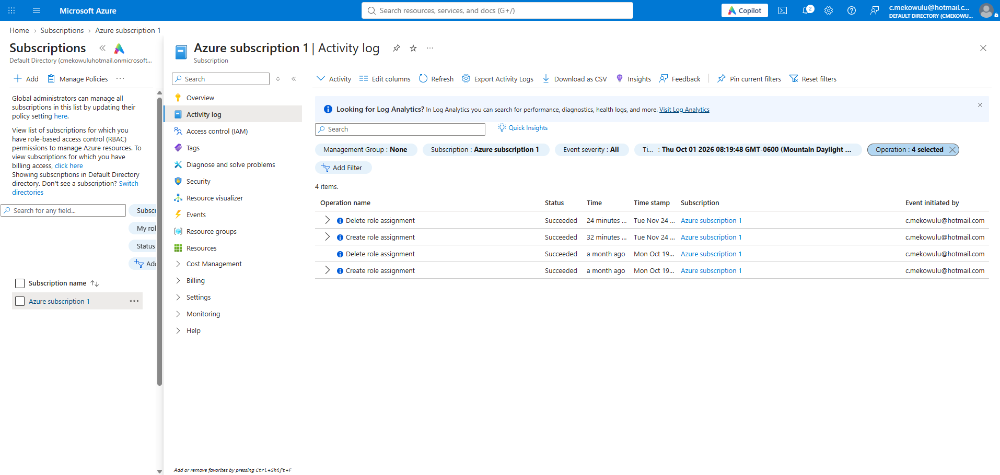
*Filtered results — Operation: 4 selected, 4 items all Succeeded.*

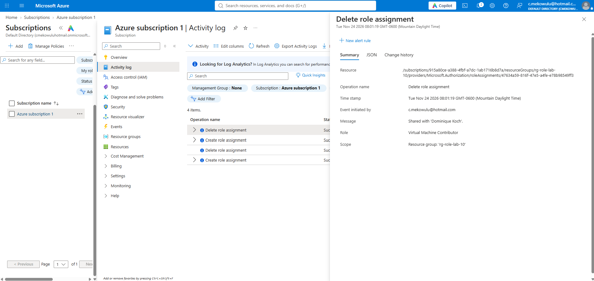
*Delete role assignment event opened — Nov 24, Dominique Koch, Virtual Machine Contributor, rg-role-lab-10.*

### Exercise 12 — Implement Microsoft Entra self-service password reset (AZ-104 extension, Nov 24, 2026)

Implemented self-service password reset (SSPR) in Microsoft Entra ID as a trial rollout for the **Marketing** security group — the group from Exercise 4, whose member is the non-administrative test user Chris Green. (The exercise scenario describes 20 marketing users; the actual group has 1 member, so the trial runs as-is.) Prerequisites met: Microsoft Entra ID P2 is licensed in the tenant, and the test user is non-administrative and licensed.

- **Properties** — Self service password reset enabled: **Selected**, Select group: **Marketing**
- **Authentication methods** — Number of methods required to reset: **1**. The blade lists only **Security questions** as a method available to users, with the note "Use the auth methods policy to manage other authentication methods" — Email, Microsoft Authenticator, SMS, and voice call are governed by the tenant's Authentication methods policy (Protection → Authentication methods), not this blade. The blade also carries the banner that Security Questions are **retiring in March 2027** and won't be available for password reset after that date.
- **Registration** — Require users to register when signing in: **Yes**; Number of days before users are asked to re-confirm their authentication information: **180**
- **Notifications** — Notify users on password resets: **Yes**; Notify all admins when other admins reset their password: **Yes**
- **Customization** — Customize helpdesk link: **Yes**; Custom helpdesk email or URL: **mekowuluchijioke@gmail.com**
- Scope note: these settings apply to end users; admins are always enabled for SSPR and are required to use two authentication methods to reset their password. After enabling, the test user is prompted to register authentication methods at next sign-in.

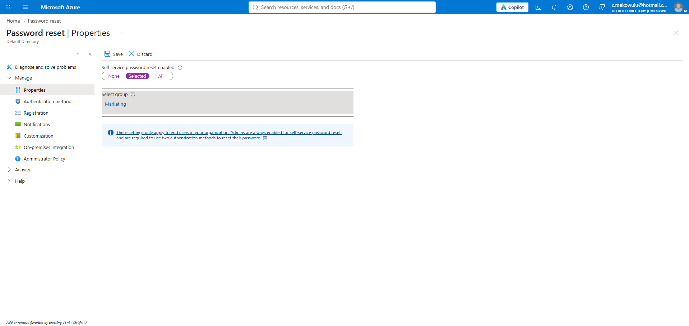
*Password reset Properties — SSPR enabled: Selected, group Marketing.*

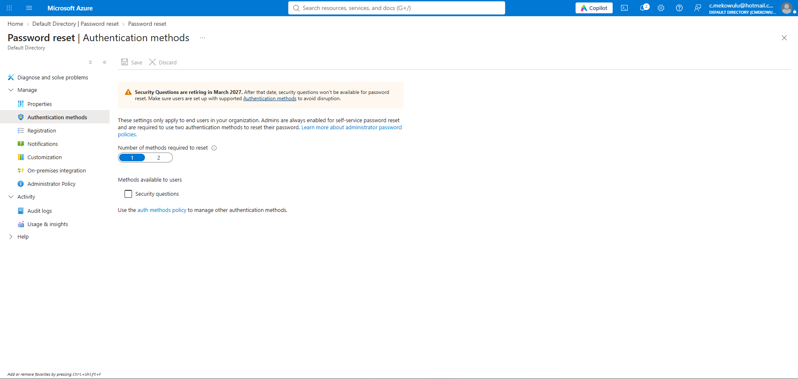
*Authentication methods — 1 method required; only Security questions listed in the blade, other methods managed by the auth methods policy; March 2027 retirement banner.*

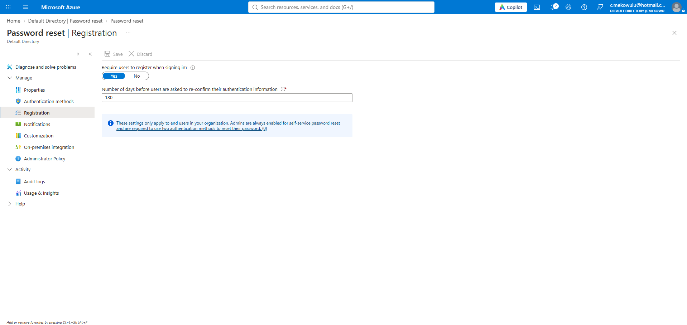
*Registration — require users to register when signing in: Yes, re-confirm every 180 days.*

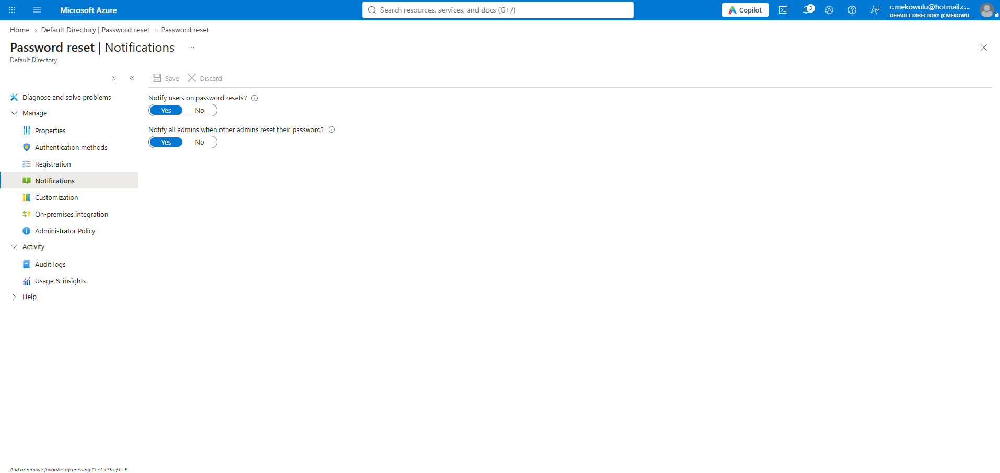
*Notifications — notify users on password resets: Yes; notify all admins: Yes.*

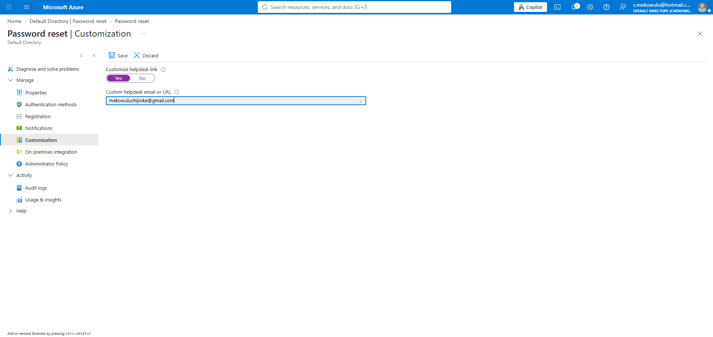
*Customization — helpdesk link Yes, mekowuluchijioke@gmail.com.*

### Exercise 13 — Set up self-service password reset (AZ-104 extension, Nov 24, 2026)

The end-to-end SSPR test, following on from the Exercise 12 configuration: a limited-rollout group, a new test user, and the full register-and-reset flow done as that user.

- Created security group **SSPRTesters** (Security type, Assigned membership, description "Members are testing the rollout of SSPR")
- Created non-administrative test user **Bala Sandhu** (balas@cmekowuluhotmail.onmicrosoft.com), assigned to the SSPRTesters group and licensed with Entra ID P2 so SSPR applies to him — the tenant now has 5 users (Bala Sandhu, Chijioke Mekowulu, Chris Green, Diego Pascal, Dominique Koch)
- **Password reset Properties** — Self service password reset enabled: **Selected**, Select group: **SSPRTesters** (scope switched from the Marketing group in Exercise 12)
- **Authentication methods** are governed by the tenant's Authentication methods policy, not the SSPR blade — the blade collapses to Security questions only once the policy loads, so the evidence is the Authentication methods **Policies** list: **Email OTP enabled Yes for All users** (also Yes: Passkey FIDO2, Microsoft Authenticator, Temporary Access Pass, Software OATH tokens, Password; No: SMS, Voice call, Hardware OATH tokens, Certificate-based authentication, Verified ID, QR code). Email enabled for All users covers Bala.
- **Customization** — Customize helpdesk link: **Yes**; Custom helpdesk email or URL: **admin@cmekowuluhotmail.onmicrosoft.com**; the "Password reset policy saved — Changes to password reset policy were saved successfully" toast confirms the save. Note honestly: this is display text on the reset page, not a monitored mailbox.
- **Registration**, as Bala at aka.ms/ssprsetup (Security info page): **Email** registered to mekowuluchijioke@gmail.com. The page also shows Password last updated 3 minutes ago and Microsoft Authenticator push MFA on iPhone 16 Pro Max. (The exercise's screenshot caption asked for a "mobile phone registration form" but the step registers Email — the captured screen is the Security info page showing the registered Email method.)
- **Test**, as Bala at aka.ms/sspr ("Get back into your account"): verification step 1 completed by email code, reaching **choose a new password** with Enter new password / Confirm new password and Finish — the end-to-end reset works by email.
- No passwords or verification codes appear in any screenshot.

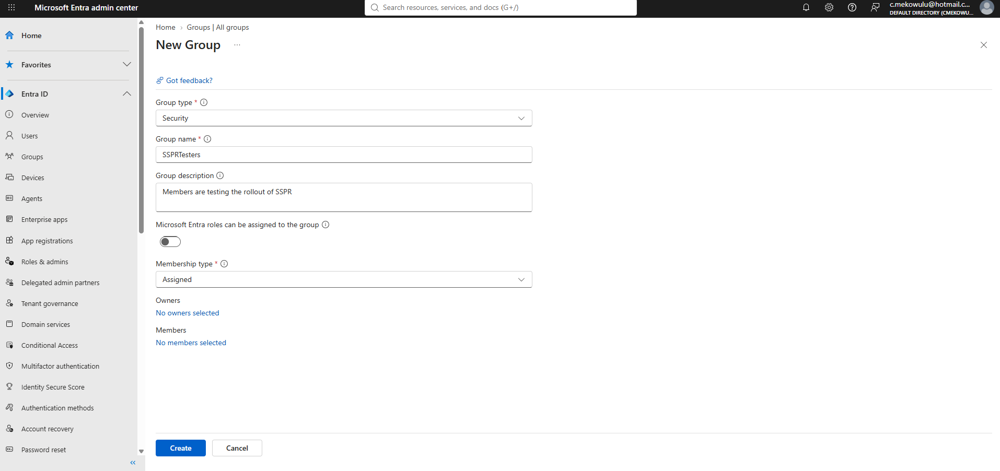
*New Group form — Security, SSPRTesters, "Members are testing the rollout of SSPR", Assigned, Create.*

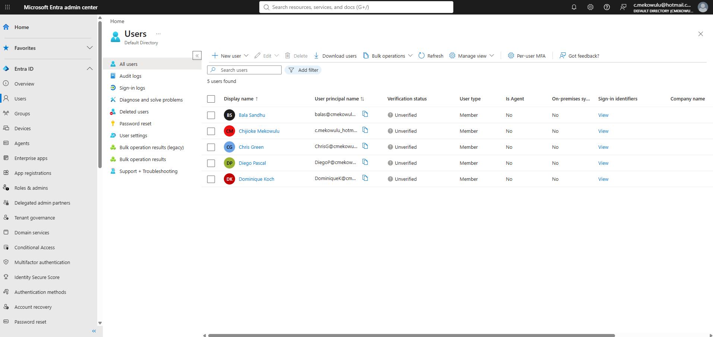
*All users list — 5 users found, including Bala Sandhu.*

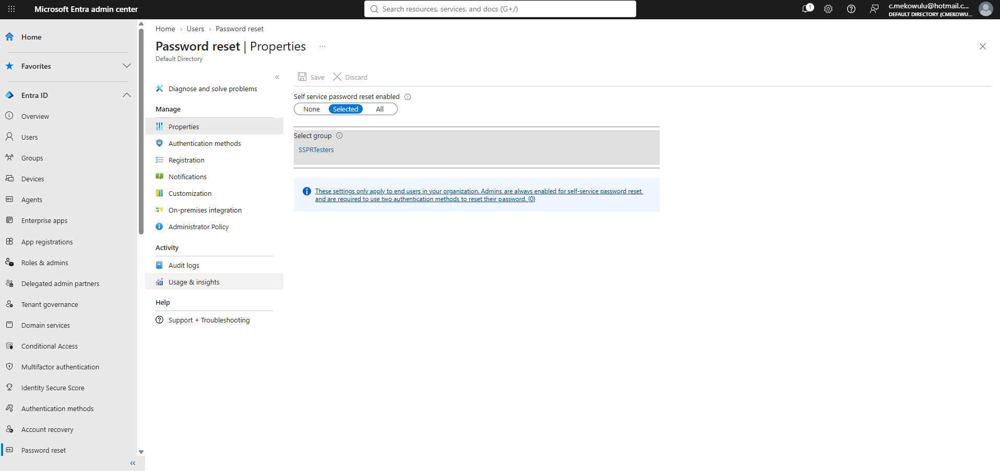
*Password reset Properties — SSPR enabled: Selected, group SSPRTesters.*

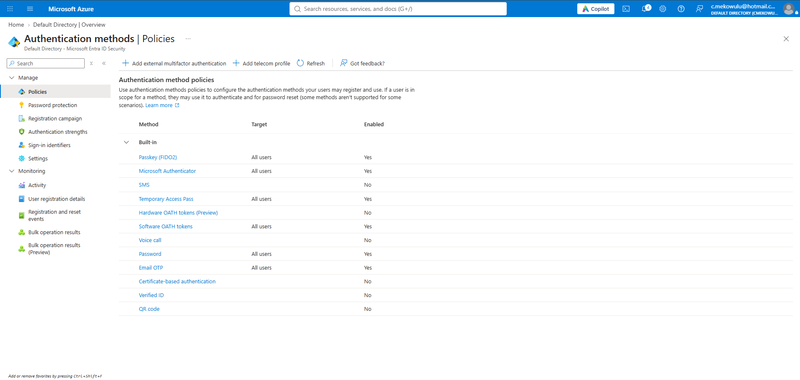
*Authentication methods Policies — Email OTP Yes, All users.*

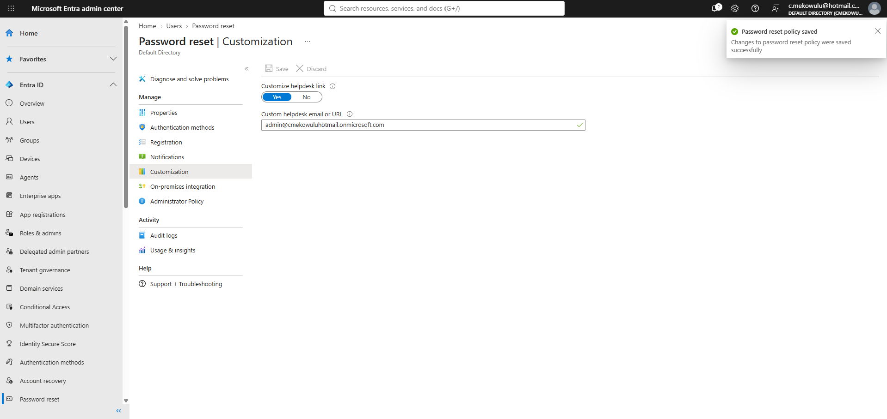
*Customization — helpdesk link Yes, admin@cmekowuluhotmail.onmicrosoft.com, "Password reset policy saved" toast.*

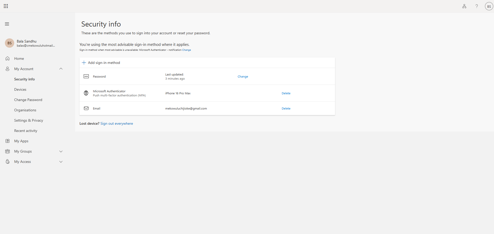
*Security info as Bala Sandhu — Email mekowuluchijioke@gmail.com registered; Microsoft Authenticator and Password also listed.*

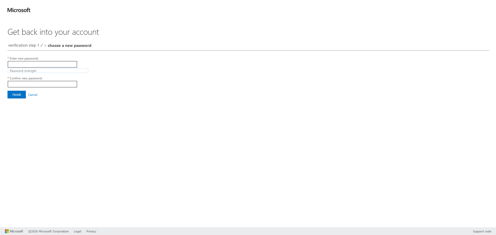
*Get back into your account — verification step 1 done, choose a new password, Finish.*
