# Project 4 — New Employee Access with Microsoft Entra ID and RBAC

Set up least-privilege access for a new employee the way an IT team actually does it: a user account, a security group, and one role assignment — then signed in as the employee to prove exactly what they could and could not do.

## What was built

- Resource group **rg-gp-access-model** with storage account **stgpaccessmodelcpm10**
- Security group **gp-rg-readers** (Security type, Assigned membership — members are added manually by an admin)
- User **Alex Guided Project** (alexgp@cmekowuluhotmail.onmicrosoft.com), added to the group
- **Reader** role assigned to the *group* at resource-group scope, so access is inherited by members
- **Temporary Access Pass** enabled and issued for Alex's first sign-in

## How it was validated

- **Check access** showed Alex's effective Reader access, inherited through the group — no direct assignment.
- The Activity Log held the "Create role assignment" audit entry for the change.
- Signed in as Alex: the resource group was viewable (read access works), and creating a storage account was denied with **AuthorizationFailed** (least privilege holds).
- All resources were deleted after the lab (cleanup confirmed).

## What this demonstrates

- Provisioning users and security groups in Microsoft Entra ID
- Group-based RBAC: assign roles to groups, not individuals, at the correct scope
- Verifying effective permissions with Check access before sign-in testing
- Passwordless onboarding with Temporary Access Pass, and audit awareness via the Activity Log

## Screenshots

### Exercise 1 — Create the user and group

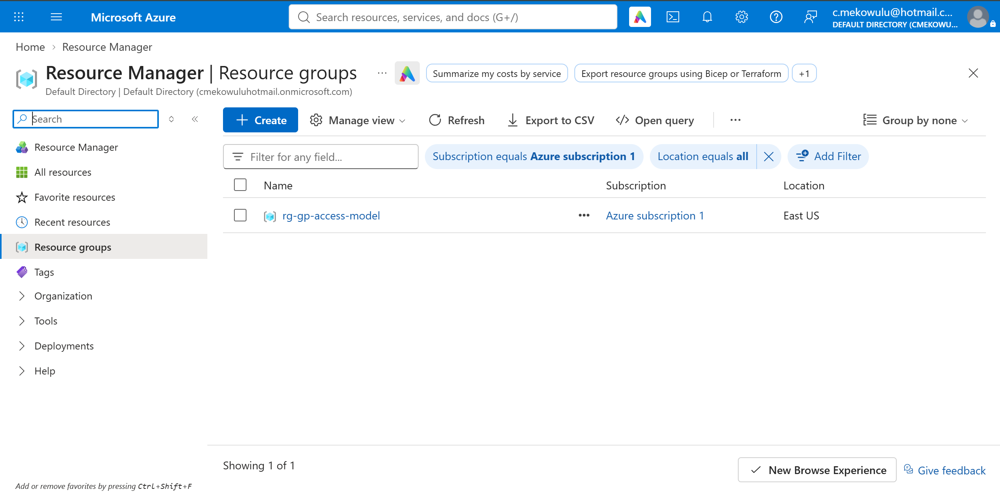
*Resource group rg-gp-access-model.*

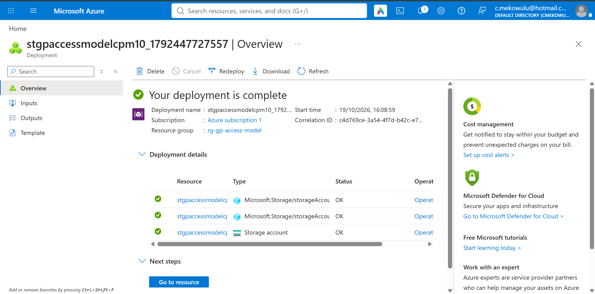
*Test storage account stgpaccessmodelcpm10 — part 1.*

*Storage account overview — part 2.*

*Security group gp-rg-readers created.*

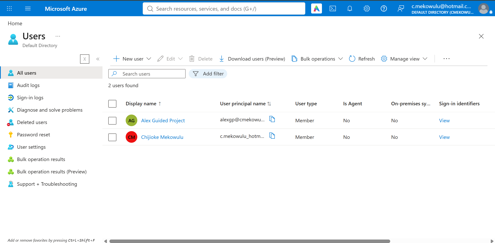
*User Alex Guided Project created.*

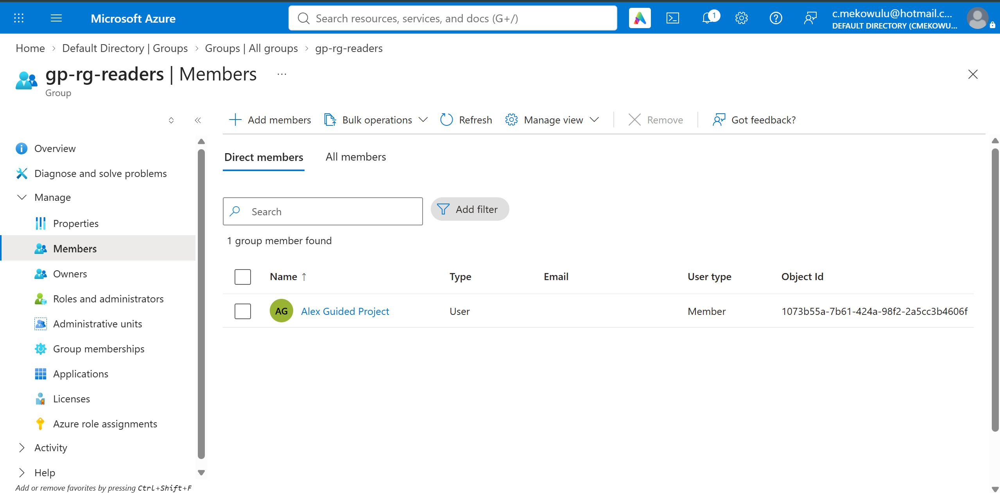
*Alex added to gp-rg-readers.*

### Exercise 2 — Assign the RBAC role at scope

*Reader role assignment to the group — review page.*

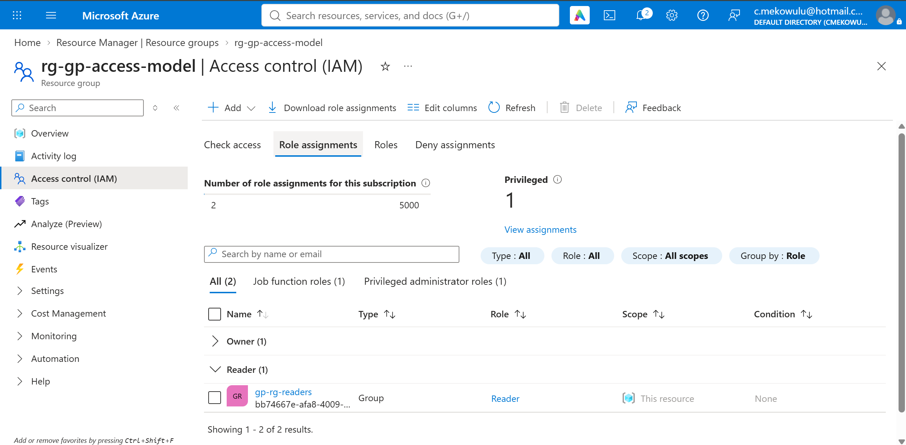
*Role assignments tab showing the group assignment at resource-group scope.*

### Exercise 3 — Verify the least-privilege model

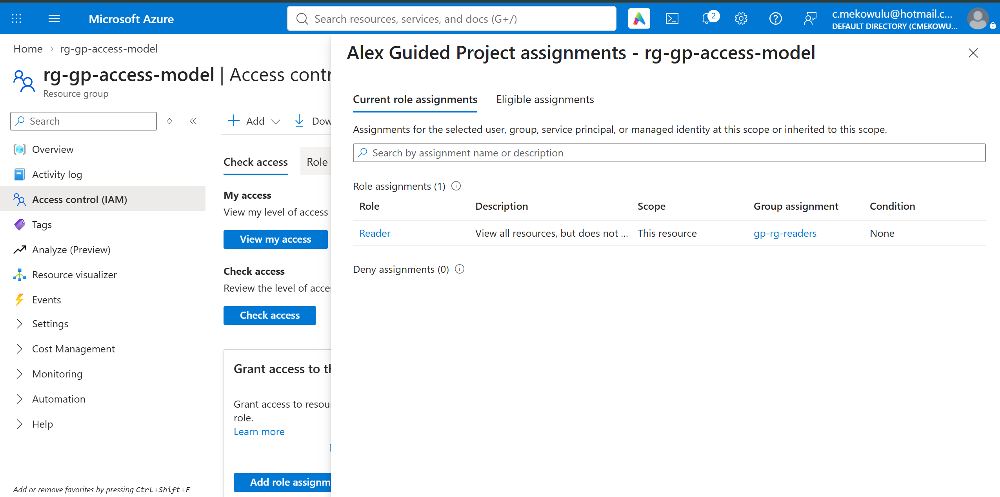
*Check access — Alex's effective permissions, inherited through the group.*

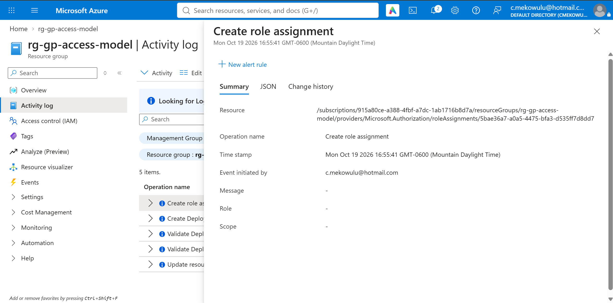
*Activity Log — "Create role assignment" audit entry.*

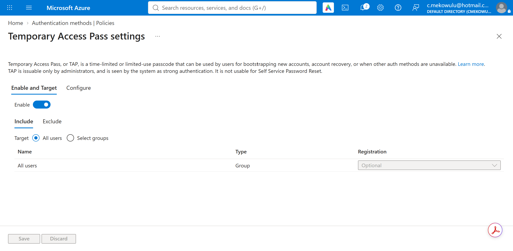
*Temporary Access Pass enabled in the authentication methods policy.*

*Temporary Access Pass issued for Alex (details pane shows the validity window only — no passcode is screenshotted).*

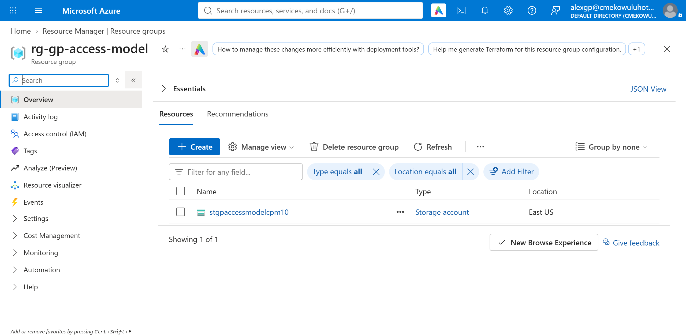
*Signed in as Alex — the resource group is visible; read access works.*

*Signed in as Alex — storage account creation denied (AuthorizationFailed).*

### Exercise 4 — Assign licenses to users (AZ-104 extension, Nov 17, 2026)

Group-based licensing in the same tenant: a new user, a security group, and an Entra ID P2 license assigned to the group through the Microsoft 365 admin center.

- User **Chris Green** (ChrisG@cmekowuluhotmail.onmicrosoft.com) created in the Microsoft Entra admin center
- Security group **Marketing** (Security type, Assigned membership, owner the administrator account, member Chris Green; Object Id fa909d91-d55b-4258-ab55-93d8a62c8a77)
- License **Microsoft Entra ID P2** — 100 available in the tenant, 0 assigned before the exercise, 1/100 assigned after
- The restore/recently-deleted-user part of the exercise page is reading only (30-day restore window; restore needs Global administrator, Partner Tier-1/2 Support or User administrator) — no deletion or restore performed

*All users list — Chris Green created (3 users in the tenant).*

*New Group form: Security, Marketing, Assigned, 1 owner and 1 member selected.*

*All groups list — Marketing, Security, Assigned.*

*Microsoft 365 admin center Licenses — Microsoft Entra ID P2, 100 available, 0/100 assigned.*

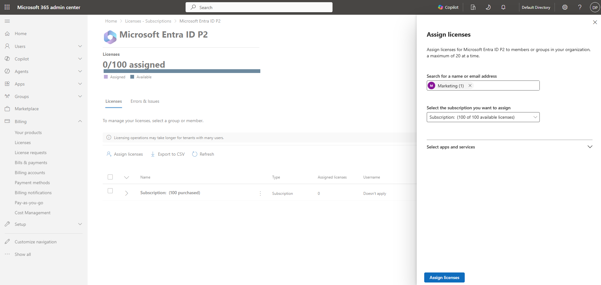
*Assign licenses dialog — Marketing selected, 100 of 100 available.*

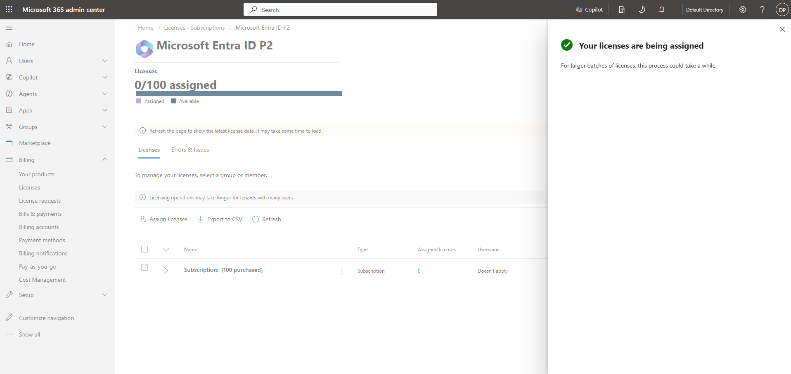
*"Your licenses are being assigned" — success message.*

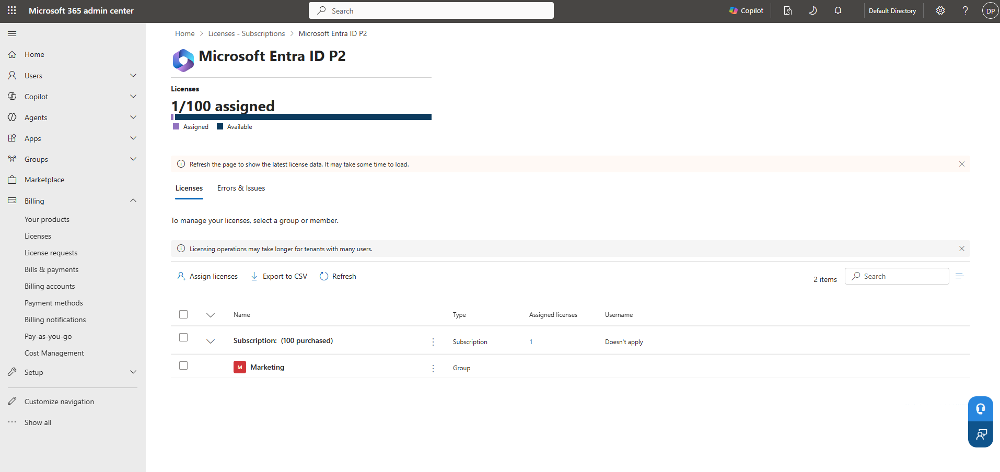
*License details — 1/100 assigned, Marketing group listed as the assignee.*

### Exercise 5 — Restore or remove deleted users (AZ-104 extension, Nov 17, 2026)

Deleted user Chris Green and restored him through the 30-day soft-delete window — then verified him back in the tenant with his original user principal name.

- Deleted **Chris Green** from the All users list ("Delete the selected users?" confirmed)
- Found him in the **Deleted users** list: deleted 17 Nov 2026, 14:26; permanent deletion scheduled 17 Dec 2026, 14:26
- Restored him ("Restore user(s)?" confirmed) and verified him back in **All users** with his original UPN — tenant back to 3 users
- Finding: **Alex Guided Project** from the original Project 4 work is still in the Deleted users list too — deleted 19 Oct 2026, permanent deletion due 18 Nov 2026. The page banner confirms users are permanently deleted automatically 30 days after deletion.

*All users list — Chris Green's checkbox selected (1 user selected).*

*"Delete the selected users?" confirmation dialog.*

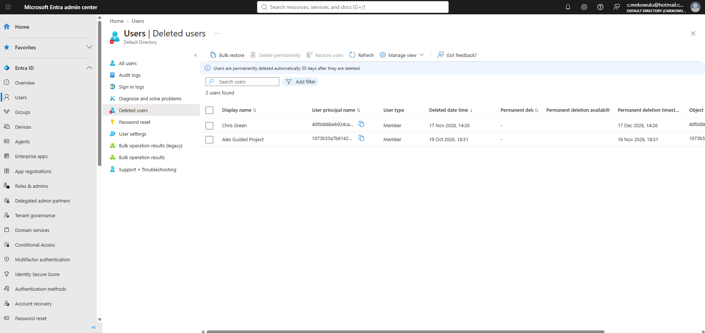
*Deleted users list — Chris Green deleted 17 Nov 2026, 14:26, permanent deletion 17 Dec 2026; Alex Guided Project deleted 19 Oct 2026, permanent deletion 18 Nov 2026.*

*"Restore user(s)?" dialog, Chris Green selected.*

*All users list after restore — Chris Green back with his original UPN.*

### Exercise 6 — Add groups in Microsoft Entra ID (AZ-104 extension, Nov 17, 2026)

Created a **Microsoft 365 group** named **Northwest Sales** — the other group type, alongside the Marketing security group from Exercise 4.

- Group type **Microsoft 365**, name **Northwest Sales**, group email address NorthwestSales@cmekowuluhotmail.onmicrosoft.com, description "Group containing members of the sales team in Northwest region"
- Membership type **Assigned**, 1 owner (the administrator account) and 1 member selected
- Verified in the **All groups** list: 2 groups — Marketing (Security, Assigned, Object Id fa909d91-d55b-4258-ab55-93d8a62c8a77) and Northwest Sales (Microsoft 365, Assigned, Object Id 8e5327d9-4bf4-40e9-aa6e-527080a4f0d2)
- Contrast with the security group: a Microsoft 365 group also gets a mailbox address and the collaboration backing behind it.

*New Group page — Microsoft 365, Northwest Sales, Assigned, 1 owner and 1 member selected.*

*All groups list — Marketing (Security) and Northwest Sales (Microsoft 365) side by side.*
