# Project 4 — New Employee Access with Microsoft Entra ID and RBAC

Set up least-privilege access for a new employee the way an IT team actually does it: a user account, a security group, and one role assignment — then signed in as the employee to prove exactly what they could and could not do.

## What was built

- Resource group **rg-gp-access-model** with storage account **stgpaccessmodelcpm10**
- Security group **gp-rg-readers** (Security type, Assigned membership — members are added manually by an admin)
- User **Alex Guided Project** (alexgp@cmekowuluhotmail.onmicrosoft.com), added to the group
- **Reader** role assigned to the *group* at resource-group scope, so access is inherited by members
- **Temporary Access Pass** enabled and issued for Alex's first sign-in

## How it was validated

- **Check access** showed Alex's effective Reader access, inherited through the group — no direct assignment.
- The Activity Log held the "Create role assignment" audit entry for the change.
- Signed in as Alex: the resource group was viewable (read access works), and creating a storage account was denied with **AuthorizationFailed** (least privilege holds).
- All resources were deleted after the lab (cleanup confirmed).

## What this demonstrates

- Provisioning users and security groups in Microsoft Entra ID
- Group-based RBAC: assign roles to groups, not individuals, at the correct scope
- Verifying effective permissions with Check access before sign-in testing
- Passwordless onboarding with Temporary Access Pass, and audit awareness via the Activity Log

## Screenshots

### Exercise 1 — Create the user and group

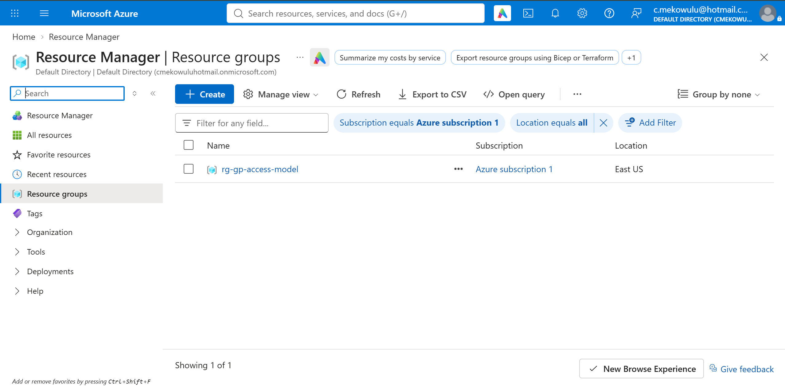
*Resource group rg-gp-access-model.*

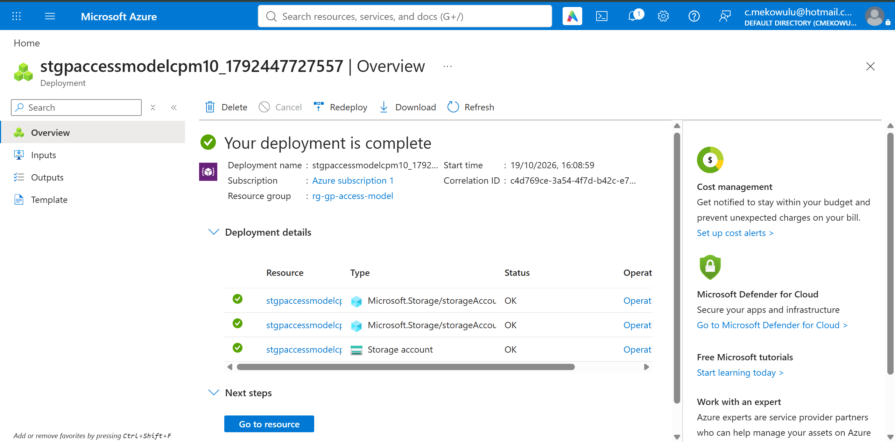
*Test storage account stgpaccessmodelcpm10 — part 1.*

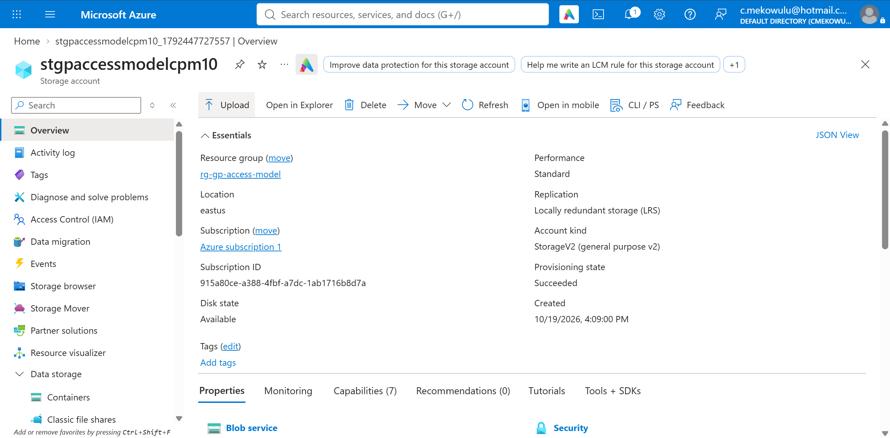
*Storage account overview — part 2.*

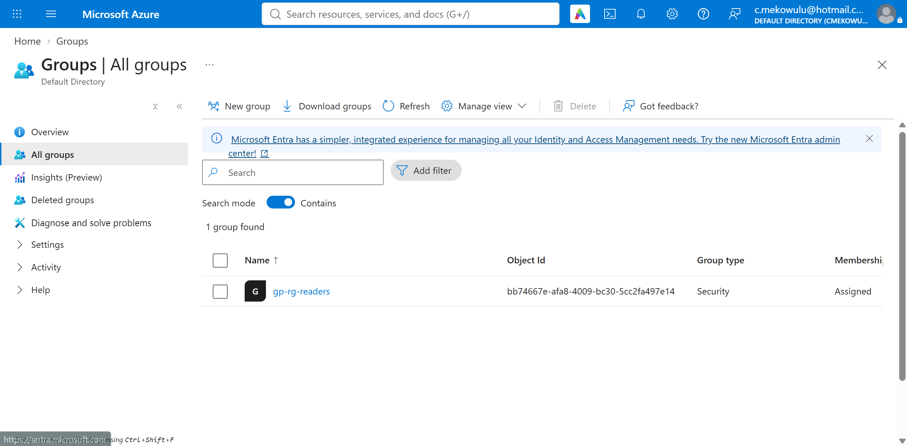
*Security group gp-rg-readers created.*

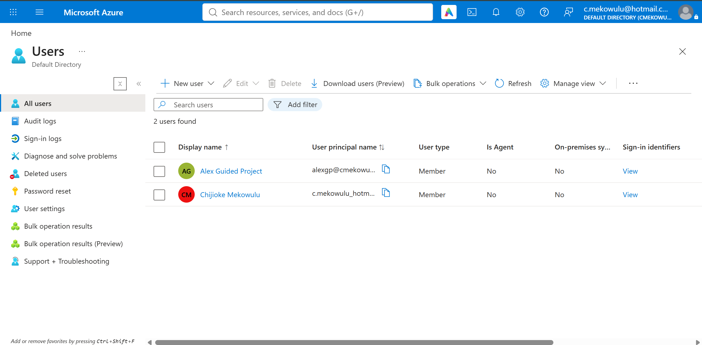
*User Alex Guided Project created.*

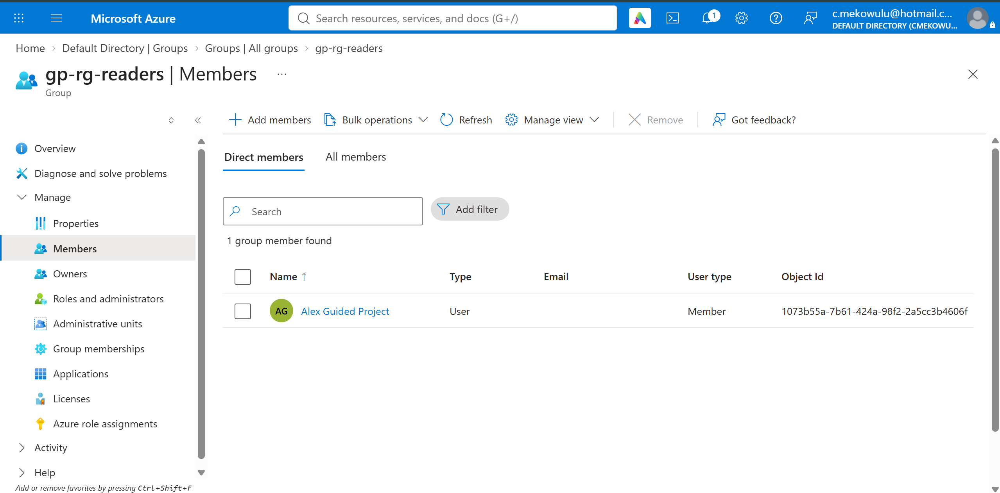
*Alex added to gp-rg-readers.*

### Exercise 2 — Assign the RBAC role at scope

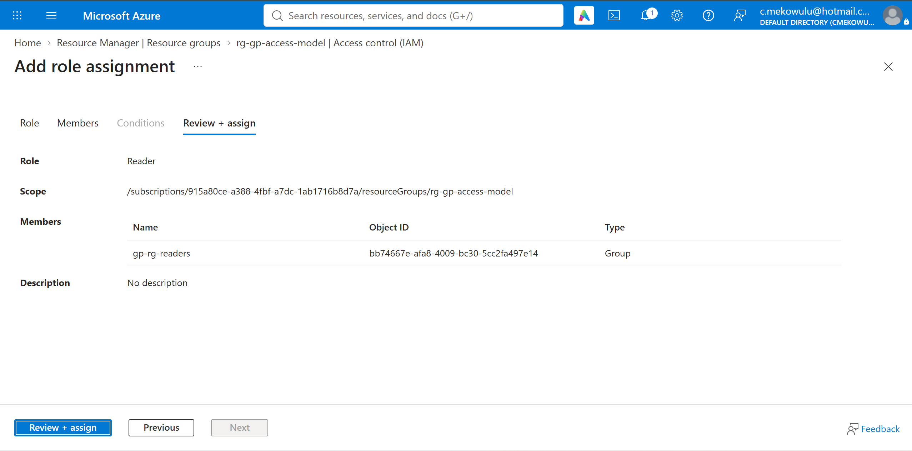
*Reader role assignment to the group — review page.*

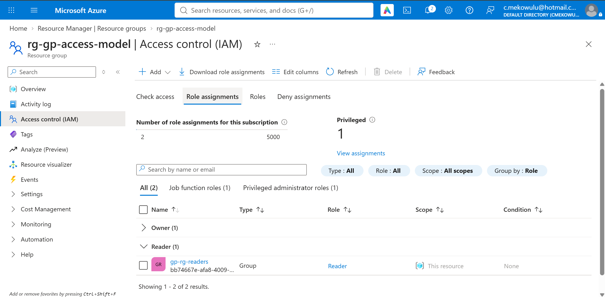
*Role assignments tab showing the group assignment at resource-group scope.*

### Exercise 3 — Verify the least-privilege model

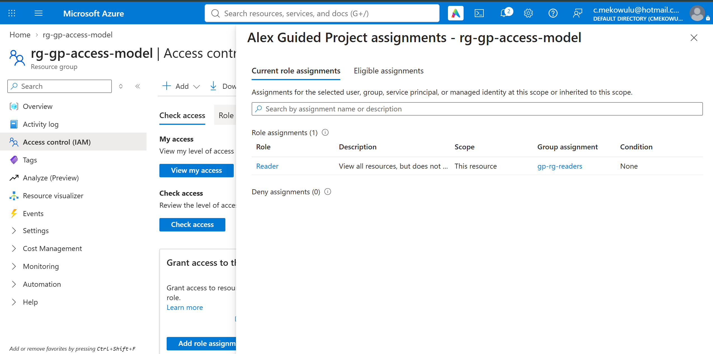
*Check access — Alex's effective permissions, inherited through the group.*

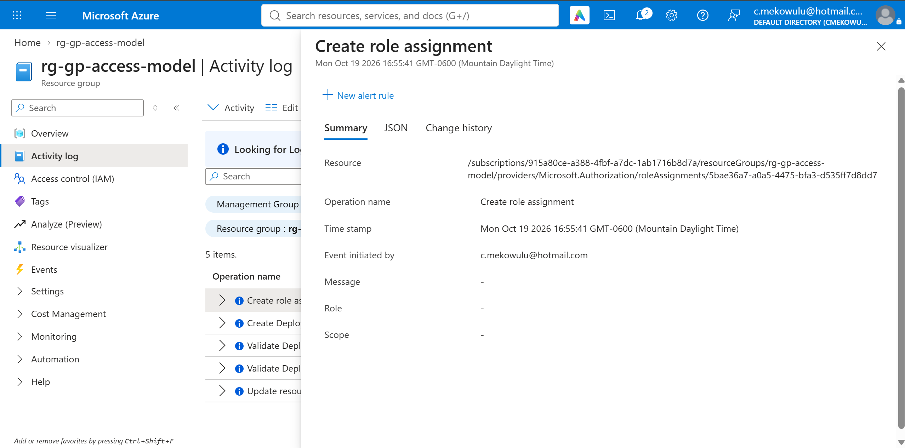
*Activity Log — "Create role assignment" audit entry.*

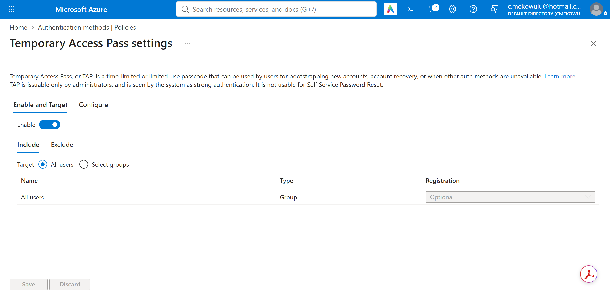
*Temporary Access Pass enabled in the authentication methods policy.*

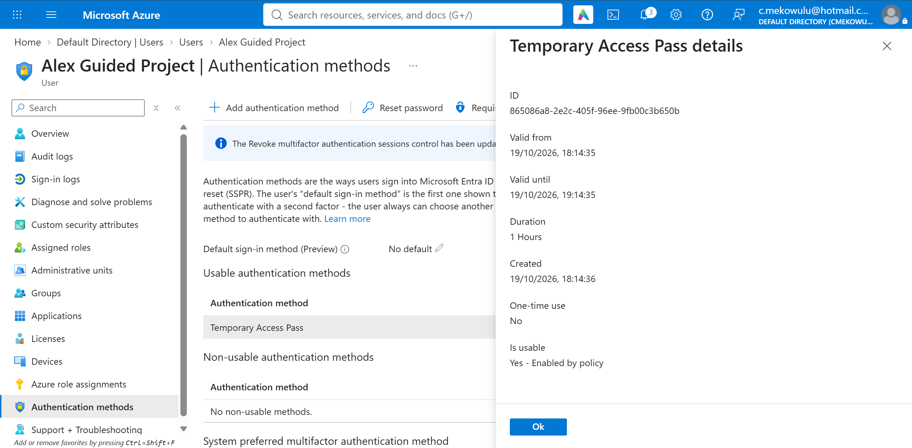
*Temporary Access Pass issued for Alex (details pane shows the validity window only — no passcode is screenshotted).*

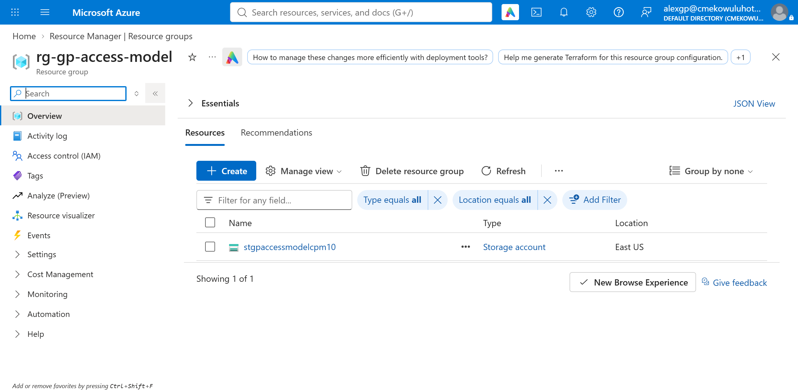
*Signed in as Alex — the resource group is visible; read access works.*

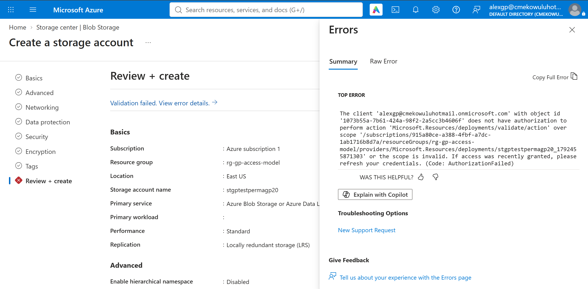
*Signed in as Alex — storage account creation denied (AuthorizationFailed).*
