# Project 5 — Secure File Sharing with SAS Tokens and Lifecycle Management

Shared a file with an external partner without giving them an account or making anything public: a private container, a time-limited SAS controlled by a stored access policy, and revocation by deleting the policy — plus a lifecycle rule to clean up shared files automatically.

## What was built

- Resource group **rg-gp-file-exchange**
- Storage account **stgpfilexchgcpm12** with a **private** container, **partner-drop**
- `monthly-report.txt` uploaded to the container
- Stored access policy **partner-read-policy** — Read only, roughly a one-hour window
- A SAS token generated from the policy (permissions and expiry are greyed out in the SAS form because the policy controls them)
- Lifecycle management rule **delete-shared-files** — blobs under `partner-drop/` are deleted when last modified more than 30 days ago

## How it was validated (tested in an Incognito window)

- The file's direct URL was denied: **PublicAccessNotPermitted** — the container is genuinely private.
- The SAS URL rendered the file — partner access works.
- The stored access policy was deleted, and the *same* SAS URL then failed with **AuthenticationFailed** ("SAS identifier cannot be found for specified signed identifier") — access revoked without touching the file, which remained intact.
- The lifecycle rule was confirmed in place with its Base blobs and Filter set configuration.
- All resources were deleted after the lab (cleanup confirmed). The stored access policy and resource group are gone, so the SAS used in the lab is retired regardless; as captured, the browser also truncated the SAS URLs in the screenshots, so no signature value is legible.

## What this demonstrates

- Private-by-default storage design for external file sharing
- Stored access policies as the control point for SAS tokens — one deletion revokes every token issued from the policy
- Time-boxed, read-only, least-privilege sharing links
- Lifecycle management for automatic retention cleanup

## Screenshots

### Exercise 1 — Create storage and upload the file

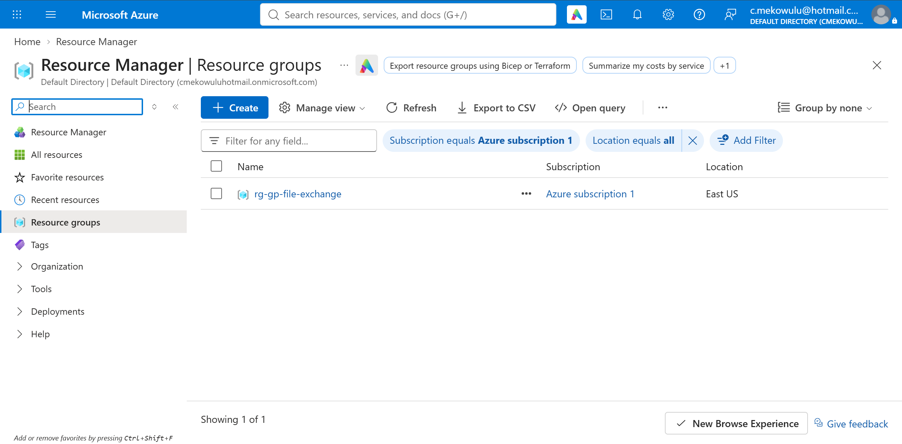
*Resource group rg-gp-file-exchange.*

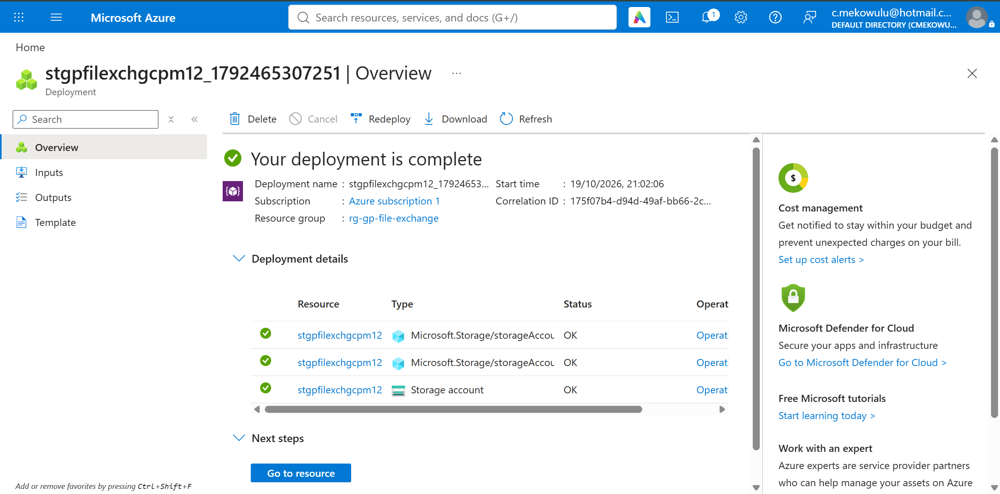
*Storage account deployment complete.*

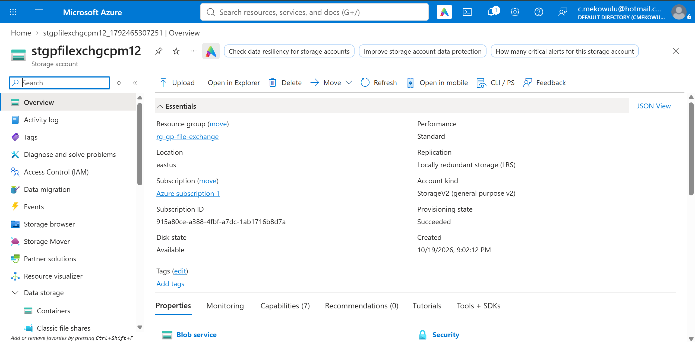
*Storage account stgpfilexchgcpm12 — overview.*

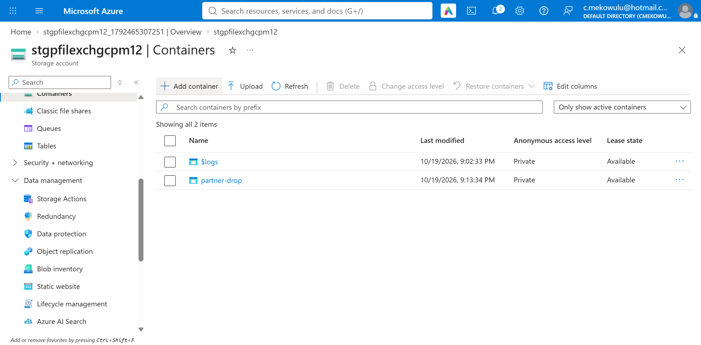
*Private container partner-drop created.*

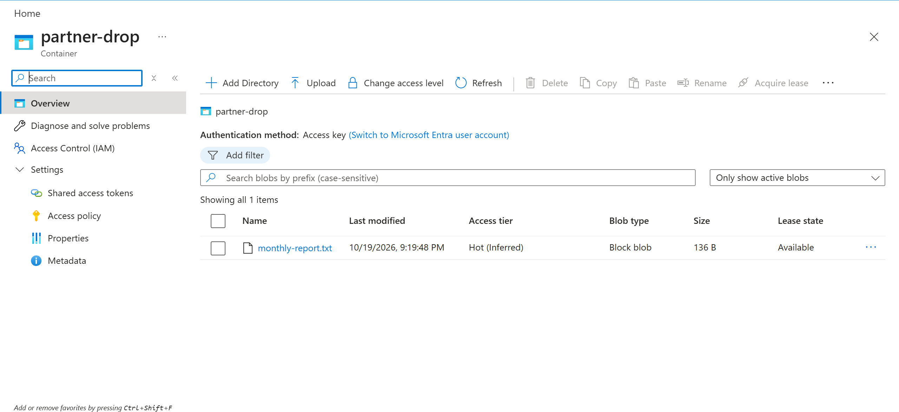
*monthly-report.txt uploaded to partner-drop.*

### Exercise 2 — Create an access policy and generate a SAS link

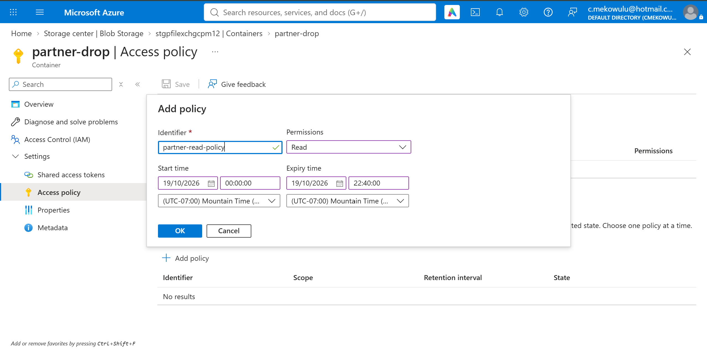
*Stored access policy form — partner-read-policy, Read only.*

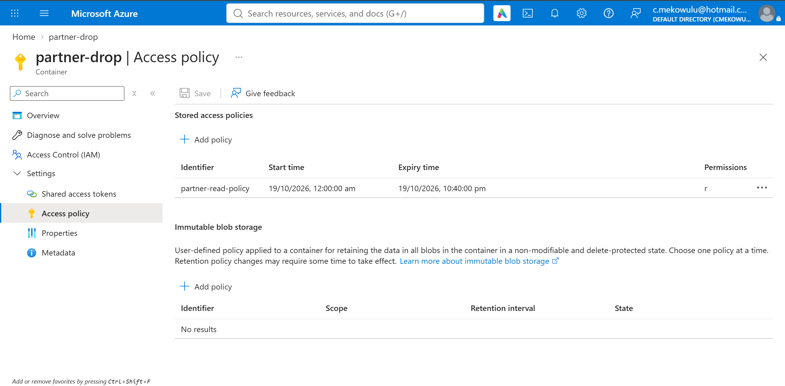
*Access policy saved on the container.*

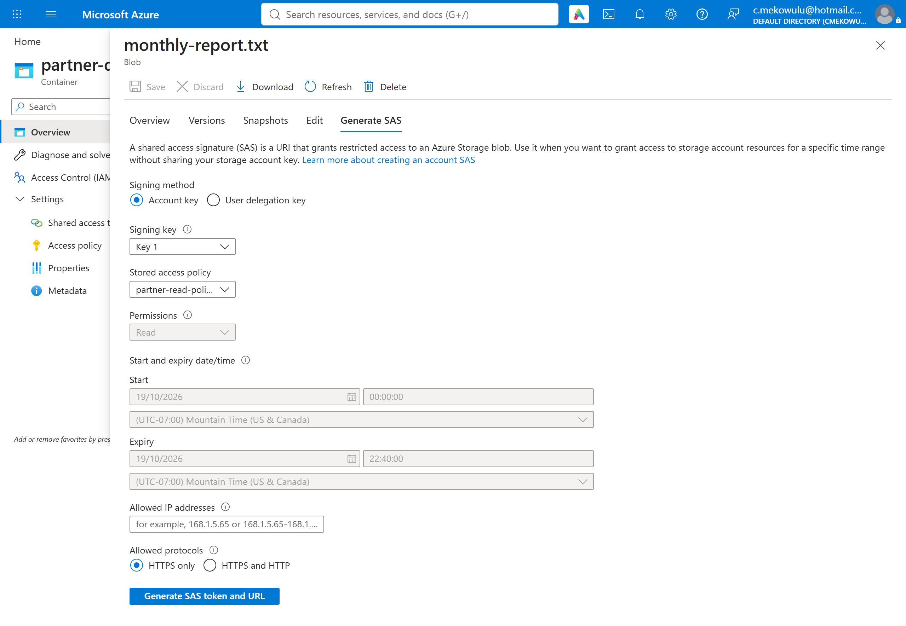
*SAS generated from the stored access policy — permissions and expiry are policy-controlled.*

### Exercise 3 — Test partner access behaviour

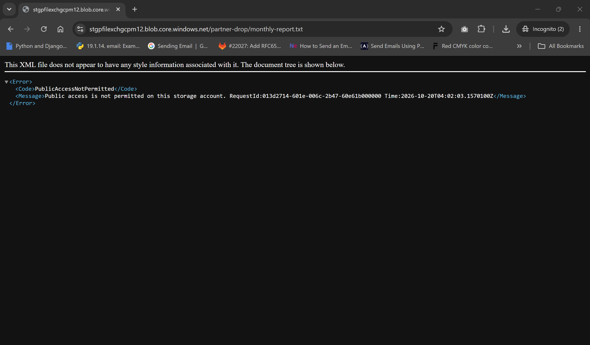
*Direct URL in an Incognito window — access denied (PublicAccessNotPermitted).*

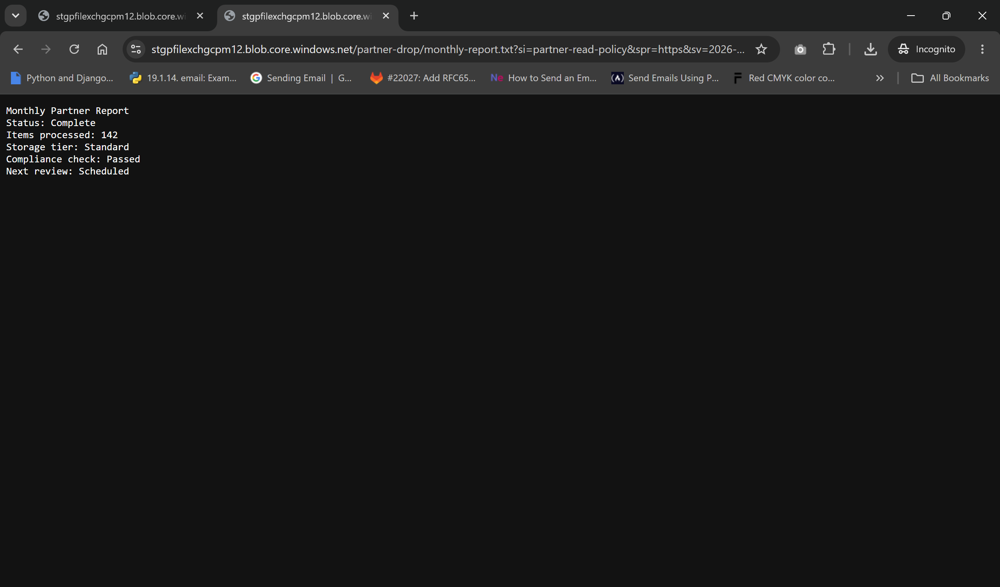
*SAS URL in an Incognito window — the report file renders.*

### Exercise 4 — Revoke partner access

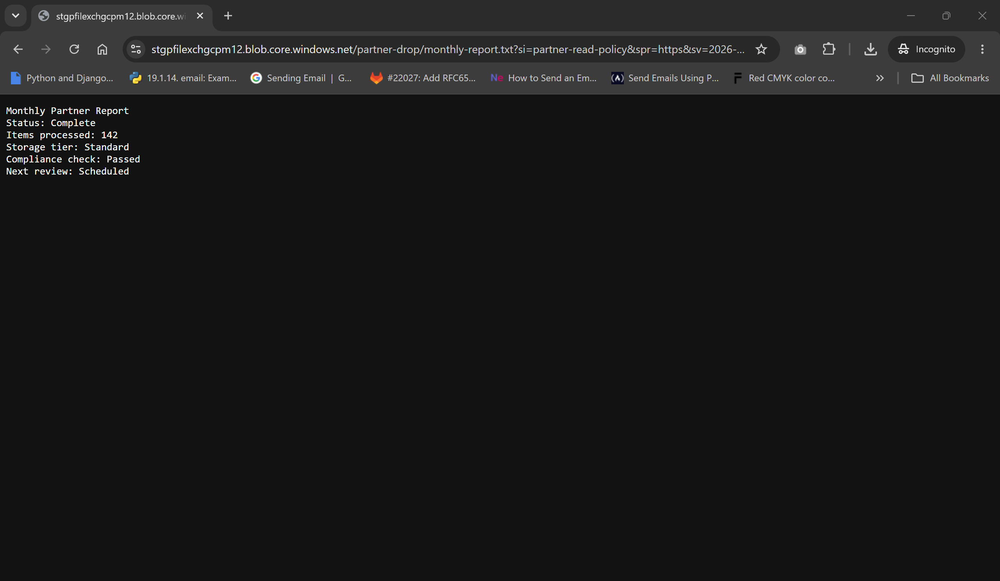
*SAS link confirmed working before revocation.*

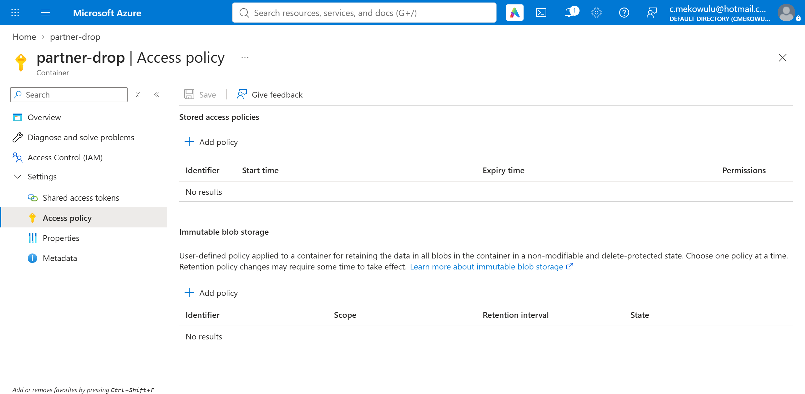
*Stored access policy deleted.*

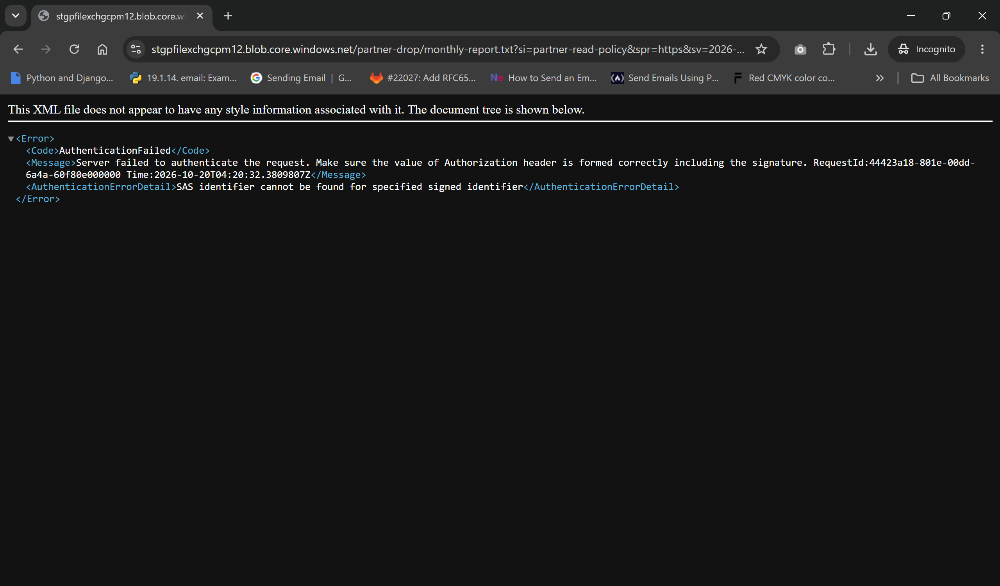
*The same SAS URL after policy deletion — AuthenticationFailed; access revoked.*

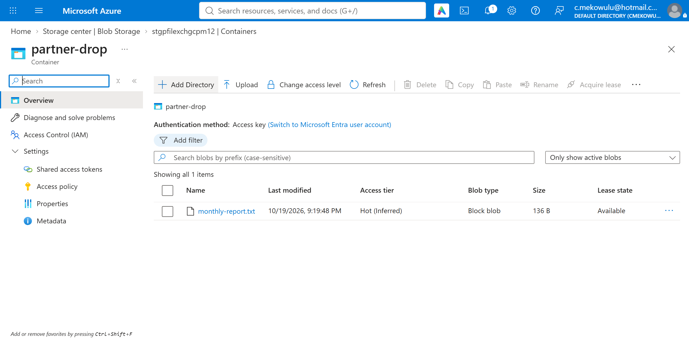
*The file itself is untouched after revocation.*

### Exercise 5 — Configure lifecycle management

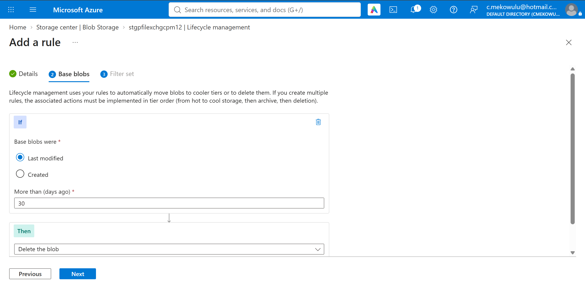
*Lifecycle rule — Base blobs tab (delete when last modified over 30 days ago).*

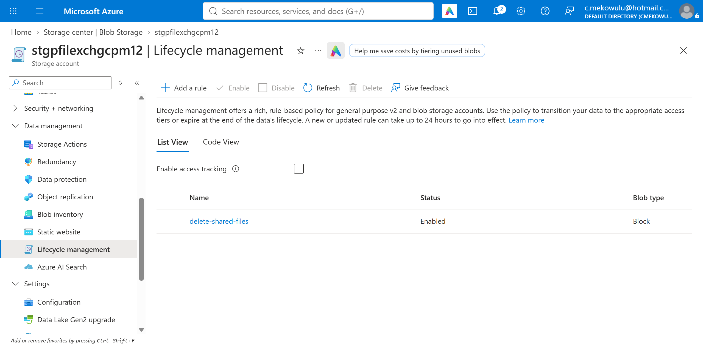
*Lifecycle rules list — delete-shared-files present.*

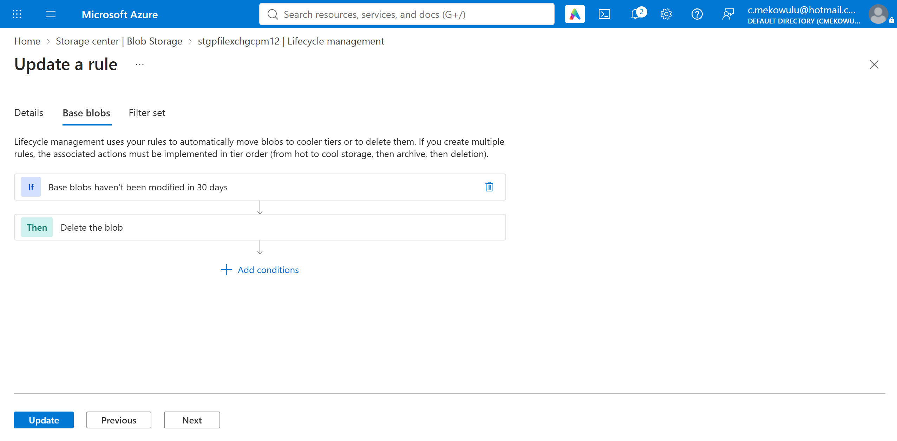
*Rule detail — Base blobs settings.*

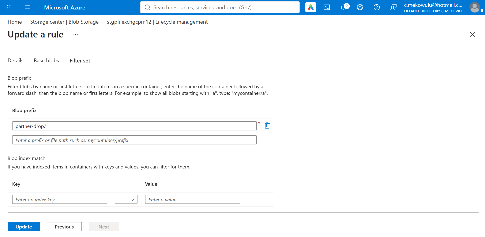
*Rule detail — Filter set, prefix partner-drop/.*
