# Project 6 — Cost Guardrails with Budgets and Azure Policy

Put two guardrails around a pilot project: a budget that warns before spend runs away, and a policy that flatly prevents resources from being created in the wrong region.

## What was built

- Resource group **rg-gp-cost-guardrails**
- Storage account **stgpcostguardcpm11** (East US)
- Cost-tracking tags **environment: pilot** and **owner: it-team**, applied at both resource group and resource level
- Budget **gp-pilot-budget** — $10/month, with actual-cost alerts at **80% (US$8)** and **100% (US$10)** sent to an email recipient
- Azure Policy **Allowed locations** assigned at resource-group scope — **eastus** only, Deny effect

## How it was validated

- A test storage account (**stgppolicytestcpm49**) targeted at **West US 2** was denied at validation — the policy blocked it before creation.
- The same creation in **East US** succeeded.
- Policy compliance showed **100% (1 of 1 resource compliant)**.
- All resources were deleted after the lab (cleanup confirmed).

## What this demonstrates

- Tagging standards that make cost reporting meaningful
- Budget thresholds and alert recipients in Azure Cost Management
- Preventive governance with Azure Policy (Deny effect at assignment scope)
- Reading compliance state to confirm a policy is doing its job

## Screenshots

### Exercise 1 — Apply cost-tracking tags

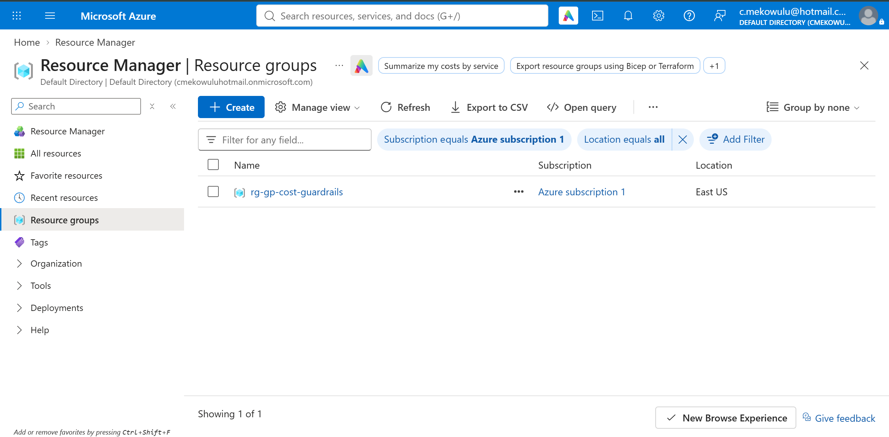
*Resource group rg-gp-cost-guardrails.*

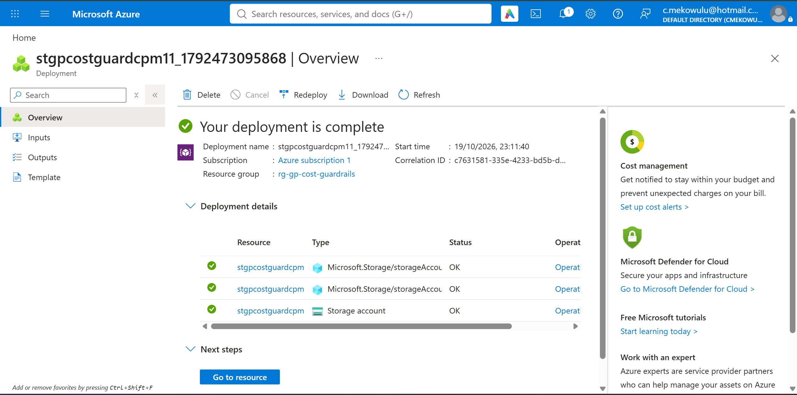
*Storage account deployment complete.*

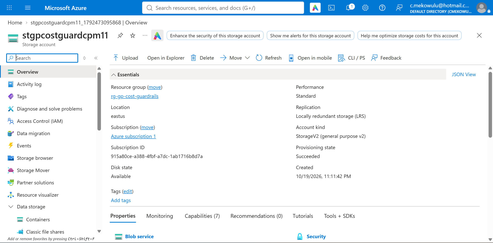
*Storage account stgpcostguardcpm11 — overview.*

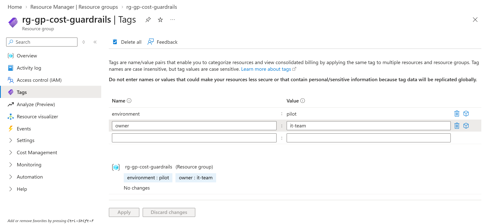
*Tags on the resource group — environment: pilot, owner: it-team.*

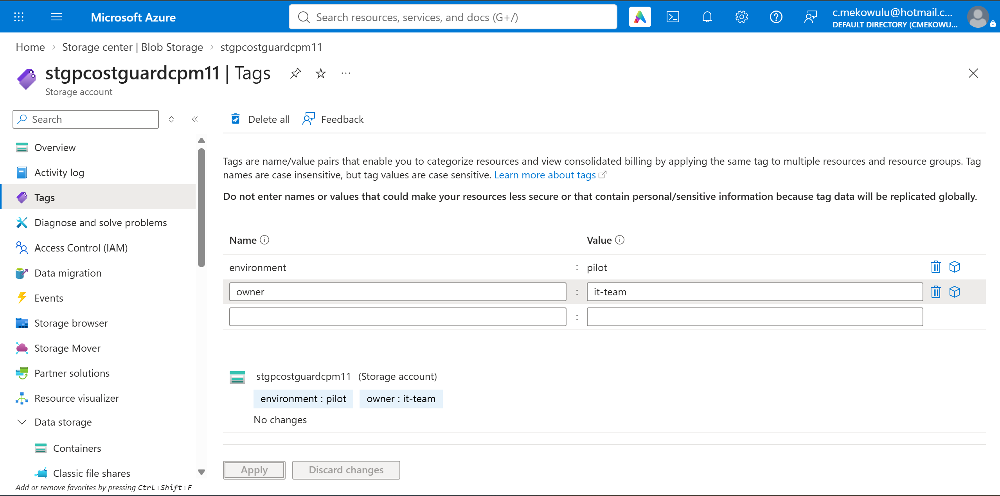
*The same tags applied on the storage account.*

### Exercise 2 — Create the budget and alerts

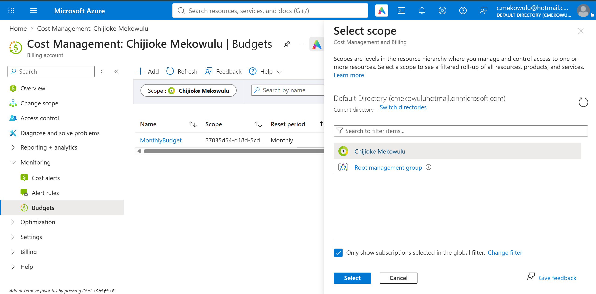
*Cost Management — budgets page.*

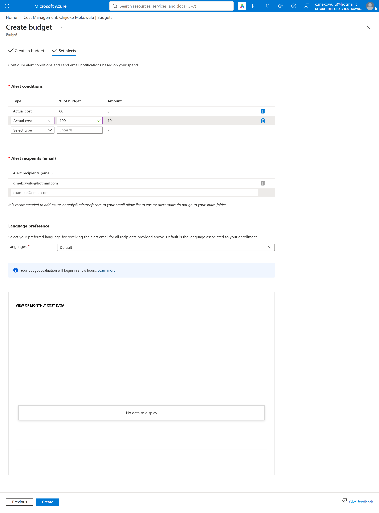
*Alert conditions — actual-cost alerts at 80% and 100%, with the email recipient set.*

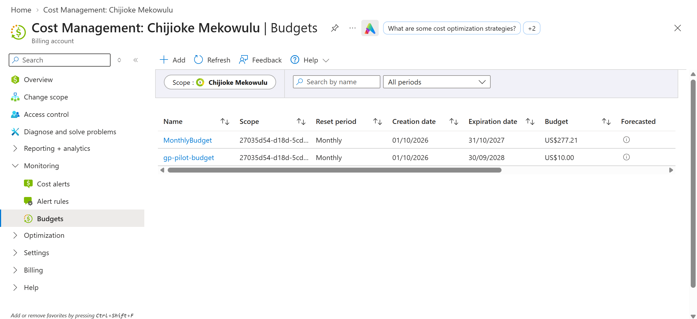
*Budget list — gp-pilot-budget, $10 monthly.*

### Exercise 3 — Assign and test an Azure Policy

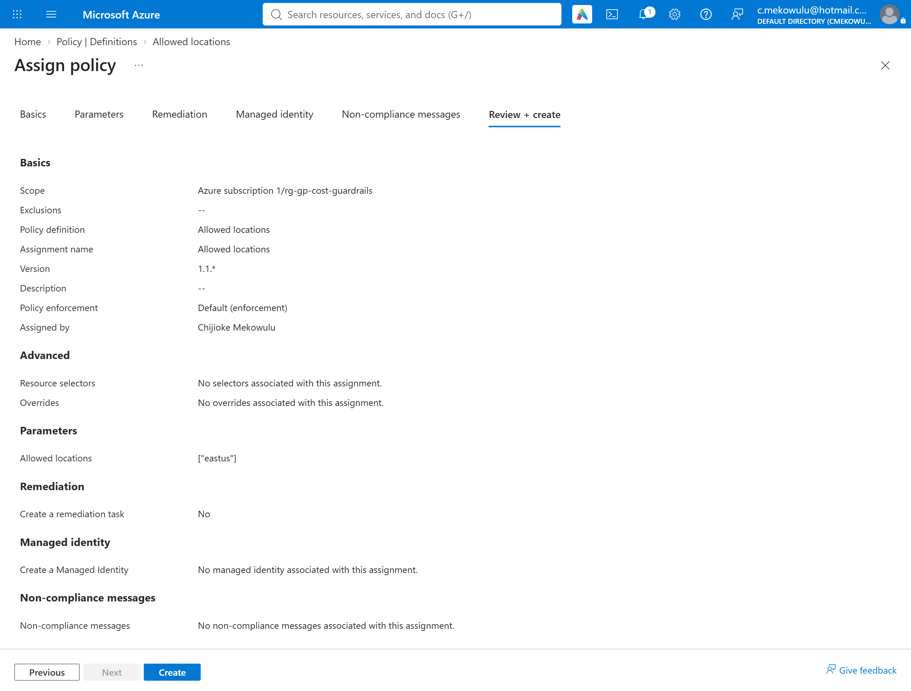
*Allowed locations policy assignment — review page.*

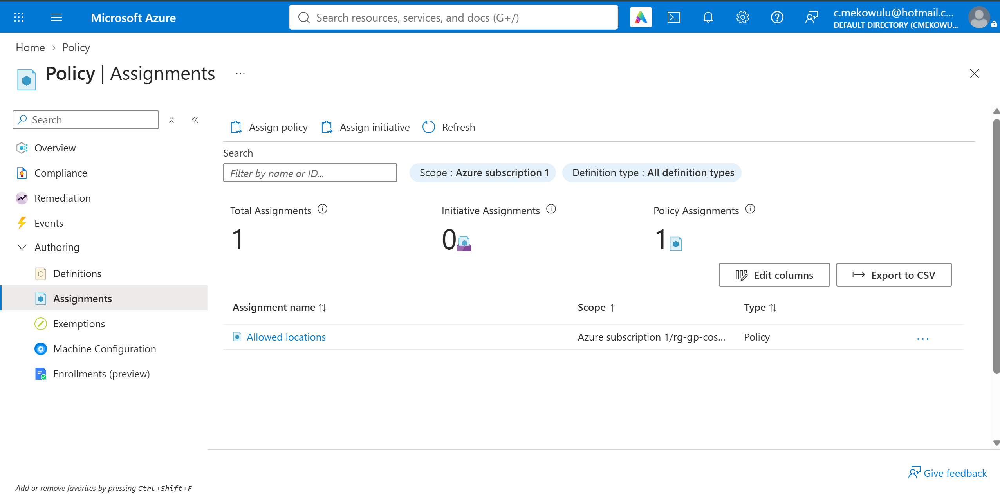
*Policy assignments list at resource-group scope.*

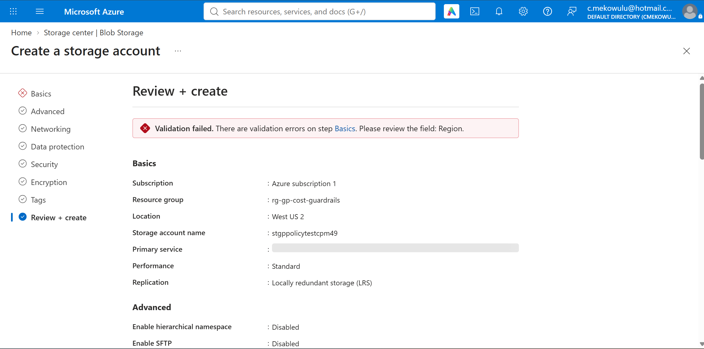
*Test storage account in West US 2 — creation denied at validation by the policy.*

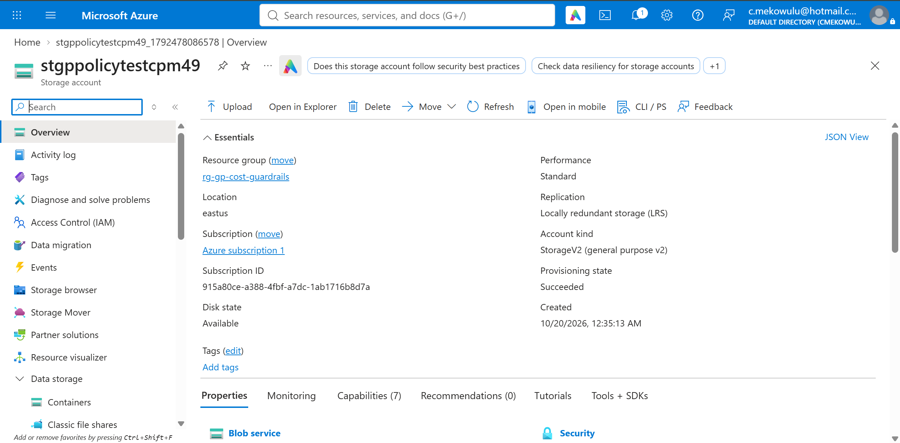
*The same creation in East US — validation passed, account created.*

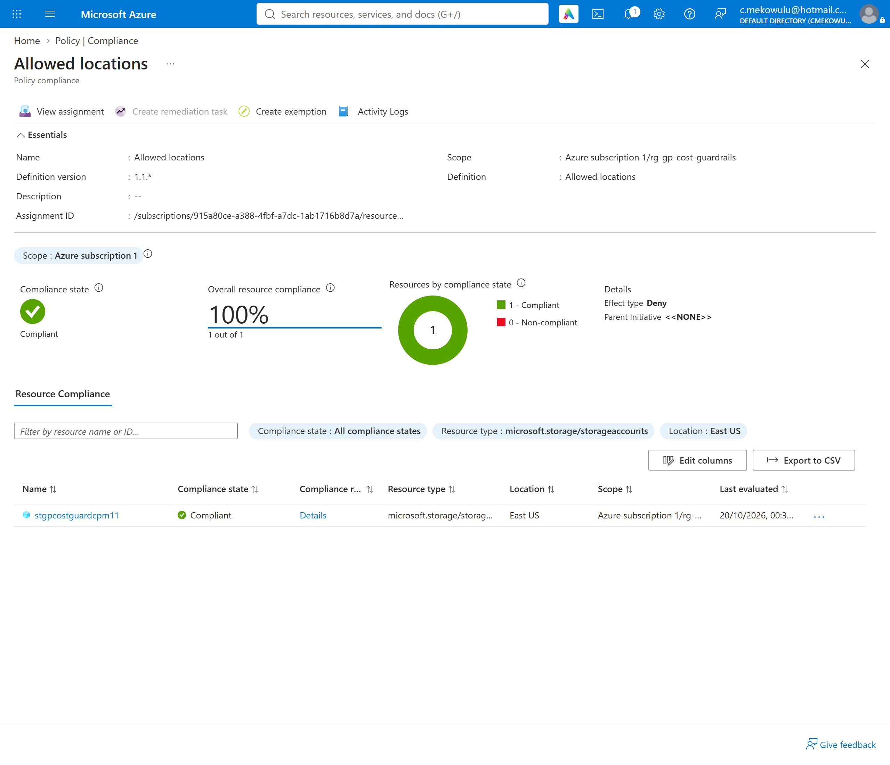
*Compliance details for Allowed locations — 100% (1 of 1).*
