# Project 7 — Monitoring with Service Health and Activity Log Alerts

Set up email alerting for two different failure modes: Azure platform incidents (Service Health) and someone deleting a resource group (Activity Log) — and diagnosed a real location gotcha along the way.

## What was built

- Resource group **rg-gp-monitoring-alerts**
- Action group **ag-gp-ops-email** (short name **OpsEmail**) with an email receiver, **ops-team-email** → c.mekowulu@yahoo.com; the test notification succeeded and the email arrived
- Service Health alert **ar-gp-service-health** — event types Service issue and Planned maintenance, subscription scope
- Activity Log alert **ar-gp-activity-delete** — Category = Administrative, Operation = "Delete Resource Group", resource-group scope
- Both alert rules **Enabled**, with the action group attached

## Troubleshooting highlight: the action group that wasn't there

The action group was first created through the portal — and then simply did not appear in the Service Health alert's action-group picker, even though the subscription matched.

Working the problem through the Azure CLI surfaced the cause step by step: `--action-group` isn't a parameter of `az monitor activity-log alert update`; the property path for attaching an action is the rule's top-level `actions`, not `properties.actions`; and adding to an empty list needs `--add`, not `--set ...[0]`. With the syntax sorted, the API returned the real answer: **ServiceHealthRuleActionGroupLocationIsNotGlobal**.

Root cause: the portal had created the action group in **East US**, and Service Health alert rules only accept action groups whose location is **Global**. Fix: delete the action group and recreate it from the CLI with `--location global` (same name and resource group, so the resource ID stayed the same), re-run the test (Success, email received), and the group then appeared in the portal picker normally and was attached to both rules.

## An honest note on severity

The lab guidance mentioned setting "Sev 2 – Warning" on the Activity Log alert. Activity Log alert rules have no severity property — the rule's full property list (actions, condition, description, enabled, scopes, tags) confirms it; severity belongs to other alert types. No severity is claimed for that rule here.

## How it was validated

- Action group test returned Success and the notification email was received.
- Both alert rules are listed as Enabled with ag-gp-ops-email attached, and each rule's detail page confirms its scope and condition.
- All resources were deleted after the lab (cleanup confirmed).

## What this demonstrates

- Action groups as the reusable notification layer for Azure Monitor alerts
- Service Health alerts vs. Activity Log alerts — platform events vs. control-plane operations
- Methodical CLI troubleshooting: reading API errors instead of guessing
- Knowing the limits of a feature (Global-location requirement; no severity on Activity Log alerts) and documenting them accurately

## Screenshots

### Exercise 1 — Create an action group

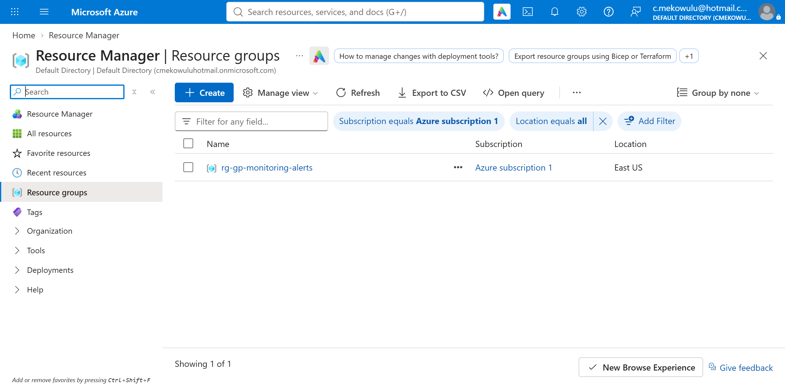
*Resource group rg-gp-monitoring-alerts.*

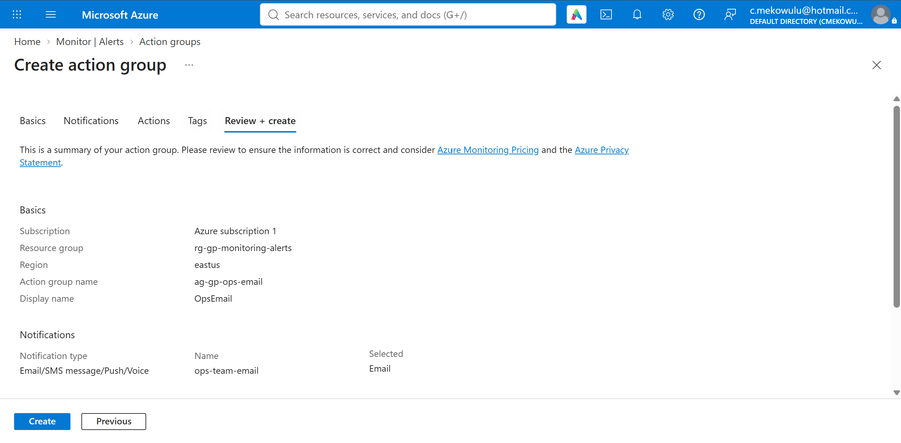
*Action group ag-gp-ops-email — review page.*

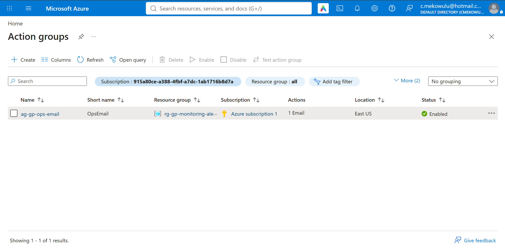
*Action groups list — ag-gp-ops-email.*

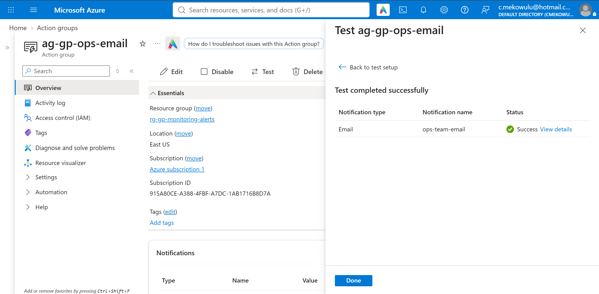
*Action group test — Success status.*

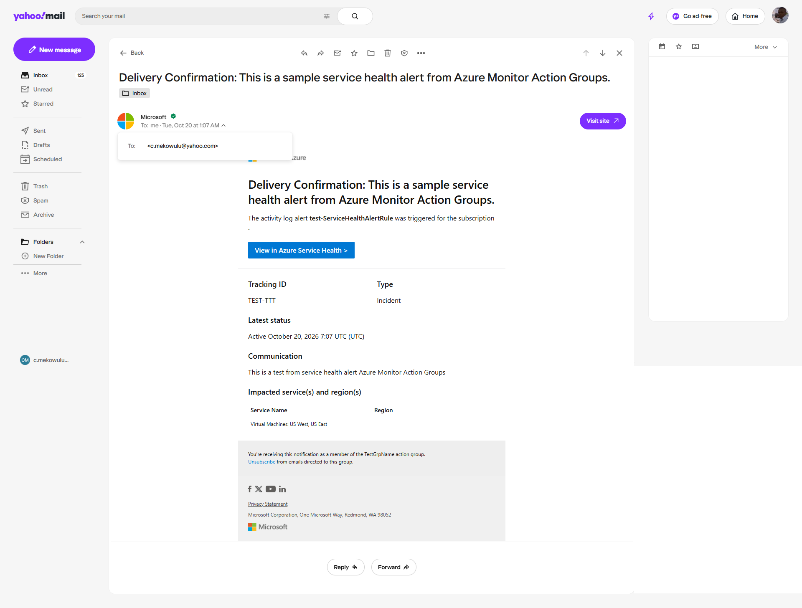
*Test notification received in the email inbox.*

### Exercise 2 — Create a Service Health alert

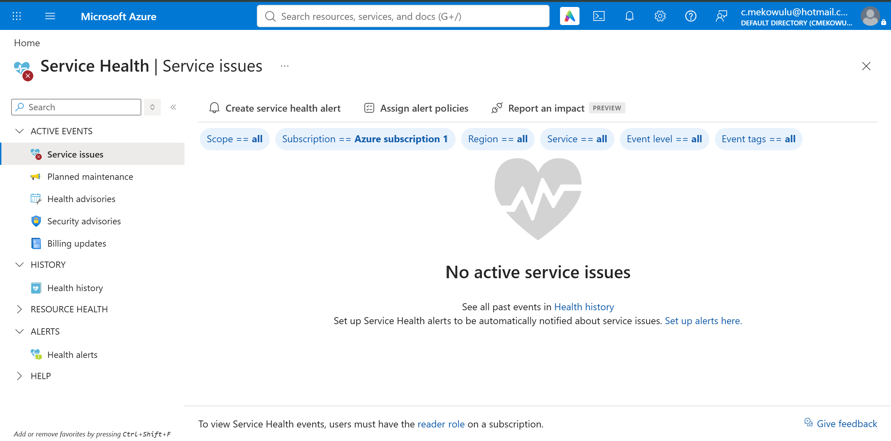
*Service Health — service issues view.*

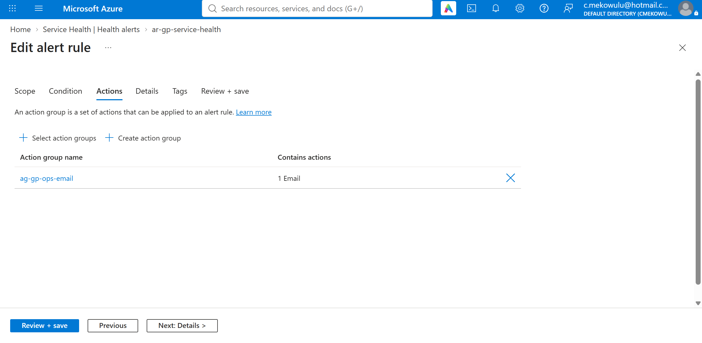
*Service Health alert — actions tab, action group attached.*

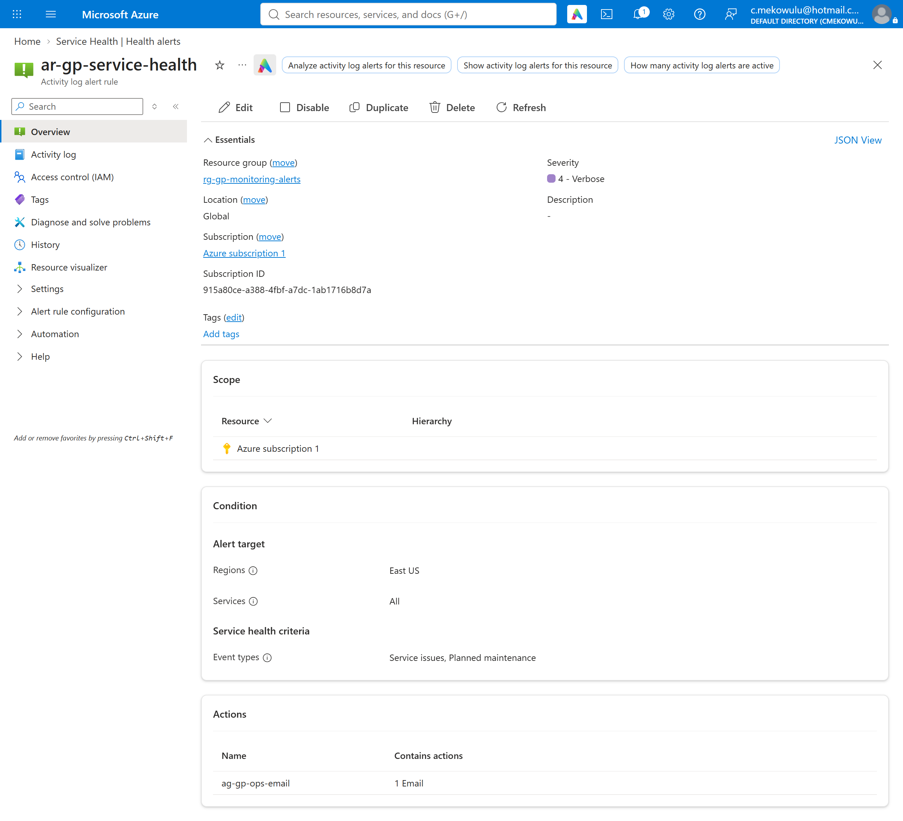
*Alert rule overview — ar-gp-service-health.*

### Exercise 3 — Create an Activity Log alert

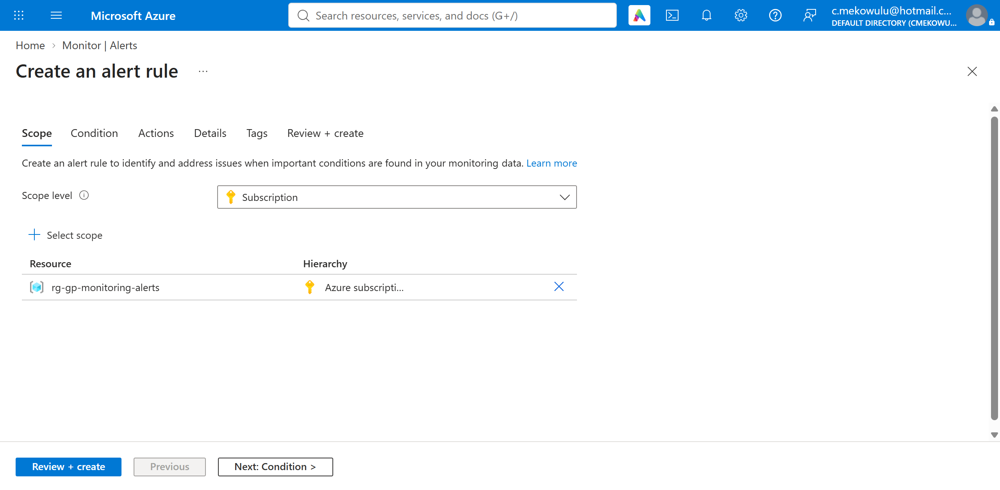
*Activity Log alert — scope tab (resource group).*

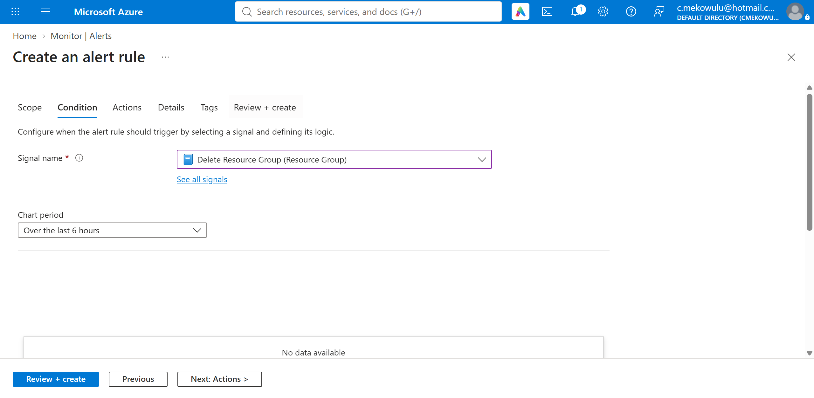
*Condition tab — Administrative category, "Delete Resource Group" operation.*

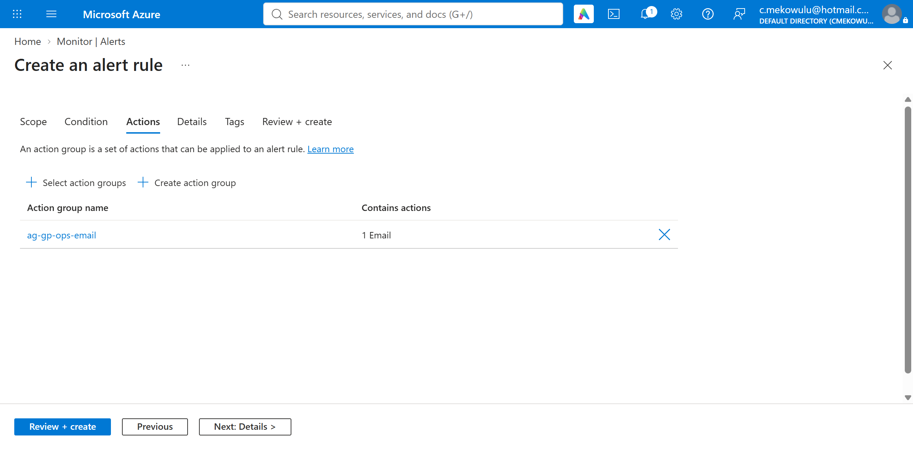
*Actions tab — ag-gp-ops-email attached.*

*Alert rules list — both rules Enabled.*

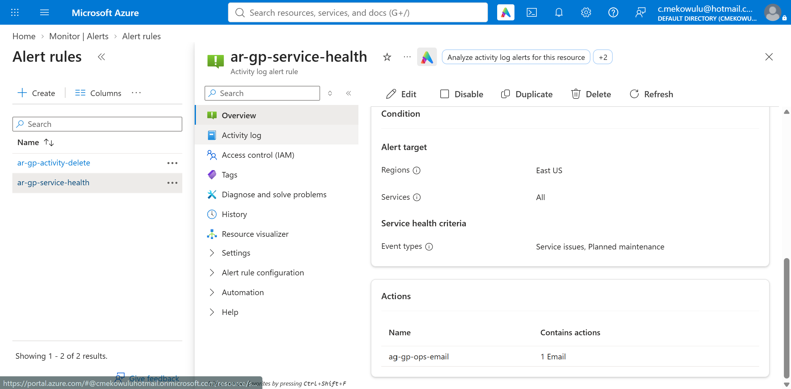
*Alert rule detail — ar-gp-service-health.*

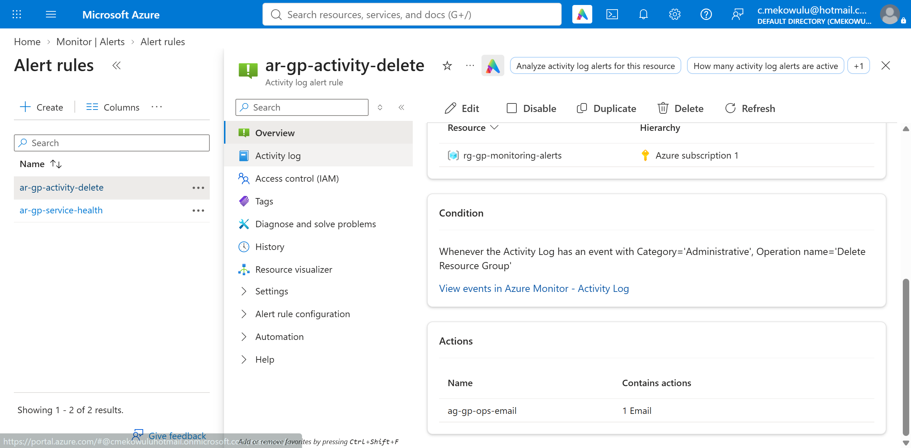
*Alert rule detail — ar-gp-activity-delete.*
