# Project 8 — Manage Azure Resources with the Azure CLI and Cloud Shell

Ran the full resource lifecycle from the command line: created, tagged, and queried resources in Azure Cloud Shell, cross-checked everything in the portal, then removed the whole group with a single command and proved it was gone.

## What was built

- Resource group **rg-gp-cli-demo** (eastus), created with the CLI
- Storage accounts **stgpclicpm10** and **stgpclicpm20**, created with the CLI (Standard_LRS)
- Tags applied from the CLI — resource group: `environment=test`, `department=it-ops`; storage accounts: `department=development` and `department=operations`
- JMESPath queries against live resources: name-and-tags table output, a filter (`[?tags.department=='development']`), and a count (`length([])` = 2)

## Key commands

```bash
# Create the resource group
az group create --name rg-gp-cli-demo --location eastus

# Create a storage account
az storage account create --name stgpclicpm10 --resource-group rg-gp-cli-demo --location eastus --sku Standard_LRS

# Apply tags
az group update --name rg-gp-cli-demo --tags environment=test department=it-ops

# Query with JMESPath — filter resources by tag
az resource list --resource-group rg-gp-cli-demo --query "[?tags.department=='development']" --output table

# Clean up — delete the group and everything in it
az group delete --name rg-gp-cli-demo --yes --no-wait
```

## How it was validated

- `az group show` reported the new group's provisioningState as **Succeeded**.
- CLI listings and the portal cross-check matched exactly — same resources, same tags.
- Cleanup was a single `az group delete --yes --no-wait`; a follow-up `az group show` returned **ResourceGroupNotFound**, confirming the group and everything in it were gone.

## What this demonstrates

- Cloud Shell as a ready-to-use, authenticated CLI environment
- Creating and inspecting resources entirely from the Azure CLI
- Tagging resources from the CLI and querying tags with JMESPath filters and functions
- CLI-to-portal verification, and single-command lifecycle cleanup

## Screenshots

### Exercise 1 — Open Cloud Shell and explore the environment

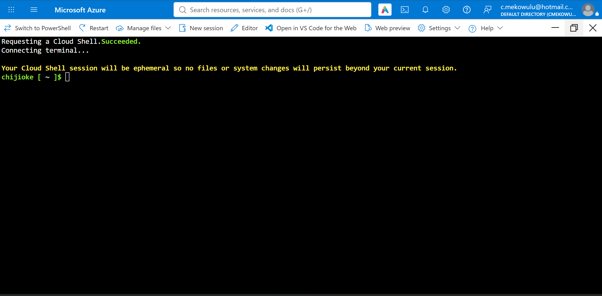
*Cloud Shell open in Bash mode.*

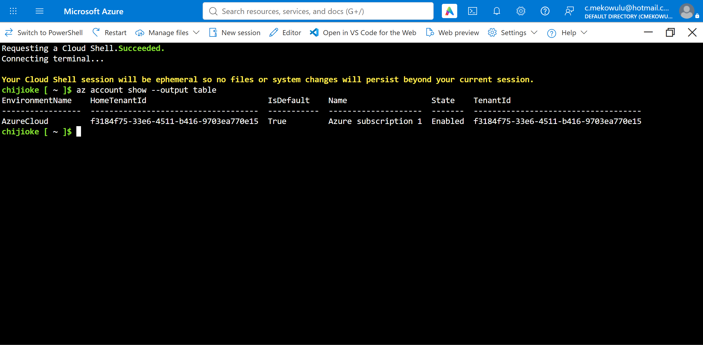
*az account show — Azure subscription 1 verified.*

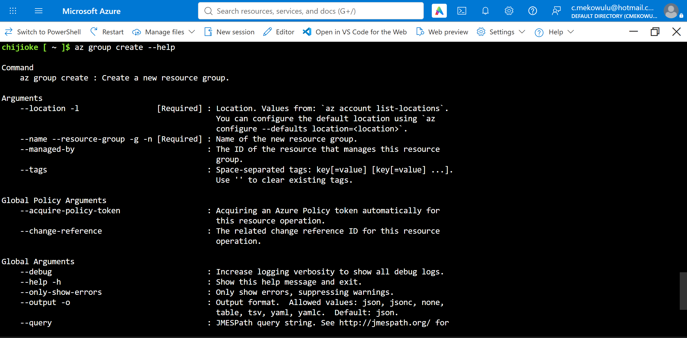
*az group create --help — the required parameters.*

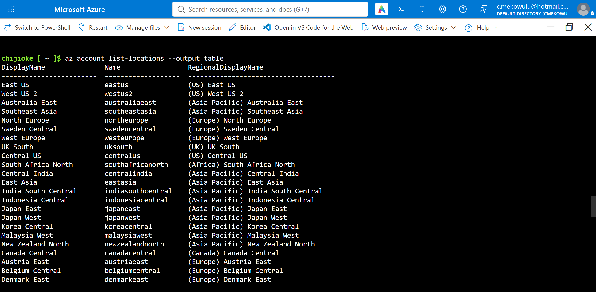
*Region list — eastus selected.*

### Exercise 2 — Create and list resources with CLI commands

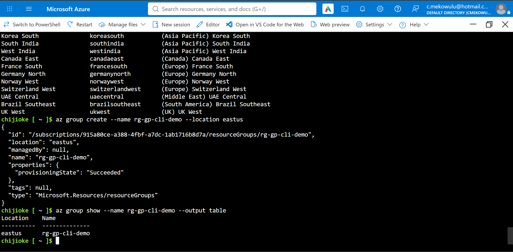
*az group create followed by az group show — rg-gp-cli-demo, provisioningState Succeeded.*

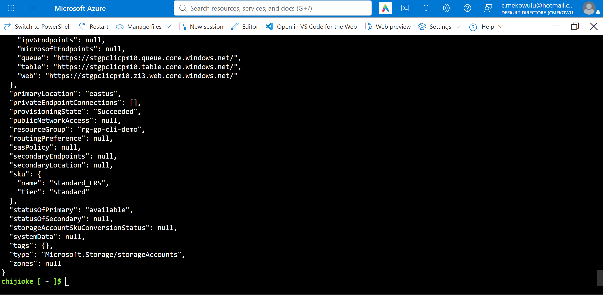
*stgpclicpm10 created.*

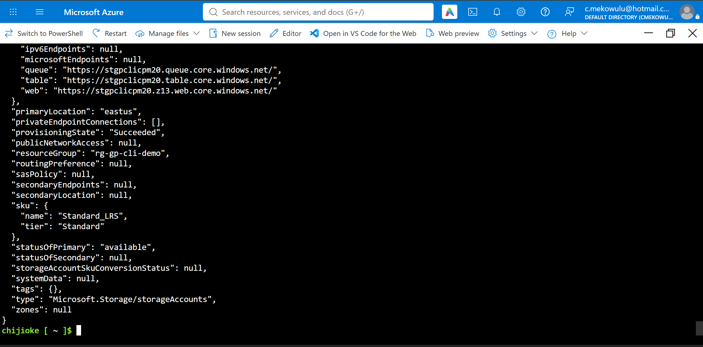
*stgpclicpm20 created.*

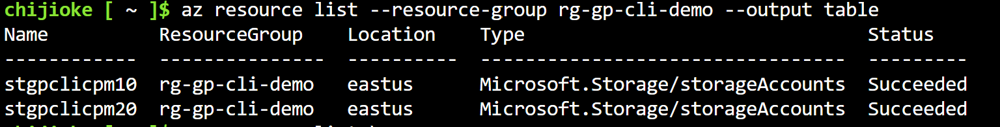
*Full resource list for the group.*

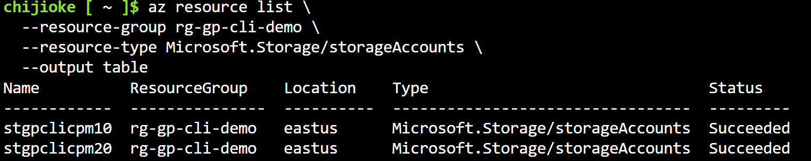
*Resource list filtered by type.*

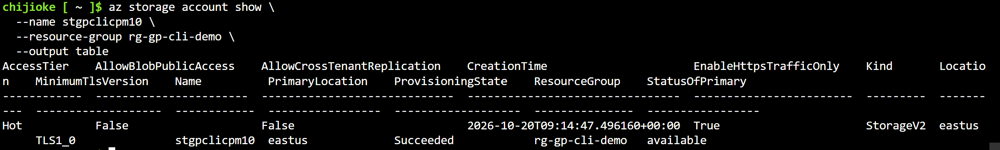
*Detailed view — az storage account show.*

### Exercise 3 — Tag, query, and clean up resources

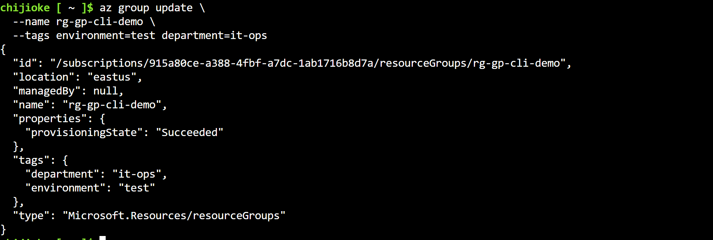
*Tags applied to the resource group from the CLI.*

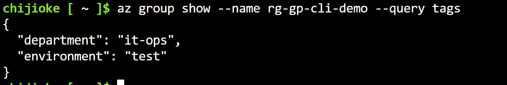
*JMESPath query returning the group's tags.*

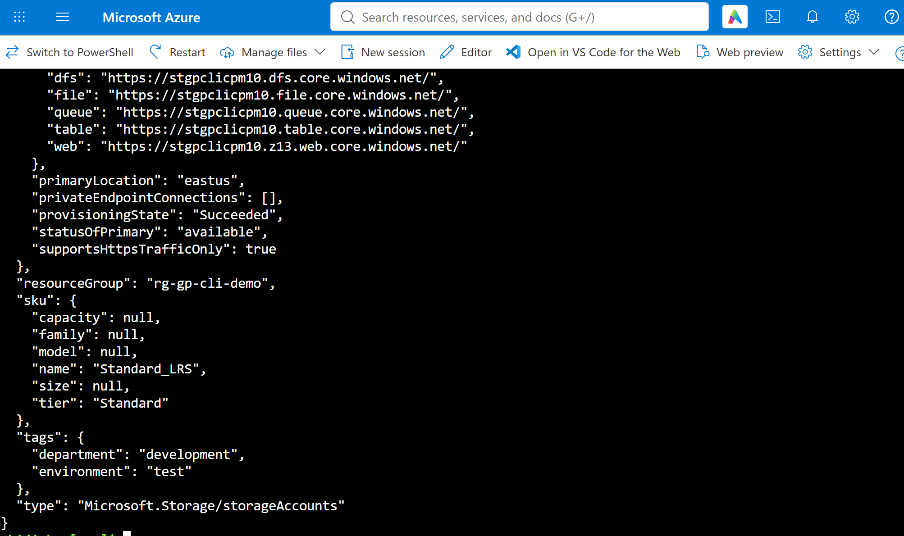
*Tag added to stgpclicpm10 — department=development.*

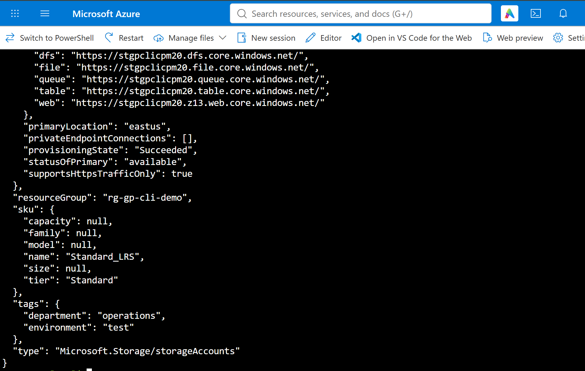
*Tag added to stgpclicpm20 — department=operations.*

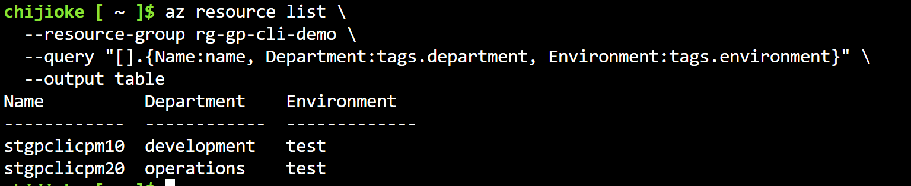
*JMESPath table output — resource names and tags.*

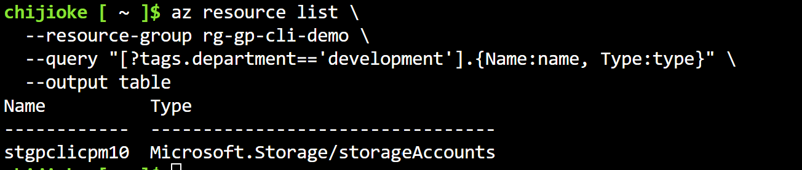
*JMESPath filter — [?tags.department=='development'].*

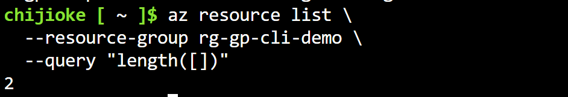
*JMESPath length() query — count of 2.*

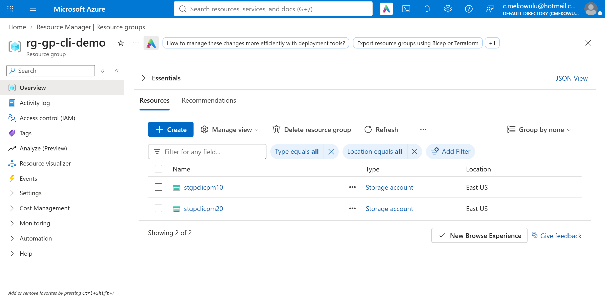
*Portal cross-check — resource group overview matches the CLI.*

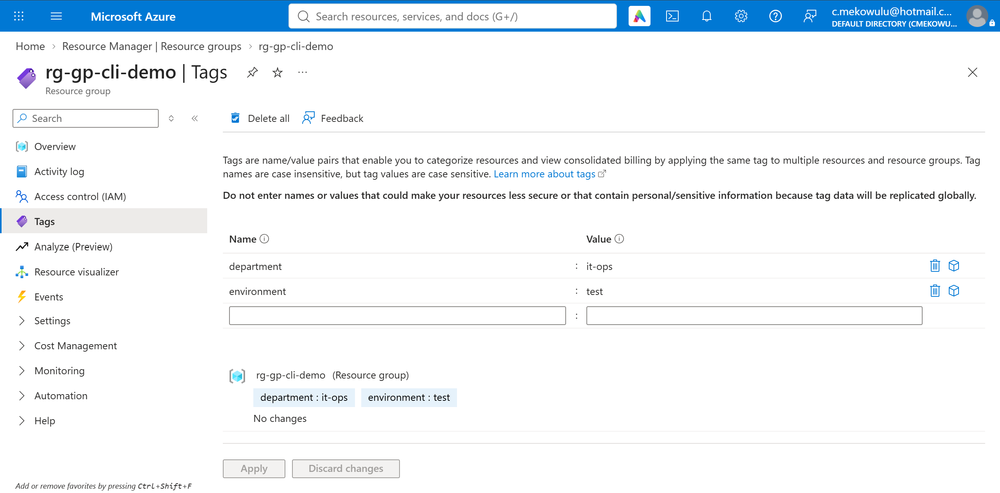
*Portal cross-check — the group's tags match.*

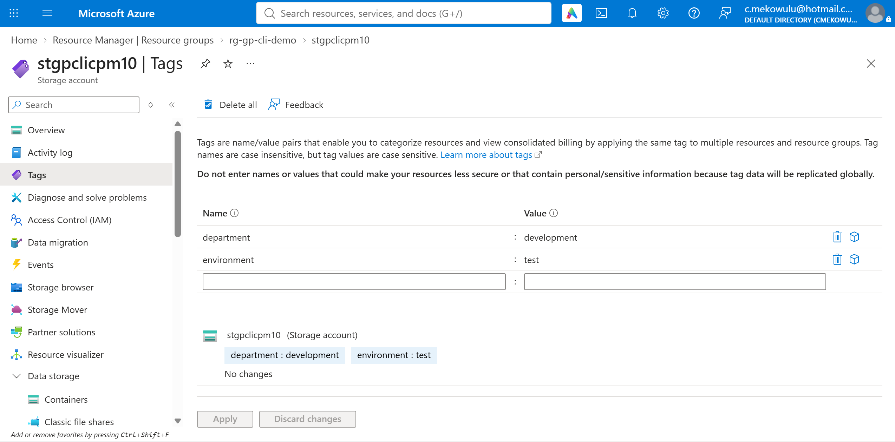
*Portal cross-check — storage account tags match.*

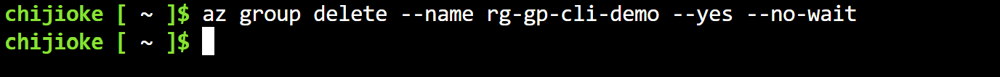
*az group delete — single-command cleanup.*

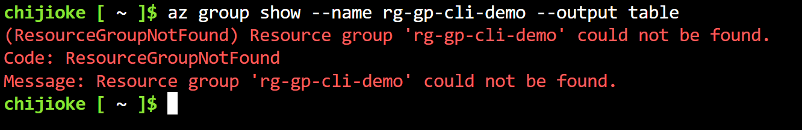
*az group show — ResourceGroupNotFound confirms the deletion.*
