# Project 9 — Deploy Azure Infrastructure with JSON ARM Templates

Wrote a JSON ARM template in Visual Studio Code and deployed it with Azure PowerShell — first blank, to prove the deployment pipeline, then extended with a storage account — and confirmed a re-deploy changes nothing.

## What was built

- Resource group **rg-armtemp-test-10** (eastus)
- ARM template **azuredeploy.json** — blank first, then extended with a StorageV2 storage account
- Storage account **starmtempcpm20** (Standard_LRS, location inherited from the resource group)
- Deployments: **blanktemplate-11-10-2026**, **addstorage-11-10-2026**, and the idempotency re-run **addstorage-11-11-2026**

## Key commands

```powershell
$templateFile="azuredeploy.json"
$today=Get-Date -Format "MM-dd-yyyy"
$deploymentName="blanktemplate-"+"$today"
New-AzResourceGroupDeployment -Name $deploymentName -TemplateFile $templateFile

# After adding the storage account resource:
$deploymentName="addstorage-"+"$today"
New-AzResourceGroupDeployment -Name $deploymentName -TemplateFile $templateFile
```

## The template (Exercise 1 version)

The file is saved here as `azuredeploy-exercise1.json`.

```json
{
  "$schema": "https://schema.management.azure.com/schemas/2019-04-01/deploymentTemplate.json#",
  "contentVersion": "1.0.0.0",
  "parameters": {},
  "functions": [],
  "variables": {},
  "resources": [
    {
      "type": "Microsoft.Storage/storageAccounts",
      "apiVersion": "2025-01-01",
      "name": "starmtempcpm20",
      "tags": {
        "displayName": "starmtempcpm20"
      },
      "location": "[resourceGroup().location]",
      "kind": "StorageV2",
      "sku": {
        "name": "Standard_LRS"
      }
    }
  ],
  "outputs": {}
}
```

## How it was validated

- The blank template deployment Succeeded in 695 ms with no resources listed — the pipeline works before anything real is deployed.
- The addstorage deployment Succeeded in 21 seconds, with the storage account listed and status OK.
- The resource group overview showed 2 Succeeded deployments; the storage account overview showed Provisioning state Succeeded, created 11/10/2026 2:23:58 PM.
- Re-running the deploy on November 11 created a new deployment record (addstorage-11-11-2026, Succeeded) but no second storage account — the date-stamped deployment name changed, the resources did not. ARM templates are idempotent at the resource level.

## What this demonstrates

- Authoring JSON ARM templates ($schema, resources, location expressions)
- Deploying with Azure PowerShell (New-AzResourceGroupDeployment)
- Incremental deployment mode and idempotent re-deploys
- Verifying deployments and provisioned resources in the portal

## Screenshots

### Exercise 1 — Create and deploy an ARM template

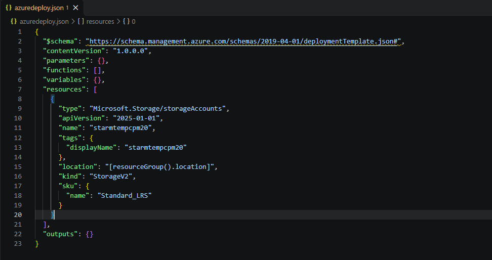
*azuredeploy.json — the storage account resource added (starmtempcpm20, StorageV2, Standard_LRS).*

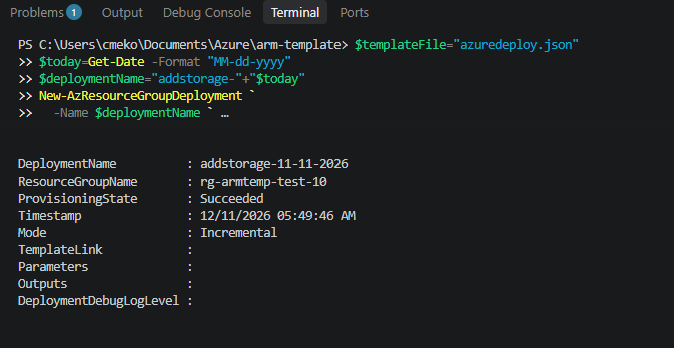
*New-AzResourceGroupDeployment — addstorage-11-11-2026, ProvisioningState Succeeded, Mode Incremental.*

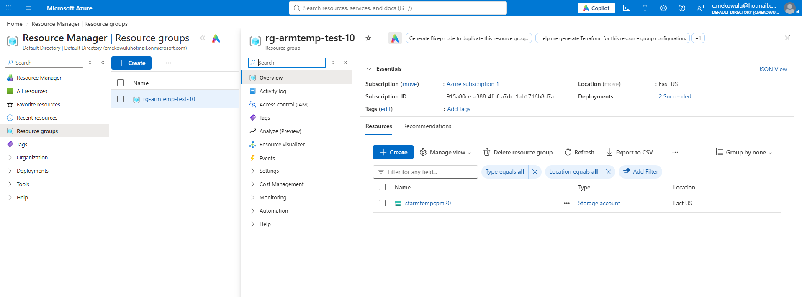
*rg-armtemp-test-10 — 2 Succeeded deployments, storage account starmtempcpm20 listed.*

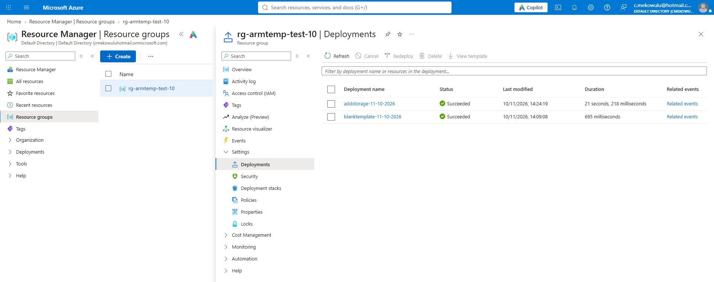
*blanktemplate-11-10-2026 and addstorage-11-10-2026, both Succeeded.*

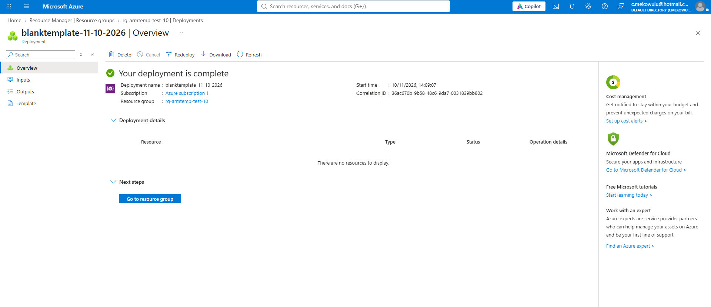
*blanktemplate-11-10-2026 — deployment complete, no resources to display.*

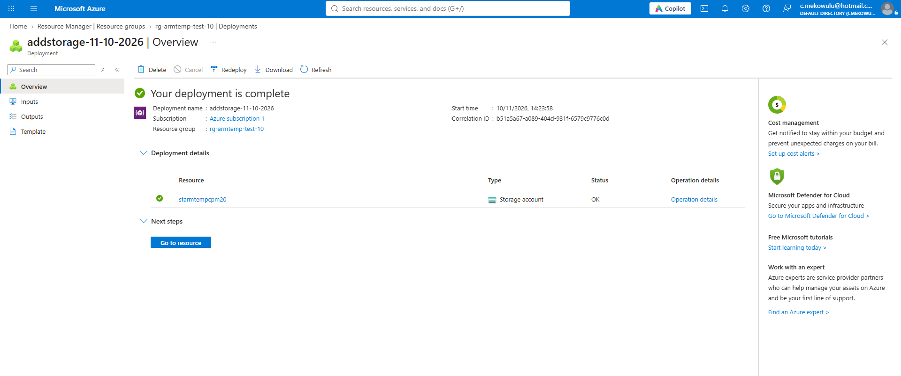
*addstorage-11-10-2026 — starmtempcpm20 listed, status OK.*

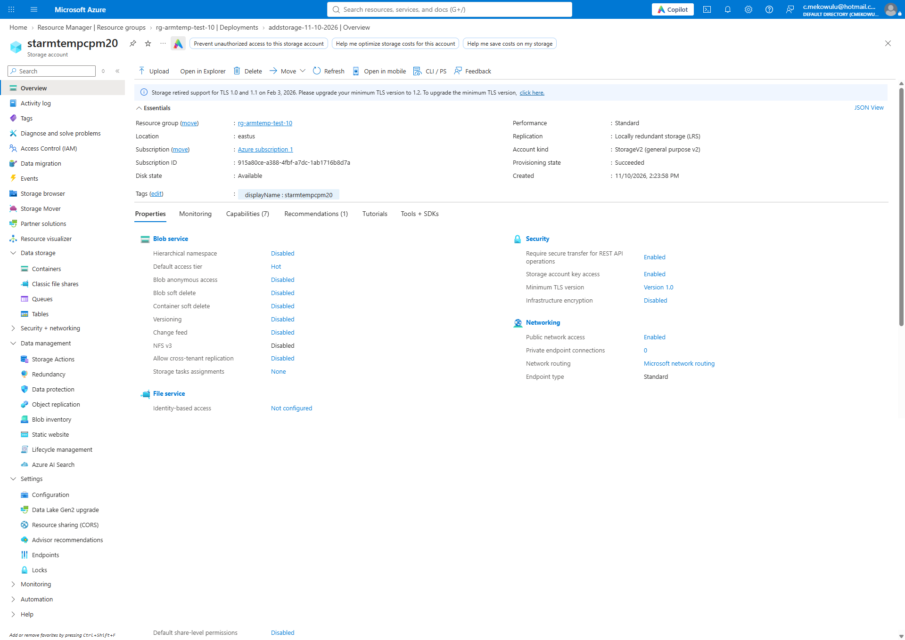
*starmtempcpm20 — East US, Standard performance, LRS, StorageV2, Provisioning state Succeeded.*

## Exercise 2 — Add parameters and outputs

Parameterized the template with `storageName` (string, 3–24 chars) and `storageSKU` (string, default `Standard_LRS`, eight allowed values), and added a `storageEndpoint` output returning the account's primary endpoints.

### What changed

- Parameters: **storageName** + **storageSKU** (allowedValues: Standard_LRS, Standard_GRS, Standard_RAGRS, Standard_ZRS, Premium_LRS, Premium_ZRS, Standard_GZRS, Standard_RAGZRS)
- Resources use `[parameters('storageName')]` for name/displayName and `[parameters('storageSKU')]` for the sku
- Outputs: **storageEndpoint** (object, `[reference(parameters('storageName')).primaryEndpoints]`)

### Deployments

- **addnameparameter-11-12-2026** — Succeeded (~2s), storageName starmtempcpm20 (reused)
- **addSkuParameter-11-12-2026** — Succeeded (~2s), storageSKU Standard_GRS (triggered the async LRS-to-GRS SKU conversion)
- **Basic attempt** — FAILED validation (InvalidTemplate, 'Basic' is not part of the allowed values), as designed — proves the allowed-values gate
- **addOutputs-11-12-2026** — first attempts failed (SkuConversionInProgress, then SkuUpdateNotAvailable); completed with a fresh account **starmtempcpm21** + Standard_LRS, Succeeded (20s), endpoints returned

### Troubleshooting

- The addSkuParameter deploy returned Succeeded in ~2s while the SKU conversion it triggered runs async in the background — that is why the later deploy hit SkuConversionInProgress. Microsoft documents geo SKU conversions as typically taking a few days, up to a few weeks, with no SLA and no way to expedite.
- The outputs step was completed against a fresh storage account (starmtempcpm21) instead of waiting out the conversion.

### The final template (Exercise 2 version)

The file is saved here as `azuredeploy-exercise2.json`.

```json
{
  "$schema": "https://schema.management.azure.com/schemas/2019-04-01/deploymentTemplate.json#",
  "contentVersion": "1.0.0.0",
  "parameters": {
    "storageName": {
      "type": "string",
      "minLength": 3,
      "maxLength": 24,
      "metadata": {
        "description": "The name of the Azure storage resource"
      }
    },
    "storageSKU": {
      "type": "string",
      "defaultValue": "Standard_LRS",
      "allowedValues": [
        "Standard_LRS",
        "Standard_GRS",
        "Standard_RAGRS",
        "Standard_ZRS",
        "Premium_LRS",
        "Premium_ZRS",
        "Standard_GZRS",
        "Standard_RAGZRS"
      ]
    }
  },
  "functions": [],
  "variables": {},
  "resources": [
    {
      "type": "Microsoft.Storage/storageAccounts",
      "apiVersion": "2025-01-01",
      "name": "[parameters('storageName')]",
      "tags": {
        "displayName": "[parameters('storageName')]"
      },
      "location": "[resourceGroup().location]",
      "kind": "StorageV2",
      "sku": {
        "name": "[parameters('storageSKU')]"
      }
    }
  ],
  "outputs": {
    "storageEndpoint": {
      "type": "object",
      "value": "[reference(parameters('storageName')).primaryEndpoints]"
    }
  }
}
```

### Screenshots — Exercise 2

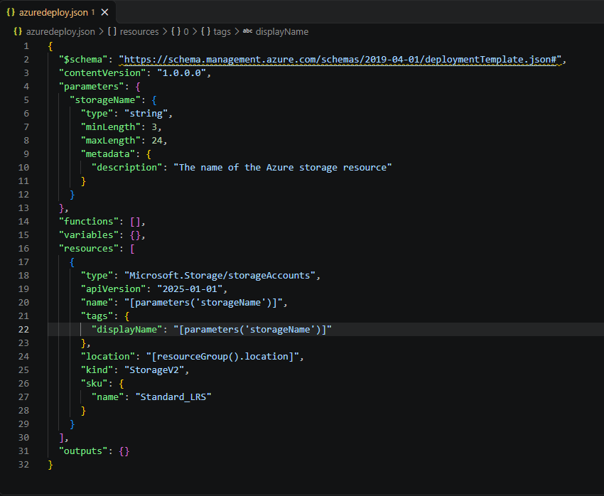
*storageName parameter, with name and displayName using `[parameters('storageName')]`.*

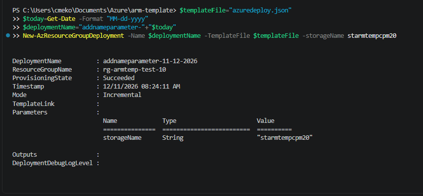
*addnameparameter-11-12-2026 — Succeeded, storageName starmtempcpm20.*

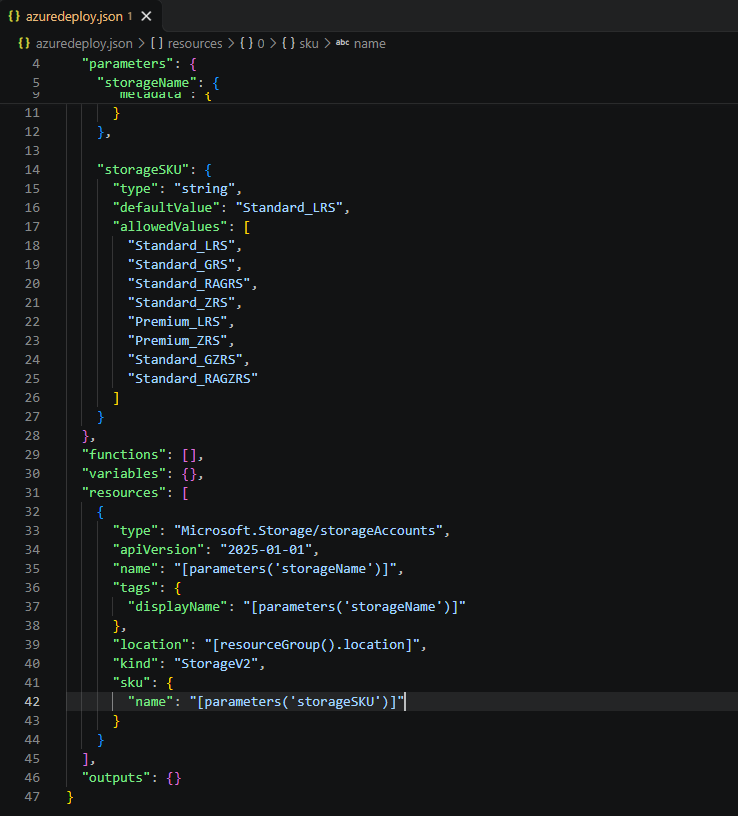
*storageName + storageSKU (eight allowed values), sku using `[parameters('storageSKU')]`.*

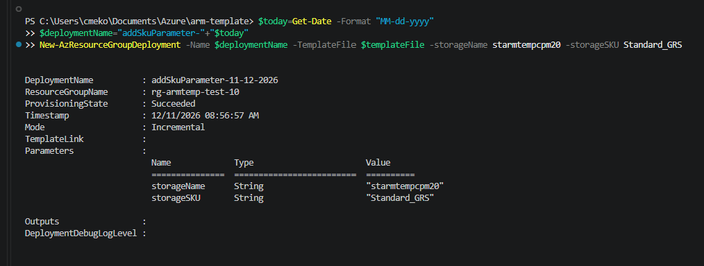
*addSkuParameter-11-12-2026 — Succeeded, storageSKU Standard_GRS.*

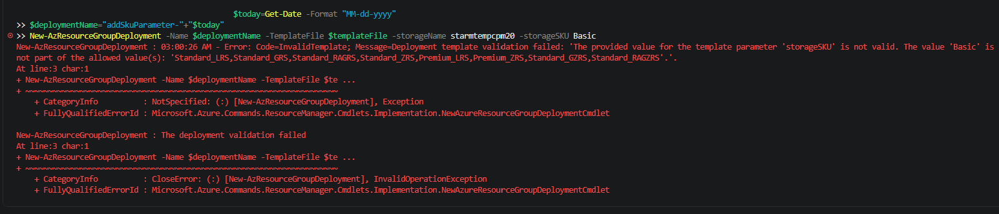
*storageSKU Basic rejected — InvalidTemplate, value not in the allowed list.*

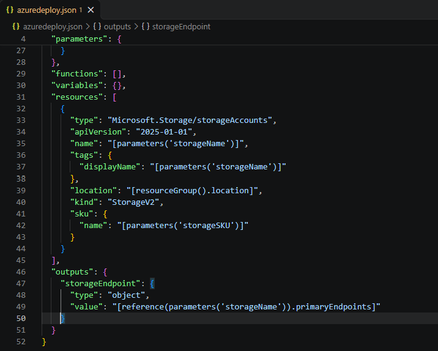
*storageEndpoint output, value `[reference(parameters('storageName')).primaryEndpoints]`.*

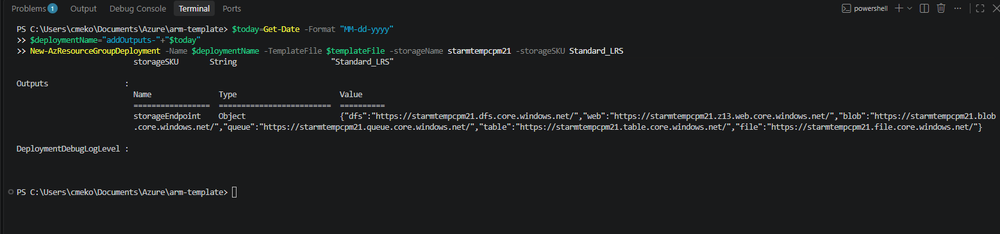
*addOutputs — endpoints returned as JSON for starmtempcpm21.*

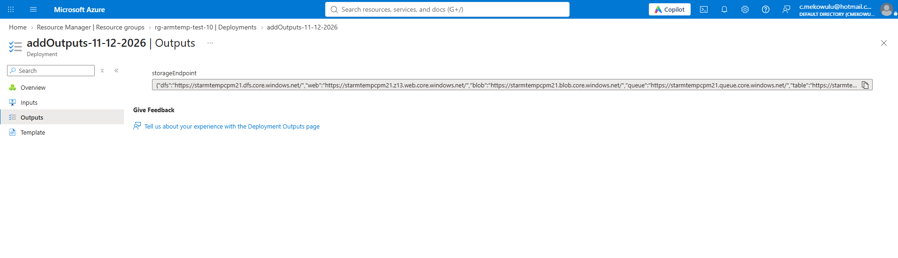
*addOutputs-11-12-2026 Outputs blade — storageEndpoint value.*

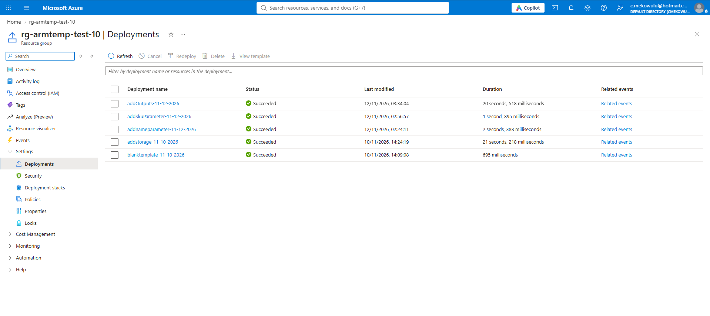
*Five deployments, all Succeeded: blanktemplate, addstorage, addnameparameter, addSkuParameter, addOutputs.*
